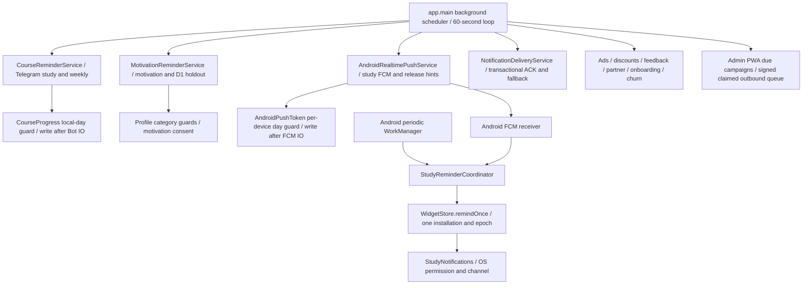

# HSK AI — Smart Reminder System
## MASTER PLAN · Техник қарорлар · Execution Tracker · Context Handoff

**Ҳолат:** IMPLEMENTATION · P1/P2 and dormant P3 boundary verified; Android passive widget adapter accepted · SMART DISPATCH OFF\
**Яратилган:** 2026-10-25\
**Репозиторий:** akbarholturaev11-lang/HSK-AI-Bot\
**Дастлабки режа тармоғи:** feat/smart-reminder-master-plan-20261025\
**Жорий source текшируви:** tested source @ c2a67072d64a38e2654f2b588169f80fe9bff706 (2026-10-29; §17.47; publication differs only by recorded evidence)\
**Масъул:** HSK AI лойиҳаси эгаси; кодни амалга оширувчи агентлар
**Қатъий чеклов:** Бу ҳужжатдаги режа ишлаб чиқилган функция, тасдиқланган бизнес қарори ёки production тест натижаси эмас.

> Бу файл Smart Reminder ишининг ягона узоқ муддатли handoff / execution журналидир. Янги чат/агент аввало шу файлни, кейин AGENTS.md, AI_RULES.md, PROJECT_MEMORY.md ва ишга тегишли РЕАЛ КОДНИ ўқийди. Файлда ёзилган эски фактлар кодга зид келса, код ва тегишли тест натижаси устун. Ҳар бир ўзгаришга далил, commit, тест ва қолган иш ёзилади. Сеанс хотирасига суянмаслик керак.

---

## 0. Ҳолат ва далил белгилаш қоидалари

- **[VERIFIED-CODE]** — кўрсатилган ref ва файлда код ўқиб тасдиқланган факт; runtime ишлаши исботланмаган.
- **[REQUIREMENT]** — лойиҳа эгасининг 2026-10-25 да билдирган мақсад/мажбурий шартлари.
- **[PROPOSAL]** — ишлаб чиқиш учун тавсия; ҳали эгаси тасдиқламаган ва код эмас.
- **[DECISION]** — эгаси аниқ қабул қилган қарор (сана ва қарор матни ёзилади).
- **[OPEN]** — қўшимча код аудити, маҳсулот қарори ёки ташқи техник текширув керак.
- **[DONE]** — тегишли commit ва тест далили билан бажарилган.
- **[BLOCKED]** — сабаби ва ҳал қилиш шарти ёзилган.
- **[NOT STARTED]** — иш бошланмаган. Чекбоксни тестсиз ёпма.
- Огоҳлантириш: GitHub’да commit борлиги production deploy, ҳақиқий пуш етказилгани ёки end-to-end QA ўтганини БИЛДИРМАЙДИ.
- Бу ҳужжатга токен, real device token, email, Telegram ID, FCM credentials, user-specific behavioral history ёзилмайди.

## 1. Мақсад ва маҳсулот чегараси

### 1.1 [REQUIREMENT] Асосий натижа
Фойдаланувчининг ўқиш одатлари, фаоллиги, тугалланмаган дарслари, кунлик мақсади ва streak’ини баҳолаб, ўқишга қайтиш эҳтимоли юқорироқ вақтда, тегишли мазмунда, фойдаланувчи рухсат берган каналда фойдали эслатма юбориш. Telegram, Android, келажакдаги iPhone PWA ва Desktop ягона аккаунт сиёсатида ишлайди. Бир ўқув мақсади учун бир неча платформадан такрорий хабар келмаслиги керак.

### 1.2 [REQUIREMENT] Муваффақият
1. Retention: фойдаланувчи реал ўқув фаолиятига қайтиши.
2. Engagement: дарсни давом эттириши/тугаллаши, ўқув сессиялари.
3. Learning consistency: ҳафта давомида фаол ўқиш кунлари.
4. Guardrail: opt-out, блоклаш, шикоят, ортиқча хабар, беўрин вақт, дубликат.

### 1.3 [REQUIREMENT] Ман этилади
- Барчага бир хил вақтда ва бир хил матнда хабар юборишни ягона стратегия деб қабул қилиш.
- Кунлик мақсад бажарилганидан кейин “бажаринг” деган эслатма юбориш.
- Ҳар бир платформа мустақил қарор қабул қилиб такрорлашини қолдириш.
- Усерни безовта қиладиган мажбурий push, рухсатсиз янги канал, ўчирилган хабарларни қайта ёқиш.
- Нотўғри/мавжуд бўлмаган дарсга deep-link ёки блокланган Pro контентга сохта ваъда.
- Ҳар хабар учун қиммат LLM генерациясини базавий dependency қилиш.
- Subscription/payment, direct APK vs Play, entitlement, scoring, HSK контент мантиғини ўзгартириш.

### 1.4 Scope / out-of-scope
**V1 scope [D10 APPROVED 2026-10-25]:** ўқиш эслатмаси, incomplete lesson, daily goal, streak, inactive learner recovery, account-level policy, **Telegram бот/Mini App ва Android transport'ларига биринчи ишловчи релиз**, аналитика асоси. Серверда **бошидан users.id бўйича универсал multi-platform architecture**: provider adapter contracts, per-channel consent/capabilities, device eligibility, single-job account dedupe, notification policy ва deep-link routing platform-neutral; iPhone learner PWA/Desktop'ни кейин қўшиш учун core decision engine'ни қайта ёзиш талаб қилинмасин. Mini App Telegram bot channel орқали қабул қилади, browser native push'ини биринчи релизда бор деб ҳисоблама.
**V2 scope [D10 APPROVED]:** learner iPhone PWA Web Push ва macOS/Windows Desktop notification transport'лари V1'нинг блокери ЭМАС. Кейин шу умумий сервер policy/API'сига реал capability/OS permission билан боғланади. Ундан ташқари ML-based notification optimization (D09 gate), multi-armed bandit, smart review/word-mastery recommendation, admin analytics UI staged features. **[D09]:** V1 launch policy is already adaptive rule-based and must collect training-quality data; future ML infrastructure is staged/validated globally but automatically becomes active for an eligible user once sufficient high-quality personal signals and model-performance guardrails are met. No separate per-user ML training is required by product decision.
**Out of scope:** Admin PWA’нинг ўз administrator push’ини learner’га айлантириш; тўлов/чеки каби транзакцион хабарларни маркетинг лимитига қўшиш; барча кампаниаларни автомат равишда бу engine’га кўчириш.

## 2. [VERIFIED-CODE] Бошланғич код аудити: 2026-10-25, main

| Контракт | Код манбаи | Кўрилган факт / интеграция хавфи |
|---|---|---|
| Cron/scheduler | app/main.py, _background_scheduler, ~596–652 | Цикл тахминан 60 сонияда; Trial, Daily Reset, Expiry, Motivation, Android study, account notice fallback, CourseReminder, weekly ва бошқалар кетма-кет чақирилади. Битта умумий try/except: битта хато циклда кейинги ишларни қолдириши мумкин. |
| Telegram lesson time | app/services/course_reminder_service.py | CourseProgress.reminder_enabled ва reminder_time билан ±2 дақиқалик ойна; time zone асосан integer offset; local-day sent guard. Telegram delivery ва inbox record алоҳида. |
| Motivation | app/services/motivation_reminder_service.py | incomplete, streak, daily goal, рейтинг, D1 recovery; 20:00–21:30 local goal window; Mini App profile’да notifications_enabled; фойдаланувчи Telegram’га уланган бўлиши керак. |
| D1 эксперимент | app/services/motivation_reminder_service.py + tests/test_motivation_reminder_service.py | D1 биринчи дарс recovery учун Telegram ID асосида 50/50 treatment/control hashing ва 48 соат holdout; мавжуд экспериментни янги rollout бузмасин. |
| Mini App notification toggle | app/main.py, /api/v3/notify; app/db/models/course_miniapp_profile.py | Telegram init-data билан тасдиқланган toggle; profile.notifications_enabled default=True; бу toggle асосан MotivationReminderService’га тегишли. Native-only account учун бу API автоматик ечим эмас. |
| Course reminder preference | app/db/models/course_progress.py | reminder_enabled default=False, reminder_time, reminder_tz_offset, last_reminder_sent_at. Бир нечта алоҳида consent/тартиб мавжуд. |
| Course inbox | app/services/course_notification_service.py; app/db/models/course_user_notification.py | CourseUserNotification user_id + legacy telegram_id, dedupe unique constraint; inbox record **транспортни** глобал dedupe қилмайди. |
| Admin motivation templates | app/services/notification_template_service.py; app/db/models/notification_template.py | UZ/RU/TJ templates, media ва enabled flag бор. Янги engine буларни бекор қилмаслиги шарт. |
| Android transport | app/services/android_push_service.py; app/db/models/android_push.py | FCM token device билан боғланган; Android study_reminders_enabled ва timezone_name мавжуд; device.last_study_push_day. |
| Android study trigger | app/services/android_realtime_push_service.py | Server Android push 20:00 локал соатда 0–29 дақиқалик device bucket билан data-only study_reminder hint жўнатади. Унинг ўзи displayed тасдиғи эмас. |
| Android decision | android/app/src/main/java/com/pomp/hskai/core/notify/StudyReminderCoordinator.kt + ReminderDecision.kt | Android курc map’дан daily goal ва streak текширади; WidgetStore local per-day dedupe; FCM ва WorkManager шу координаторни ишлатади. Бошқа қурилма ва Telegram билан глобал dedupe йўқ. |
| Android realtime receiver | android/app/src/main/java/com/pomp/hskai/core/notify/HskAiMessagingService.kt | study_reminder сервер hint’ини Android StudyReminderCoordinator’га узатади. |
| Account notice delivery | app/services/notification_delivery_service.py; app/db/models/account_notice_delivery.py | Subscription/limit notice учун Android ack + Telegram fallback (10 минут) бор. Бу learner study reminder’нинг ягона delivery механизми ЭМАС; кўчиришдан олдин scope ва duplicate semantics’ни текшир. |
| User identity | PROJECT_MEMORY.md; app/services/account_identity.py; app/db/models/desktop.py | users.id — canonical account. Telegram ID реал мусбат бўлса transport; native-only аккаунт ҳам бор. DesktopDevice.user_id билан қурилмага боғланади. |
| Learning events | app/db/models/course_miniapp_event.py; app/db/models/course_xp_event.py; app/services/daily_plan_service.py | lesson_started/completed, android_lesson_started/completed, XP ва daily plan сигналлари мавжуд. Event семантикаси ва coverage’ини audit қилиш керак. |
| Localization | localization/README.md; localization/ui/{uz,ru,tj}/notifications.json | Янги user-facing текст canonical UZ/RU/TJ source’дан генерация қилиниши шарт; generated файлга қўлда ёзма. |
| QA base | tests/test_motivation_reminder_service.py; tests/test_native_scheduler_transport.py; android/app/src/test/java/com/pomp/hskai/core/notify/* | Мавжуд тестлар бор; ушбу режалаштириш сессиясида тест ишга туширилмаган. |

### 2.1 [OPEN] Махсус текшириш керак бўлган код нуқталар
- [ ] CourseNotificationService.record() фақат params.get("template") бўлса params сақлаётгани, MotivationReminderService эса params["template_service"] юбораётгани текширилди: бу re-localization/inbox параметрларини тушириб қолдириши мумкин. Реал тест билан исботлаб, алоҳида минимал fix қилиш.
- [ ] Main scheduler task’лари error isolation, overlap, multi-worker/replica concurrency, late ticks, DB transaction чегараси: production deploy’га қараб текшириш.
- [ ] Бир user’га рейтинг, daily goal, scheduled course reminder, onboarding, churn, sales/ad campaign параллел келиши мумкинми? Total frequency аудит.
- [ ] Native-only account’да onboarding push розилиги, profile toggle ва Android notification option ўртасидаги семантика.
- [ ] Android FCM accepted vs posted ack, WorkManager stale snapshot, device timezone ва account switching.
- [ ] Бутун app’да deep-link access/entitlement guard ва exact lesson target сақланиши.
- [ ] User-data purge, consent changes, token revoke/logout, Redis/queue infra ва versioned migration conventions. **D13:** data inventory: raw learning/reminder events, aggregated features, model inputs, attempts/ACK, analytics, backups/caches, account deletion and legal/business retention exceptions; define justified per-class TTL after audit.
- [ ] Daily plan/date/XP semantics ва HSK 2.0/3.0 track-specific progress.
- [ ] Ҳозирги main билан фаол integration branch’лар ўртасидаги фарқ; код ишидан олдин target branch қайта белгилансин.
- [ ] iPhone learner PWA ва Desktop learner push қўллаб-қувватлашининг реал коди; Admin PWA push ни learner push деб ҳисоблама.

## 3. Инвариантлар (бузилмаслиги шарт)

**I01 Identity:** барча study delivery policy ва frequency user_id=users.id бўйича. Telegram ID фақат reachability; email тенглиги аккаунт бирлаштирмайди.

**I02 Consent [D01/D14 OWNER APPROVED 2026-10-25]:** Smart Reminder фойдаланувчининг АВВАЛДАН ЁҚИЛГАН ўқиш эслатмалари ўрнига автоматик ишга тушади, янги функция номи билан қайта-қайта алоҳида розилик сўралмайди. **D14:** Telegram/Mini App/CourseProgress ва Android эски назоратлари ўрнига битта **account-level Smart Reminder settings UX** бўлади, лекин *per-channel explicit OFF/opt-out ва OS/platform denied* ёнма-ён сақланади: бир канал ON бўлса бошқа OFF канални очиб юбормаслик, ҳаммаси OFF бўлса глобал enabled'ни ёқмаслик, no cross-channel consent inference. Explicit global OFF future pending study jobs'ни барча каналларда тўхтатади. Legacy time cold-start'да сақланади (D02); migration'нинг ўзи explicit manual lock эмас. Кодда ҳар toggle'нинг аниқ scope/precedence'ини P0 source audit билан исботлаш ва unknown/contradiction'да fail closed қилиш талаб қилинади. Янгидан илк OS permission талабини четлаб ўтмаслик; old/new parallel delivery бўлмасин.

**I03 Account-level cadence [D03/D06 APPROVED 2026-10-25]:** Бир аккаунт учун каналлараро ягона study frequency policy: реакция ва фойдали ўқиш натижасига қараб индивидуал хабар тезлиги ўзгаради (ignored / no study → пасайсин; фойдали реакция → хавфсиз бюджетда кўпайиши мумкин). **Қатъий юқори чегара: календар маҳаллий кунида 1 тадан ортиқ study reminder йўқ**, ҳатто бир нечта қурилма бўлса ҳам. **D06:** сервер фойдаланувчи ҳақиқатан қайси платформада кўпроқ ўқиётганини, delivery reachability/permission ва ишончлиликни ҳисобга олиб *битта канал ва битта мақсадли қурилмани* танлайди; фойдаланувчи хоҳласа ўз каналини қўлда қотиради (auto selection override). Ҳафталик абсолют max ва adaptive thresholds ҳали owner томонидан тасдиқланмаган. Транзакцион хабарлар алоҳида категория.

**I04 Completed goal:** dispatch олдидан canonical daily progress'ни янгидан текшир; мақсад бажарилса бекор қил. Current lesson ва selected HSK track ҳам қайта текширилсин.

**I05 Adaptive time [D04 APPROVED 2026-10-25]:** Барча фойдаланувчилар учун умумий тақиқланган соатлар ёки 22:00–08:00 каби қотирилган вақт чегараси **йўқ**. Engine ишончли шахсий ўқиш одатига қараб куннинг исталган вақтида, шу жумладан кечаси ҳам, эслатма вақтини белгилаши мумкин. Фойдаланувчи аниқ вақтни қўлда белгиласа (D02) ёки махсус тинч вақт/пауза/ўчириш созламасини танласа, бу ихтиёрий чеклов устувор. OS Do Not Disturb/Focus ва notification permission'ларни четлаб ўтмаслик шарт. IANA timezone, DST, travel, day transition, late delivery ва duplicate guard сақлансин. D03 кунлик max 1 хабар ўзгармайди.

**I06 Access:** CTA реал ишлайди, URL signed/allowlisted/validated, paid content bypass қилинмайди; unlock, 7-day trials ва Play/direct split ўзгармайди.

**I07 Security:** push payload'да token/AI contents/sensitive account data бўлмасин; device ownership ҳар token read/ack'dа текширилади.

**I08 Localizations:** барча visible template, settings, CTA — UZ, RU, TJ; кейин тил ўзгарса inbox'да қайта кўрсатиш имкони.

**I09 Experiments:** control group хабар олмайди; эксперимент assignment stable, migration oldinги D1 holdout'ни бузмайди.

**I10 Observability:** ҳар қарор учун reason code (send/suppress); ҳақиқий sent, accepted, shown, opened ва completed бир-бирига тенг эмас.

**I11 Safe rollout:** flags, dry-run, kill switch, rollback, old sender migration. Parallel old+new study scheduler ишлаб турмасин.

**I12 No unearned guarantees [D07 APPROVED 2026-10-25]:** эслатма 100% ўз вақтида етказилади ёки exactly-once деб ваъда берилмайди (FCM/OS, retry, network); backend ledger + device ack билан натижа имкон қадар яқинлаштирилади. **D07: фақат биринчи канал/қурилмада хабар кўрсатилмагани ишончли исботланса**, consent/expiry/progress/cap текширувидан кейин шу logical job учун бошқа рухсатли каналга қайта юбориш мумкин. Биринчи натижа **номаълум** бўлса, таймаутнинг ўзи исбот эмас — бошқа каналга қайта юборилмайди. Account/payment transactional notices учун олдинги махсус fallback қоидаси ўзгармайди.

## 4. [PROPOSAL] Архитектура: сервер ягона decision owner

1. **LearningSignalCollector** — canonical progress, Xp, events, daily plan, active learning days, incomplete parts, timezone, consent, reachability.
2. **UserHabitEstimator** — одатий вақт слоти; ишонч даражаси (cold/warm/confident), weekday/weekend variation, travel changes.
3. **ReminderPolicyEngine (pure deterministic)** — send/suppress, priority, D03 frequency cap, D04 no global time blackout (only explicit user restrictions/OS permission), streak, daily goal, target access; explainable reason codes.
4. **ReminderScheduler/Planner** — account local-date + fire_time_utc + expiration; future jobs reschedule/cancel.
5. **DeliveryOrchestrator [D06/D07/D10]** — account-level claim/lock/idempotency, auto-select a single reachable permitted channel and a single eligible device using real per-platform study activity + delivery reliability; user-pinned channel wins if currently permitted and reachable. No parallel Telegram+Android+PWA+Desktop fanout. **D07:** alternate permitted channel only after verifiable first-channel non-display/failure and fresh eligibility check; ambiguous/missing acknowledgement means no cross-channel resend. **D10:** universal channel-neutral core and provider adapters from start; ship Telegram bot/Mini App + Android first, defer iPhone learner PWA and Desktop transports to V2 without rewriting core. Never select not-yet-supported adapters as deliverable endpoints.
6. **NotificationRenderer** — versioned notification template, canonical i18n, safe parameters, CTA target; no live LLM requirement.
7. **OutcomeAttribution** — planned/attempted/accepted/displayed/opened/resumed/completed/optout counters.
8. **Hybrid Optimizer [D09 OWNER APPROVED 2026-10-25]** — newly registered/low-data user: real functioning personalized rule-based policy, not a nonfunctional waiting period. Gather reliable learning/outcome signals. When a globally validated ML model exists and this user's evidence crosses a **quality/confidence eligibility threshold**, **automatically** switch this user to ML-guided time/content/channel/cadence optimization, with no feature-prompt or extra user consent beyond existing valid notification permissions (D01). Transition is gradual and versioned; insufficient/conflicting/stale data, degradation, unsupported platform, model failure or guardrail breach immediately uses safe rules again. Account/user override and D01–D08 constraints always override ML. Exact eligibility threshold/ML design/experiment gates are technical [OPEN] until audit/test, not invented as a fixed count.
9. **Admin Control & Analytics [D11 OWNER APPROVED 2026-10-25]** — existing Admin PWA'да жуда содда ягона Smart Reminder бошқарув/статистика юзаси: global kill switch (ва permissioned pause), current UZ/RU/TJ notification templates/edit/preview, ҳамда **фақат реал ҳисобланган** sent, suppressed, delivery status, opt-out, actual learning reactivation / completed study outcomes ва эксперимент натижаларининг қисқа кўриниши. Real attribution маъноси аниқ кўрсатилсин; 'sent'ни 'shown' ёки 'opened' деб аталмасин. Кераксиз filter/options ва фейк demo рақамлар йўқ. Admin PWA’нинг ўз администратор push'и learner notification орқали юборилмасин; auth/roles, audit trail, current template infrastructure ҳурмат қилинсин. Бу feature **тасдиқланган scope**, V1/V2 admin UI релиз санаси алоҳида техник режада аниқланади.

**Қарор чиқариш кетма-кетлиги:**
- Auth/canonical account → study consent → active/blocked/allowed channel → current progress → goal already done? → D03 cooldown/cap and **user-selected** quiet/pause settings only (D04: no global night cutoff) → priority selection → target exists & accessible? → channel capability → reserve unique job → dispatch recheck → platform display confirmation → outcome tracking.
- Ҳеч бири ишончли бўлмаса **no push** — “кўпроқ юборайлик” fallback эмас.
- Upcoming content recommendation (spaced repetition/weak skill) фақат ҳақиқатан мавжуд клиент экран ва access guard билан берилади.
- Кузатилган “одат”ни бир мартаги 20:00 киришдан хулоса қилма.

### 4.1 Reminder intents ва proposed priority
Priority only among eligible intents, all study intents share frequency budget:
1. **resume_unfinished:** дарс бошланган, тугалланмаган, target accessible, session stale эмас.
2. **streak_risk:** ҳақиқий узилиш хавфи, бугун ўқиш қилинмаган, consent, D03 cadence ва фақат user explicitly selected restrictions (D04: no system-wide quiet hours).
3. **daily_goal:** кунлик мақсад реал қолган, attainable task.
4. **reactivation [D08 APPROVED]:** шахсий ўқиш одатига нисбатан ғайриоддий узилиш; барчага бир хил 3/7/14 кун trigger эмас. Қайтиш учун ҳақиқатан мавжуд енгил вазифани таклиф қил; самара бермаса хабар оралиқлари узаяди, охирида reactivation серияси тўхтайди.
5. **due_review:** ишончли mastery/spaced repetition сигнали, реал ишлайдиган route.
6. **generic_habit:** фақат бошқа муҳим, ҳақиқий фойдали intent йўқ бўлса.

**[DECISION D05, 2026-10-25]:** рейтингда орқага тушиш ва ҳафталик натижа каби хабарлар study reminder'нинг D03 **1/day** лимитига автоматик киритилмайди — алоҳида мақсадда сақланади. Лекин **барча шу турдаги ўқиш/мотивация хабарлари users.id бўйича ягона cross-channel coordination/anti-spam policy'дан ўтади**: устма-уст вақтда юбориш, такрорланиш ва фойдасиз ranking хабарлари камайтирилади; фойдали weekly summary эса ўринсиз ташлаб юборилмайди, зарур бўлса кейинги маъқул вақтга сурилади. Бу бир кунда study + рейтинг + ҳисобот учун чекланмаган хабар юбориш дегани эмас. Аниқ cross-category cooldown ва priority чегаралари [OPEN], реал audit/owner қарордан кейин. Payment/receipt/account-decision transactional notices ҳозирги ўз жойида ва study cap'га аралашмайди. Onboarding, trial/churn ва marketing campaign budget қоидаларини кейин алоҳида audit/қарор билан белгилаш.

### 4.2 Habit/time estimator [D02 APPROVED: smart by default; technical details PROPOSAL]
- Event: real lesson/practice session start; app_open’нинг ўзи “ўқиди” эмас.
- Recent 14–28 days, уникал active study days, foreground/login ва offline duplicate'ларни тозалаш.
- “Confident” учун дастлаб тахминан 5+ мустақил active study day [НЕРАСМИЙ threshold].
- Бир-бирига яқин ўқиш вақтларини slot'ларга бирлаштириш (масалан, 30 минут интервал), айлана вақт чегараси (23:50/00:10)ни тўғри ҳисоблаш.
- **[DECISION D02, 2026-10-25]** Smart Reminder эслатма вақтини фойдаланувчининг амалдаги ўқиш одатлари асосида автоматик мослаштиради; аввалги белгиланган вақтни ўзгармас қоида деб ҳисоблама. Фойдаланувчи аниқ вақтни ўзи белгилаб **қотирса**, автоматик ўзгариш тўхтайди. Тизим етарли ишончли ўқиш маълумотини йиғмагунча аввалги ёқилган эслатманинг танланган вақтини сақлайди; аввалги вақт йўқ бўлса хавфсиз fallback аниқланади. Бунинг учун фойдаланувчига янги функцияни ёқиш ойнаси кўрсатилмайди (D01).
- [PROPOSAL] Auto/manual status аниқ сақланади; manual lock фақат фойдаланувчининг онгли ҳаракатидан келиб чиқсин. Legacy saved reminder time'ни automatic манба билан адаштирма; migration'да D14 билан мослаштир.
- Вақт ойнаси: фойдаланувчининг ўзи 20:00 да дарс бошласа 19:45–20:00 оралиғи [PROPOSAL]; аниқ вақт A/B далилсиз “optimal” эмас.
- Timezone: IANA ZoneInfo (Asia/Shanghai) canonical; эски offset'ни миграция даврида ўқиш, DST ва travel учун сақланган zone name'ни қайта аниқлаш.
- User маҳаллий куни турли OS/device'ларда бир хил ҳисоблансин; сервер authoritative clock.

### 4.3 Example decision contracts [PROPOSAL]
- lesson_completion today after schedule → cancel.
- lesson unfinished yesterday but course switched → revalidate → cancel or correct target; old lesson deep-link'ни чиқарма.
- opened app but not studied → daily goal completed деган хулоса эмас.
- **[DECISION D08, 2026-10-25]:** 3/7/14 кун бўйича барчага бир хил мажбурий reactivation режа йўқ. Фойдаланувчининг ҳақиқий ўқиш ритми, одатий танаффус давомийлиги ва охирги lesson/practice activity асосида ноодатий узилишни баҳола. Реал очиладиган қисқа ва енгил дарсни таклиф қил; бўлмаган 3–5 дақиқалик дарсга ваъда берма. Қайтиш бўлмаса хабарлар ораси узаяди ва охирида reactivation тўхтайди. Аниқ босқичлар, кун/сон thresholds ва қайта фаоллашув trigger'и [OPEN], ҳали owner қарори эмас.
- **[DECISION D03]** repeated ignore ёки хабардан кейин реал ўқиш бўлмаса кейинги reminder интервали автоматик узайсин. Реал ўқиш қайтиши кўп бўлса хавфсиз чегарада frequency ошиши мумкин; ҳар маҳаллий кунда 1 дан ошмайди. Аниқ observation window / weekly cap / thresholds [OPEN].
- **D08:** қайта-қайта натижа бермаган reactivation эслатмалар орасини узайтир ва охирида тўхтат. 'Push opened' ёки 'no read receipt'нинг ўзи фойдаланувчи ўқиди ёки эътиборсиз қолдирди дегани эмас; canonical learning progress'га қара. Кечиктириш/stop threshold ва қайта ўқиш бошланса restart қоидаси [OPEN].
- 2 Android phones + Telegram linked → single preferred endpoint / claimed device, no broadcast.

## 5. [PROPOSAL] Database design — migration олдидан код билан келишилади

Мавжуд User, CourseMiniAppProfile, CourseProgress, CourseUserNotification, AndroidPushToken, DesktopDevice, CourseMiniAppEvent, CourseXpEvent schema'ларини қайта ишлатиш; маълумотни икки марта store қилмаслик.

### 5.1 reminder_preferences (new; exact fields review)
- user_id PRIMARY KEY → users.id, ON DELETE CASCADE.
- study_enabled (explicit/effective consent semantics) = account-level effective study reminder master preference [D14], with **per-channel opt-out / permission state separately enforced**; user_selected_time_local nullable, time_mode: manual_locked|smart_auto (D02: smart automatically learns once sufficient real study history exists; old selected time is preserved during cold start; user may lock manual time). Persist consent provenance, per-source toggle and time evidence, mode and timestamp/source; do not infer explicit manual lock from mere presence of legacy reminder_time. If conflicting or unclear legacy signals, do not grant new consent or invent time precedence; audit source semantics before migration.
- timezone_name (IANA); user_quiet_start_local/user_quiet_end_local **nullable explicit override only**. Default = no predefined quiet-hours exclusion (D04). Auto schedule depends on individual reliable learning habit, not a global allowed-hours range.
- channel_policy: **auto|manual_locked** (D06 approved: auto selects one channel/device based on actual account learning activity and observed delivery reliability; user may lock a preferred channel); preferred_channel nullable, optional preferred_device_id subject to ownership verification, last_channel_selection_reason / capability snapshot (proposed). Existing disabled/blocked/OS-denied channels never silently enabled.
- daily_max (hard server maximum = **1 study reminder per local day**, D03 approved), weekly_max [exact upper bound OPEN; proposal default 3/week], adaptive_cadence_state/cooldown_until (proposed), snooze_until UTC, paused_until UTC. Across Telegram/Android/PWA/Desktop shared canonical account budget; never multiply caps by channel.
- settings_version, updated_at, consent_source, consent_at; **D01/D14:** old ON study reminder settings silently and correctly migrate to one shared UX **only for historically permitted channels**, preserve every explicit OFF, OS denied and manual time override where truly explicit; do not conflate Mini App motivation toggle with course study consent. Schema may include `channel_consent_provenance`, effective-channel allowlist and legacy_snapshot/migration_version [PROPOSED fields; audit to finalize]. Global ON alone is never authority to re-enable a blocked channel. Global OFF cancels all study reminder jobs. Existing UI/app versions must not create competing settings truth.

### 5.2 reminder_jobs (new immutable logical-intent ledger)
- id UUID; user_id FK; local_day; intent; target_ref with validated type; timezone snapshot, scheduled_at_utc, expire_at_utc.
- policy_version, variant_id, experiment_id/arm, chosen_channel / chosen_device_id nullable, channel_selection_reason (D06), manual_override_applied bool, selection evidence timestamp; only ONE account-level job per logical study reminder.
- status: scheduled|claimed|suppressed|sent_unconfirmed|shown|failed|cancelled|expired.
- Unique constraint (user_id, local_day, category="study") ёки equivalent partial unique index; “битта study message/day” policy'си ўзгарса schema strategy version'ланган бўлсин.
- decision_reason, suppression_reason, attempt counter, last_attempt_at, claim lease/claimed_until.
- Atomic compare-and-set / SELECT FOR UPDATE SKIP LOCKED, multi worker safety; stale claim reclaim.

### 5.3 reminder_attempts (new append-only transport attempts)
- id, reminder_job_id, provider, device_id (nullable), attempted_at, provider_receipt_id (hash/opaque), status, retry_class, ack_at.
- FCM accepted != device shown; Telegram API success != human read; platform constraints bilan displayed unknown бўлиши мумкин.
- Unique attempt-id and idempotency keys; **D07:** fallback only within the same logical reminder job, never separate user/day job; if first channel conclusively could not display, allow *one controlled alternate attempt* only after atomic claim and D03 consent/progress/cap recheck; unknown first-channel display status → suppress alternate, record ambiguity. Actual retry counts/backoff/TTL are technical proposals until tests verify safety.

### 5.4 reminder_outcomes (or existing analytics events, decide by audit)
- event_id/idempotency, job_id, user_id, event_name, timestamp, platform, lesson_ref, session_ref, source.
- server-confirmed lesson completion/XP canonical; client open is supporting signal only.
- **[DECISION D13 2026-10-25]:** 2-вариант — Smart Reminder учун **энг кам зарур шахсий ўқиш/эслатма реакцияси маълумотлари** сақланади; батафсил хом воқеалар муддатсиз тўпланмайди. Белгиланадиган retention муддати тугаганда raw events/data минималлаштирилади, ўчирилади ёки заруратга қараб махфийлиги таъминланган aggregated статистикага айлантирилади. Индивидуал мослашиш ва D09 ML gate учун зарур ишончли сигнал/қисқа даврий summary сақланиши мумкин, лекин мақсадга боғлиқ TTL ва access control бўлиши керак. **Exact raw/detail/aggregate TTL, aggregate re-identification safety ва model-training input retention — OPEN technical/privacy audit, ҳали тасдиқланган рақам йўқ.** Фойдаланувчи deletion/logout/token revoke талаблари ва account data purge'ни мавжуд қоидаларга мувофиқ таъминлаш шарт; raw history'ни абадий сақлаш мумкин эмас.
- No per-user secret or private HSK answer content.

**Lean alternative [OPEN]:** 3 жадвал (preferences, jobs, attempts), outcomes'ни мавжуд canonical analytics event pipeline'га қўшиш. Алоҳида preference table фақат old settings mapping audit'дан кейин.

### 5.5 Migration/backfill rules
- Additive nullable columns/tables; unique constraints old data scan'дан кейин.
- **[DECISION D14, 2026-10-26]:** 2-вариант — фойдаланувчига **битта умумий аккаунт Smart Reminder созламаси**, барча клиентларда шу ҳолат изчил акс этсин. Аммо миграцияда ҳар каналнинг аввалги ON/OFF ёзуви, хабар тури, OS permission, old user-selected reminder time, explicit pause/opt-out ва consent provenance'си алоҳида сақлансин. Legacy Mini App `notifications_enabled`, `CourseProgress.reminder_enabled`, Android `study_reminders_enabled` бир хил маънога эга деб тахмин қилинмасин; Mini App toggle асосан motivation хизматини бошқариши мумкин. Агар биринчи канал рухсатли ON, иккинчиси OFF бўлса аккаунтда эслатма фақат биринчи рухсатли каналга eligible; OFF канал фойдаланувчи ўзи очмагунча OFF қолади. Барча канал OFF → умумий study reminders OFF. **Global OFF барчасини тўхтатади.** Эски вақт D02 cold-start'да сақланади; фақат фойдаланувчининг аниқ manual-lock ҳаракати ўша вақтни ўзгармас қилади. Номаълум/зид legacy setting'да consent берма ва тахминий precedence тўқима. OS push permission'ни ўтказиб юбормасдан, олдиндан ON бўлган eligible каналда қайта modalсиз Smart upgrade.
- **[D01/D14 approved, exact source precedence after code audit]:** old enabled *compatible study-reminder* каналларни Smart Reminder'га seamless ўтказиш, қайта consent modal/banner талаб қилинмайди. Legacy OFF/disabled ва OS denied ўзгармайди. Бир channel ON бўлиши бошқа channel'га янги permission бермайди; P0'да **per-source mapping/precedence matrix** (toggle name → notification type → explicit ON/OFF → scope → timestamp → effective allowed channels → cold-start time source → migration-version) source citations билан тузилади. Эски fallback `notifications_enabled default=True` каби ноаниқ/кенг маъноли flag'ни янги study consent сифатида automatic ON деб қабул қилма. Backfill ўрганилган фойдаланувчи вақт/танловини сақлайди. Old/new clients shared account state'ни consistent ўқийди ва user OFF overrides old sender.
- Backfill one-time with source tag and idempotent migration key [D14], audit and rollback plan. Хавфли bulk re-send йўқ. Legacy setting changed during migration → explicit last-authoritative user action respected; stale clients cannot silently re-enable disabled channels. OFF cancels queued jobs and cross-platform senders; rollback cannot restore consent the user revoked.
- **D13:** purge / legal retention / revoked device / logout / account-link change cascade audit: reminder history, attempts, outcomes, device identifiers, scheduled jobs, cache ва derived personalization features учун data inventory ва deletion hooks. Existing account deletion/retention rules'ни бузмаслик; aggregation'ни қайта шахсга боғлаб бўлмайдиган усулда ҳисоблаш. Opt-out → new reminder behavioral tracking/dispatch stop as technically appropriate, existing required transactional records remain separately governed. Detailed deletion timing/TTL audit P0/P1'да кейин аниқланади.
- Alembic heads ва downstream old binaries compatibility.

## 6. Delivery state machine [D07 OWNER DECISION + IMPLEMENTATION PROPOSALS]

CANDIDATE → ELIGIBLE / SUPPRESSED → SCHEDULED → CLAIMED → PROVIDER_ATTEMPTED → ACCEPTED_UNCONFIRMED → DISPLAYED_ACK / FAILED / EXPIRED.

- BEFORE_DISPATCH: re-read consent, goal progress, selected course, account status, user timezone, frequency total.
- Unique reservation occurs BEFORE external send, not after it; retry cannot create second logical job.
- Retry transient network errors with bounded backoff, TTL, no stale-day sends.
- FCM provider accepted does not guarantee actual delivery or display. Shown ack from verified device where technically feasible.
- Telegram бот блокланган бўлса token/reachability update; native-only ҳисобга Telegram fallback ясама.
- **[DECISION D07, 2026-10-25]: 2-вариант — хавфсиз қайта юбориш.** Study reminder биринчи танланган канал/қурилмада **кўрсатилмагани ишончли исботланса** (масалан, provider send'ни аниқ рад этган ёки authenticated client no-display деб тасдиқлаган), бошқа мавжуд рухсатли каналга фақат шу logical job бўйича назоратли fallback мумкин. **FCM қабул қилди, аммо client ack йўқ / таймаут / интернет йўқ / delivery unknown** ҳолатларида биринчи қурилмада кўринмагани исботланмайди; шунинг учун автоматик иккинчи каналга хабар юборилмайди. Эски биринчи push кечикиб пайдо бўлиш эҳтимоли ҳам guard'da ҳисобга олинсин; claim/expiry/ack races regression тестда текширилсин. Ҳар бир fallback олдидан D01 opt-out, D03 daily study cap, actual goal done, D04 explicit quiet/pause ва D06 permitted channel текширилсин. Баъзи хабарлар етмай қолиши мумкин — duplicate'дан қочиш устувор. **Scope:** фақат study reminder; Subscription/limit/payment/account notice'нинг мавжуд Android→Telegram махсус эскалацияси бу қарор билан ўзгармайди.
- On resume/offline app starts: perform reconciliation and suppress stale intents. Local notification fallback must consult server-issued logical job/lease or be explicitly disabled once migrated; purely local offline notification cannot guarantee cross-device exactly-once.
- Универсал background scheduler яхшиланса: independent worker failure isolation + process/replica lease, observability, cancellation and graceful shutdown.

## 7. Notification UX / localization / deep-link [PROPOSAL]

- **Settings [D02/D04/D06]:** фойдаланувчи хоҳласа эслатма вақтини қўлда қотиради; акс ҳолда Smart вақт одатга қараб автоматик ўзгаради. Default 22:00–08:00 ёки бошқа тақиқланган соатлар йўқ. **D06:** эслатма канали ҳам фойдаланувчи қайси платформада ҳақиқий ўқиётганига ва етказиш ишончлилигига қараб автоматик танланади; хоҳласа фойдаланувчи битта канални қўлда белгилай олади. Хоҳласа quiet hours, pause ва opt-out амал қилади; OS Focus/DND'ни четлаб ўтмаймиз. Етарли ўқиш маълумоти йўқ пайтда эски белгиланган вақт сақланади (D02); мажбурий feature promo ёки қайта permission prompt йўқ (D01).
- **Permission flow [D01]:** мавжуд study notification рухсатини Smart upgrade учун такроран сўрама, функционал ҳақида мажбурий onboarding/marketing ойна очма. Янги platform/OS push permission ҳали йўқ бўлса, фақат OS талаб қиладиган рухсат user interaction орқали одатдаги бир марталик оқимда сўралиши мумкин; рад этишни ҳурмат қил. Existing OFF'ни ON қилма, app-level opt-out ва OS-level off'ни ажрат.
- **Content:** UZ/RU/TJ canonical catalog; polite, short, contextual; no invented lesson numbers/XP/minutes. Render placeholders validated and escaped.
- **CTA:** resume lesson vs daily goal vs review; deep-link internal validated target, track/level/access check. Telegram Mini App, Android native, later iPhone PWA and Desktop adaptors, all canonical data.
- **Feed:** existing CourseUserNotification reused where appropriate, inbox item ≠ delivery ledger; re-render after language change and template version handling.
- **Admin [D11]:** existing admin motivation template editor сақланади; new study message kinds mapping. Admin PWA'да фақат бир содда Smart Reminder control+analytics section: ON/OFF emergency kill switch, хабар шаблонлари, real sent/suppressed/opt-out ва real study return attribution statistics, experiment summary if evidence sufficient. Натижа йўқ бўлса 'маълумот етарли эмас' кўрсат, fake metrics/тасдиқланмаган % йўқ. Admin PWA technical push ва receipts билан аралаштирма.
- **Play/Direct:** learner notification may navigate to existing content but cannot introduce forbidden external checkout/self-updater in Play flavour.
- **Privacy:** quiet lockscreen text defaults, user-level sensitive context in notification text must be restrained.

## 8. Channel strategy — D06/D10 owner approved, channel adapters/ACK mechanics proposed

**[DECISION D10, 2026-10-25 — 1-вариант]:** Биринчи релизда Smart Reminder Telegram (бот орқали Mini App user) ва Android'да ишлайди. Learner iPhone PWA Web Push ва Desktop OS push кейинги V2 босқичда. Лекин **универсал сервер architecture V1 билан бирга тайёр бўлиши шарт**: user-level single-source policy, adapter interface, shared identity/preferences/events/jobs, platform capability inventory, extendable target routing, consent and cross-device dedup. Кейинги платформани улашда core reminder engine, tables'нинг асосий семантикаси ёки фойдаланувчининг аккаунт сиёсати қайта қурилмасин. Ҳозирги Admin PWA пушларини learner iPhone PWA билан адаштирма; номаълум PWA/Desktop capability'ни 'implemented' деб белгилама.

**[DECISION D06, 2026-10-25]:** 2-вариант тасдиқланди. Агар бир аккаунтда Telegram/Android/iPhone PWA/Desktop бир нечтаси бўлса, система мавжуд рухсатли каналлардан фойдаланувчи амалда кўпроқ ўқийдиган ва эслатма ишончлироқ етказиладиган **биттасини** автоматик танлайди. Битта study reminder'ни ҳамма платформага бирдан тарқатмайди. Фойдаланувчи хоҳласа канални қўлда танлаб қотиради; ўчирилган канал, OS permission йўқ канал, blocked Telegram ёки аккаунтга тегишли бўлмаган қурилма танланмайди. Бу танлов ҳозирча ишловчи код эмас. Қайси сигналларга неча балл ва no-ack/fallback handling D07/P0–P4 дизайнида аниқланади; фақат 'app open' ҳақиқий study engagement дегани эмас.

**[PROPOSAL] Selection order:** (1) explicit user locked channel if permitted and reachable; (2) verified platform-level recent actual learning + reliable displayed ack when supported; (3) permitted/reachable channel with sufficient confidence; (4) none → no send. Do not mistake FCM accepted for shown. A manually locked but unavailable channel should not silently trigger a second channel without D07 approved fallback semantics. D03 global daily cap ва D05 cross-category coordination сақланади.

| Channel | First target | Eligibility | Delivery proof | Notes |
|---|---|---|---|---|
| Telegram Bot | V1 | real linked Telegram ID, reachable, opted in | Bot API accepted; read unknown | One user account → one logical intent, no fake telegram_id. |
| Android FCM+client | V1 | authorized Android device, FCM token, study opt-in, OS permission | server accepted + client optional shown ack | WorkManager fallback must not independently display duplicate. |
| Learner iPhone PWA | V2 | Home Screen app, user gesture permission, Push API subscription | Web Push provider + SW reporting | Separate learner implementation; Admin PWA push not reused blindly. |
| macOS Desktop / Windows Desktop | V2 | authenticated installation, OS permission, valid capability | platform-specific ack | Paired functional parity; avoid claiming universally reliable background notifications. |

**External platform facts:**
- WebKit iOS Home Screen Web Push support (iOS/iPadOS 16.4+) and user-interaction permission: https://webkit.org/blog/13878/
- Apple Web Push integration: https://developer.apple.com/documentation/usernotifications/sending-web-push-notifications-in-web-apps-and-browsers
- Firebase accepted ≠ device delivered; TTL caveats: https://firebase.google.com/docs/cloud-messaging/customize-messages/setting-message-lifespan
- Firebase background/priority behavior: https://firebase.google.com/docs/cloud-messaging/android-message-priority
- APIs/policies can change: reread before implementing corresponding channel.

## 9. Frequency/safety policy — D03 partial owner decision, other details PROPOSAL

- **[DECISION D03, 2026-10-25]:** **2-вариант — адаптив индивидуал лимит** танланди. Агар хабарлар реал ўқишга ёрдам берса, тизим хавфсиз бюджет ичида кўпроқ эслатиши мумкин; фойдаланувчи хабарни эътиборсиз қолдирса, сони камайсин. **Кунига барча каналлар бўйича кўпи билан 1 та study reminder** — ўзгармас юқори чегара. Тизим билдиришнома очилмаганини ягона 'ignored' белгиси деб қабул қилмайди (Telegram read receipt йўқ); canonical lesson progress устувор сигнал. Айни бир кун ичида иккинчи study reminder йўқ.
- [OPEN] Ҳафталик қаттиқ лимит ва адаптив тезликнинг minimum/maximum параметрлари ҳали тасдиқланмаган. **3/week — олдинги таклиф, қарор эмас.** Cold-start'да эски opt-in/мануал вақт созламаларини сақлайди; жадал янги хабар юборишни бошлама. Thresholds offline simulation ва guardrail metrics билан тасдиқланади.
- **[DECISION D04, 2026-10-25]:** умумий 22:00–08:00 ёки бошқа fixed blackout йўқ; вақт фойдаланувчининг исботланган ўқиш одатига максимал мослаштирилади, кечаси ўқийдиганлар учун ҳам. Шахсий тарих етарли бўлмаса D02'даги old scheduled time / conservative nonspamming fallback ишлатилади; global daytime fallback мажбурий эмас. User explicit quiet hours / pause / manual time, notification disabled ва OS Focus/DND устун; OS'ни bypass қилиш ёки одамга ҳеч қандай сигналсиз тунда кўп хабар юбориш мумкин эмас. D03 1/day сақланади.
- If daily goal done before send: cancel; do not silently reschedule to a different intent same day.
- **[DECISION D08]:** Inactive learner'ни қайтариш индивидуал: шахсий ўқиш ритми бузилганда содда вазифа билан таклиф қилиш; ҳеч қандай натижа бўлмаса таклифлар сони камайиб боради ва охирида тўхтайди. **14+ кун умумий автоматик stop қоидаси тасдиқланмаган.** Аниқ stop ва cooldown рақамлари [OPEN].
- Cooldown after voluntary lesson session so it never nags somebody already learning.
- **[DECISION D05, 2026-10-25]:** study reminder, рейтинг ва ҳафталик натижа алоҳида мақсадли категориялар; D03 daily max=1 фақат study reminder'га тааллуқли. Лекин ягона per-account notification coordinator ҳаммасининг юборилиш вақти, duplicate key, category priority ва global nuisance/anti-spam ҳолатини ҳисоблайди. Категориялар яқин келса кўпинча рейтинг каби кам аҳамиятли хабарни suppression/defer қилиш, фойдали weekly report'ни эса алоҳида навбатда сақлаш. Нормал хабарлар consent/blocked ва per-channel permission'га бўйсунади. Аниқ global cap/cooldown [OPEN], олдиндан рақам тўқилмайди. Receipt/payment/security/account notices study cap'га киритилмайди, мавжуд алоҳида доставка ва эскалация қоидалари ўзгармайди.
- Consent “off” must trump AI recommendation. Snooze/disable easy from settings and where platform supports direct notification actions.
- No fear/pressure manipulative streak text. No false prediction that user “will lose all progress”.
- All numbers above are proposals, NOT final business decisions.

## 10. Analytics, causal evaluation, optimization

### 10.1 Events (server names proposals)
reminder_candidate_evaluated, reminder_suppressed, reminder_job_reserved, reminder_dispatch_attempted, reminder_provider_accepted, reminder_device_displayed, reminder_opened, reminder_lesson_resumed, reminder_learning_completed, reminder_user_opted_out.

Every event captures: canonical user_id or aggregate-safe key; reminder_id, experiment arm, policy_version, rendered template key/variant, platform, local_day, decision timestamp, reason, source; client facts cannot forge server-owned lesson completions.

### 10.2 Primary KPIs [D12 owner decision: target/duration based on real baseline]
1. **D7 learning retention:** eligible signup/exposure cohort users with server-confirmed learning activity on day 7 / all eligible cohort users. Cohort origin and exact day window versioned.
2. **Weekly active learning days:** per-user distinct local dates with server-confirmed lesson/practice activity, averaged over enrolled experiment participants.
3. **Completed learning units / learner-week:** unique server-confirmed completed lessons/eligible study tasks; protect against inflated repeats.

Supporting: resumed lessons per eligible user, percentage scheduled→shown→opened→learned; time/channel distribution. Guardrail: unsubscribe, bot blocks, OS denied, complaint, duplicate displayed, late arrival, crash/scheduler latency, notification cost.

**Crucial:** opened/delivered rates alone are not retention; outcome measured at user/account level, not notification level only.

**[DECISION D12 — 2026-10-25]:** 2-вариант — натижани баҳолаш учун ҳозирдан сунъий **10% ўсиш / 14 кун синов** ёки бошқа қотирилган KPI threshold/давомийлик белгиланмайди. Аввал амалдаги Telegram/Android'даги **baseline** (сегмент/платформа, ўқишга қайтиш, D7 retention, active learning days, lesson completion, opt-out/complaint) ва eligible traffic аниқ ўлчанади. Сўнг meaningful minimum detectable effect (MDE), sample size, statistical power, cohorts, user-level randomized control/treatment allocation, expected observation period ва guardrail stop criteria ҳисобланади ва experiment олдидан versioned protocol сифатида ёзилади. Мақсад ҳам, синов муддати ҳам **реал маълумотга асосланган**, owner рақамларни keyingi tasdiqlashda қабул қилади; baseline йўқда тахминий ROI/impact фоизлари ишлатилмайди. D09 model migration ҳам шу ўлчовли uplift/guardrails'га қараб баҳоланади.

### 10.3 Experiments [PROPOSAL]
- First rollout: deterministic rule policy shadow mode → small canary → treatment/control split; unit of randomization users.id, not device nor Telegram ID.
- Stable assignment persisted, migration old D1 experiment mapping protected. No overlap/multiple simultaneous experiments without mutual exclusion.
- Measure intent-to-treat (all assigned eligible users), also delivered-user diagnostics separately; never compare responders-only to all nonresponders.
- 1st experiments: (a) reminder vs holdout, (b) manual/default vs habit-based time after verified value, (c) short lesson-oriented vs generic content, (d) channel preference after real consent.
- **[D12 APPROVED]:** safety guardrail thresholds + stop rule, MDE, sample size/power, exposure/cohort window and duration real baseline+eligible traffic'дан ҳисобланади; arbitrary 7/14-day cutoff ва олдиндан 10% uplift тахмини тасдиқланмаган. Experiment registration/decision written before exposing users; report effect with uncertainty and actual eligible denominators.
- **[DECISION D09 2026-10-25 — HYBRID]:** two stages are **one continuous product**, not two products and not a manual user toggle: stage 1 immediately runs adaptive deterministic rules for new and sparse-history users and captures verified learning signals; stage 2 turns on an already-trained and experimentally validated ML optimizer **automatically per eligible user** when their usable history meets an approved reliability/confidence gate. ML may personalize best time, content, channel, and reminder cadence but must honor fixed rule guardrails. If model unavailable/uncertain/regresses, auto fallback to stage 1 with no missing opt-out or extra push. A shared model with per-user features is preferred over training a separate model per person; architecture choice to verify during P7.
- [OPEN technical thresholds]: define minimum distinct study days, quality/coverage of signal, warm/cold start, sample-size/causal lift, model confidence, max age of data, model version, staged cohort release, shadow test and rollback before ML dispatch goes live. No arbitrary numeric threshold approved; no claim model implemented. LLM-generated marketing copy not core.

## 11. Иш босқичлари, рақамланган чеклист ва acceptance

### P0 — Full integration audit / policy lock
**Ҳолат:** [PARTIAL] — source audits 1.1/1.2/1.4 accepted (§17.27); scoped live reads and anonymous version inventory recorded (§§17.29–17.32). Per owner scope correction (§17.33), remaining historical/mixed-build acceptance is deferred to P4 before dispatch; it does not block additive dispatch-OFF P1 work. No new Smart dispatch is authorized by these observations.
- [x] Main/current feature target ref SHA, runtime environment, production flags, active scheduler/replicas and schema head аниқлансин.
- [x] Барча reminder senders, push/OS permissions, consent toggle, notification preferences ва policy matrix инвентаризация қилинсин; **D01/D14 mandatory:** per-source `Mini App notifications_enabled` (motivation scope), `CourseProgress.reminder_enabled/reminder_time`, Android `study_reminders_enabled`, OS/FCM, per-channel blocked/opt-out, old UX and client versions; source-linked ON/OFF/scope/precedence/time migration matrix; unknown conflicting consent fails closed. Enabled compatible study channel → silent Smart migration; disabled remains off, denied channel → no push, no duplicate system permission prompt. **D05:** study/rating/weekly reports and transactional/marketing notices category ownership, eligibility, urgency and cross-category overlap matrix.
- [x] Canonical study event granularity, day/timezone semantics, idempotency, deep-link ва lessons guards аниқлансин.
- [x] P0 risks reported, owner-selected defaults and scope ledger DECISION деб қайд этилсин.
**Acceptance:** repo code references + event flow diagram + old/new coexistence switch table + no unverified architecture claims.
**QA:** static audit, affected existing unit tests baseline ва version/branch check; production metrics only if legitimately accessible.

### P1 — Instrumentation + schema foundation
**Ҳолат:** [IN PROGRESS] — reviewed storage, source-aware backfill, authenticated/CAS preference and OFF/lifecycle slices (tasks 2.1–2.4, §§17.35–17.38) verified. Next is P2 task 3.1, pure shadow policy. Broader event/retention and claim/dispatch acceptance below remains scoped to its later implementation; no new dispatcher or client settings screen is active.
- [ ] Minimum additive models/migrations; unique keys, indexes, FK cleanup, dry-run explain reasons; D07 distinguish confirmed_not_displayed vs unconfirmed/unknown, provider accepted vs shown ACK, fallback attempt on SAME job, authenticated device and monotonic state transition. Exact enum/database schema to be selected after source audit.
- [ ] Preference mapping/API endpoints: auth, validation, optimistic revision, old client compatibility; **D01/D14** unified account-level Smart Reminder UX + effective per-channel consent provenance and permissions; map only actually enabled study channels, preserve explicit opt-out and cold-start time; global OFF propagates to all channel senders and scheduled jobs; conflicting legacy state denied rather than guessed; migration idempotent and versioned, no extra Smart opt-in dialog. **D06** channel_policy auto/manual_locked, manual priority, account/device ownership validation and conservative unavailable-channel behavior.
- [ ] Canonical event collector and daily-learning aggregation; no duplicate score/event counts.
- [ ] **D13:** privacy/data minimization and deletion/retention hooks, diagnostics; store only learning/notification data needed for personalization/dedup/audit, finite per-class raw detail TTL (not numerically approved), aggregated long-term statistics only if privacy-safe, deletion/account unlink propagation and queue/cache cleanup. No indefinite raw logs.
**Acceptance:** migration up/down where safe, invalid account/token rejected, dual-read settings coherent, no reminders newly sent; **D14** old enabled eligible channels only, old explicit OFF stays OFF, legacy time unchanged until habit confident, one UX consistent per account, older clients cannot re-enable channel on stale state; no old+new duplicate send.
**QA:** SQLite/Postgres migration, concurrent preference writes, NULL Telegram identity, legacy backfill, delete/logout/token revoke; **D14** mixed ON/OFF Telegram+Android, all OFF, OS denied, Mini App motivation-only flag, explicit master OFF, pre-existing time, manual time lock, conflicting source values/unknown timestamp, multiple devices editing simultaneously, rollback after opt-out.

### P2 — Deterministic decision engine (DRY RUN)
**Ҳолат:** bounded 3.1–3.5 shadow/context code and automated acceptance are recorded in §§17.39–17.43; production numeric calibration, authoritative outcomes and activation/cutover gates remain OPEN.
- [ ] Policy pure function: reasons, priorities, frequency budget, only user-selected quiet hours/pause (D04: no global preset), current-day done, snooze; D03 personalized cadence by verified learning reaction, one study reminder/user/local day absolute cap, ignored→decelerate, safe learning return→increase only under cap; weekly hard cap still OPEN. **D05:** eligible study/rating/weekly category coordination: collisions suppressed or deferred (ranking low priority, weekly summary retained where possible), all platforms counted by users.id; account/payment transactional notices excluded. **D07:** fail-closed alternate-channel routing on ambiguous delivery; confirmed failure only, no timeout-based blind resend.
- [ ] **D02:** Smart habit estimator with reliability; enough observed study days бўлмагунча existing reminder time сақлаш; user қўлда вақтни қотирган бўлса optimizer override қилмасин; changed habit adaptation and zone/DST tests. **D08:** user-specific typical inter-study gap vs abnormal inactivity, gradual reactivation cooldown and final stop; cold-start sparse histories and real study resumption QA. **D09 stage 1:** already-functioning personalized rule-based reminders from first eligible account use; persist model eligibility evidence without blocking core reminders.
- [ ] Job reservation/cancel/recompute and policy versioning; no network delivery.
- [ ] Shadow logs compared against old reminders without user notification.
- [x] **D15:** shared platform-neutral widget projection from verified learning/today/goal/personal-time context, with version/expiry/account-day-zone-course binding and safe action. Android first; future iOS/macOS/Windows use the same semantics and golden fixtures. No platform-local habit model, extra study job or per-refresh LLM call.
**Acceptance:** identical inputs → identical decisions, safe suppress when data unknown, one study job/account/day, dry-run has no side effects.
**QA:** midnight/DST/travel, 0 offset, incomplete→done race, 2 schedulers, duplicate events, stale activity, account-switch.

### P3 — Telegram delivery integration [D10 V1]
**Ҳолат:** bounded tasks 4.1–4.2 ownership/content/inbox code and automated acceptance are recorded in §§17.44–17.45; real integration, canary and activation/cutover gates remain OPEN.
- [ ] Telegram notifier adapter, templates UZ/RU/TJ, validated lesson deep-link; existing admin template edit. D06 only one chosen allowed channel can claim a study job; Telegram study sender cannot independently fire after Android was selected.
- [ ] Feature flag selectively routes Telegram study reminders new engine. Old CourseReminder/Motivation senders skip users controlled by new engine. **D01/D14:** eligible existing ON *compatible study reminder* learners migrate without re-consent; course ON vs motivation ON semantics must be audited; OFF user/channels suppressed and old client toggle synchronization verified. **D03:** account daily study cap enforced also when course reminder and motivation intent compete.
- [ ] D1 holdout protected; opt-out/blocked, rate limiting, retry ledger and logging. D07: provider definite failure can release controlled same-job fallback, ambiguous result cannot trigger another channel; mark reason and verify transaction/ack race.
- [ ] Pilot cohort + rollback to old behavior without double-send. D05: existing Telegram ranking/weekly sender must consult global category anti-spam policy without dropping useful weekly summary or violating D03 study cap; no double dispatch during migration.
**Acceptance:** canonical account receives no duplicate; all linked/unlinked/blocked cases correct; genuine reminder opens valid lesson.
**QA:** unit+integration with fake bot, multi-instance, callback/deeplink, rendered locale, 3-day cooldown, failure/retry.

### P4 — Android unified reminder and personal widget [D10/D15 V1]
**Ҳолат:** PARTIAL — bounded passive widget task 5.5 accepted (§17.46); launcher/installed acceptance and server claim/cutover remain OPEN.
- [ ] Android FCM data contract includes job ID, TTL, policy version, no sensitive payload.
- [ ] Client verifies account/device, current goal/consent, notified job state; post ack with safe auth. D06: chosen device only; app activity and delivery reliability derive from verified cross-platform signals rather than mere device installation.
- [ ] WorkManager local fallback consults shared job semantics or is suppressed when server-owned; no dual display. D07: securely signed-in and device-owned shown/no-display ack distinction; lack of ack is NOT no-display; stale original FCM cannot produce an extra post after confirmed alternate routing.
- [ ] Direct+Play parity; OS notification channel user preference respected. **D14:** account-wide shared UX and existing Android channel opt-out must be synced safely; OS denial cannot be overridden by server setting or migration; old APK toggles cannot silently grant Telegram notification permission.
- [x] **D15 (bounded task 5.5; §17.46):** adapt the existing Android widget to the shared personal context, retaining current progress/goal, epoch/cache compatibility, art/layout and safe continuation. Personal study phase replaces universal urgency hours only when supported by real evidence; completed/quiet/stale/sparse states stay calm and truthful. Widget pin/refresh/tap never grants notification consent or sends another reminder.
- [ ] **D15 QA:** Direct/Play resolver/store and isolated launcher tests for 02:00 habit vs daytime learner, manual time, completion vs reward XP, sparse history, pause/OFF, OS notification denial, offline/expiry/future data, midnight/DST/travel, track switch, late old-account response, logout/deletion, resize/tap and UZ/RU/TJ. Local tests are not real installed-widget acceptance.
**Acceptance:** one account Telegram+2 Android devices ≤1 visible study reminder within policy, as far as ack/capability allows. No false done/failure statuses.
**QA:** Android 13 permission denied, offline FCM, revoked token, delayed hint, sign-out, two devices, old-client rollout, Play vs direct.

### P5 — Learner PWA + Desktop transport [D10 V2; NOT a blocker for V1]

**D15 widget extension (planned V2):** iOS uses a real supported host/widget extension; macOS and Windows receive paired native/provider adapters with equivalent account behavior. They consume the unchanged shared projection/golden fixtures and implement OS-specific rendering, protected storage, refresh budget, privacy and safe navigation. Existing iPhone PWA push or Tauri app presence is not an implemented widget. No universal refresh-time promise or platform-local learning engine.
**Ҳолат:** [NOT STARTED]
- [ ] **D10 phase boundary:** V1 must expose stable provider-neutral contracts and safe unknown/unsupported-channel suppression; do not make iPhone learner PWA or Desktop OS push a launch blocker. V2 adds channel-specific adapters without changing core engine, existing user preferences or global dedup. Verify backwards-compatible API/schema evolution.
- [ ] Confirm learner PWA installability, HTTPS, manifest, service worker scope, consent, push subscription cleanup.
- [ ] Build learner push subscription endpoints; do not reuse Admin PWA auth/push as learner API.
- [ ] macOS/Windows OS notification parity, foreground/background support boundaries, deep-link and logged-out behavior.
- [ ] Cross-platform opt-out, channel preference, fallback and suppression tests; D03 adaptive cadence and at most one study reminder/account/local day even when Telegram+Android+PWA+Desktop are concurrently available. D06: auto choose one channel/device using real study activity+reliability, manual channel lock. **D07:** only verified non-display triggers controlled alternate; unknown/timeout/no-ACK doesn't trigger resend; transactional separate.
**Acceptance:** supported conditions send, unsupported/denied conditions clearly no-send; shared ledger with Telegram/Android.
**QA:** real supported iPhone Home Screen PWA, Safari/macOS, Windows, multi-account, device removal, blocked OS notifications.

### P6 — Analytics + controlled experiments + admin observability
**Ҳолат:** [NOT STARTED]
- [ ] Server events, attribution IDs, cohorts, dashboards with real denominators; D05 category-level suppression/defer/dispatch counts and per-account all-category frequency, duplicate and nuisance metrics. **D11:** structured read-only admin metrics endpoint with distinct dispatch accepted/shown/opened/returned-to-study definitions; empty/insufficient data rendered honestly; no fabricated recovery count. **D13:** analytics/ML training use privacy-minimized events/aggregates, no unnecessary identifiable long-term clickstream; verify retention controls, model feature freshness and deletion consistency.
- [ ] Stable user-level randomized control, D1 experiment interference audit, metrics baselines; D09 verify ML uplift and safety against the actual working rule baseline rather than against no reminders, and model readiness based on meaningful learning outcomes. **D12:** measure baseline cohorts/traffic FIRST; calculate justified KPI target, MDE, sample size/power and duration/stop criteria, document owner-approved experiment before launch; zero/few users → report insufficient evidence, don't invent a positive uplift.
- [ ] **D11 approved:** Admin PWA'да минималистик битта Smart Reminder section: master kill switch and authorized template edit/preview, succinct *real* sent/suppressed/opt-out and genuine resumed learning, plus A/B effect only if validated; avoid filters clutter, duplicate headers, marketing-style explanatory UI and extra decorative controls. Use existing HSK AI admin template system rather than second editor; role checks + audit logs + safe fail-closed off handling.
- [ ] Notification annoyance guardrails and alerting.
**Acceptance:** replay sample data deterministic, cohort reports consistent, control never dispatched, production users not exposed without policy gate; **D11** Admin PWA view has real backed metrics with denominator/time window and safe on/off/template controls, empty data stays empty, no false 'sent=shown' attribution and no unauthorized edit. **D12:** metric definitions, measured baseline, eligible cohort estimate, sample size and justified experiment duration recorded before experiment; no hard-coded success percentage or calendar-day expiry unsupported by data.
**QA:** attribution late/duplicate event, logging failure isolation, control/treatment equality check, privacy; D11 role authorization, missing/stale aggregate, zero traffic, kill switch concurrency and opt-out precedence, template localization and no duplicate admin UI blocks. **D12:** baseline sampling, low-traffic and uneven cohorts, underpowered experiment correctly flagged, no early winner claims from repeated looks, denominator and local-day consistency.

### P7 — Optimization: automatic rule-to-ML upgrade [D09 OWNER APPROVED; implementation not started]
**Ҳолат:** [NOT STARTED]
- [ ] First production stage already uses useful rule-based personalized reminder decisioning (P2–P6); there is **no waiting for an ML model before users receive eligible reminders**.
- [ ] Collect quality-checked canonical learning events/outcomes, compare verified time/content/channel/cadence performance and data sufficiency with a rule-policy baseline.
- [ ] Train/validate shared user-personalizing model offline; assess leakage, consent/privacy, fairness for sparse-history users, silent users, and underrepresented languages/platforms. ML implementation and production support remain conditional on evidence.
- [ ] Define and version `optimizer_mode=rules|ml`, `model_version`, user eligibility/confidence gate, feature freshness, evaluation and automatic transition reasons; **automatically enter ML mode once both the model is safely deployed and user eligibility is satisfied**, without manual opt-in. Use reversible gate: automatically fall back to rule mode when signals/model fail.
- [ ] Shadow ML predictions against existing rule policy, controlled randomized A/B, explicit metric lift and safety thresholds, staged release/kill switch; preserve experimental holdout and all D01–D08 guards.
- [ ] Exploration frequency caps + model rollback, no more than one study reminder/user/local day and no cross-channel duplicate.
**Acceptance:** new users get rule-based reminders immediately; eligible users automatically adopt demonstrably better ML decisions when criteria are met, while ineligible ones stay on functioning rules; model failure or degraded evidence falls back automatically, respecting user preferences/permissions, channel and cadence limits. If ML uplift is unproven, rules remain the deployed policy; never claim model is production-ready merely because personal data count reached a threshold.
**QA:** cold vs warm cohort, threshold-cross event, automatic transition, threshold lost/stale feature, model down or unreliable, model-rules conflict, duplicate/opt-out, experimental holdout and rollback.

### P8 — Release / documentation closeout
**Ҳолат:** [NOT STARTED]
- [ ] Versioned staged rollout, release flags/rollback, incident procedures and migration safety.
- [ ] Full regression in affected learning, auth, subscription, localization and device flows.
- [ ] Exact commit/PR/test evidence and production monitoring results archived in THIS file; update permanent PROJECT_MEMORY per AGENTS.md when justified.
- [ ] No leftover legacy double-senders / migration TODOs; clean owner handoff.
**Acceptance:** owner explicitly accepts real test outcomes and monitored rollout; mark COMPLETE only then.

## 12. Regression matrix (қатъий текширилади)

- [ ] Telegram-linked + Android same user, Telegram-only, native Google/Apple-only (Telegram ID NULL), unlinked, re-linked valid Telegram, blocked Telegram.
- [ ] Same user multiple Android devices, Android+PWA+Desktop, stale/revoked token, old APK clients; D06 test auto selection using verified recent study activity and channel availability, same-account multi-device singular target, manual override and unavailable user-locked channel.
- [ ] Global off / Android OS off / Telegram opt-out / wrong channel / double permission toggle / paused/snoozed.
- [ ] Daily goal complete just before send; unfinished lesson completed on another platform; course switched HSK2→HSK3; restricted course CTA.
- [ ] 2 workers concurrently tick; queue restart; DB timeout; send succeeds then commit fails; provider accepted but unshown; retry after cancellation; **D07:** authenticated confirmed-no-display → one same-job alternate, no ACK after acceptance → no alternate, original late push vs claimed alternate race, account cap+optout preserved; transactional notices unaffected.
- [ ] Zero timezone, fractional UTC offset, summer time DST, timezone edited, clock skew, midnight, long offline period, late push after local day; D04: observed late-night study may lead to a late-night reminder, but no invented global night blackout; respect user quiet override and OS Focus.
- [ ] UZ/RU/TJ template, HTML escaping, long text, after language change and admin template changes.
- [ ] Event duplicate/replay, experimental holdout, analytics attribution, client forgery safety.
- [ ] Free/trial/Pro/expired account; Android Play notification action never links prohibited direct payment.
- [ ] Notification enable/disable legacy migration, data export/purge and user deletion; **D13:** expired raw event deletion/aggregation, account deletion across scheduler/ML/log stores, long-lived summary privacy checks, auth revoked/old device cleanup. **D14:** ON/OFF matrix all permitted/blocked/mixed, permission denied, legacy time preservation, old client and multi-device setting races, master OFF cancel, rollback preserve opt-out.
- [ ] Cost/frequency cap guardrail, study message vs subscription/receipt separate routing; D05: same-day study + rating + weekly collision, rating suppressed/deferrable, weekly report not silently lost, transactional delivery unaffected.

## 13. [OPEN] Owner product decisions — confirm BEFORE relevant code

| ID | Савол | Тавсия / олдинги маълумот | Status |
|---|---|---|---|
| D01 | Smart Reminder'ни фойдаланувчи қандай қабул қилади? | **1-вариант танланди:** аллақачон рухсат берилган/ёқилган ўқиш эслатмаларини Smart Reminder'га автоматик seamless upgrade; қайта-қайта рухсат сўралмайди; фойдаланувчига функция номи эмас, қулайлик муҳим. Илгари OFF қилган ва OS denied каналлар ўзгармайди, янги OS каналига қўшимча permission талабини четлаб ўтмаймиз; exact legacy mapping D14 да. | **DECISION 2026-10-25 — APPROVED / IMPLEMENTATION PENDING** |
| D02 | Эслатма вақти автоматик ўрганиладими? | **2-вариант тасдиқланди:** вақт фойдаланувчи одатига автоматик мослашади; ишончли маълумот йиғилмагунча мавжуд вақт сақланади; user истаса аниқ вақтни ўзи белгилаб автоматик ўзгаришни тўхтатади. D01'га мувофиқ янги activation prompt талаб қилинмайди. | **DECISION 2026-10-25 — APPROVED / IMPLEMENTATION PENDING** |
| D03 | Study reminder'лар қанчалик тез-тез юборилади? | **2-вариант тасдиқланди:** фойдаланувчининг ҳақиқий ўқиш реакциясига мосланувчи индивидуал frequency; эътиборсиз қолса камаяди, фойда берса хавфсиз доирада ошиши мумкин. **Қатъий чегара: 1 study reminder / account / local day, барча каналлар бирга.** Ҳафталик max ва аниқ adaptive thresholds OPEN, 3/week фақат таклиф. | **DECISION 2026-10-25 — APPROVED / IMPLEMENTATION PENDING** |
| D04 | Эслатманинг тақиқланган умумий соати борми? | **OWNER CUSTOM DECISION:** умумий белгиланган вақт лимити ЙЎҚ; вақт фойдаланувчининг ўқиш одатига максимал мослашади, ҳатто кечаси ҳам. User manual time / self-set quiet hours / pause / opt-out ва OS DND/permission устун; D03 кунлик 1 та лимит сақланади. Cold-start D02'га мувофиқ. | **DECISION 2026-10-25 — APPROVED / IMPLEMENTATION PENDING** |
| D05 | Рейтинг ва ҳафталик натижалар дарс лимитига кирадими? | **2-вариант тасдиқланди:** дарс, рейтинг ва ҳафталик натижа алоҳида category сифатида қолади, лекин битта account-level anti-spam/coordinator ўзаро устма-уст тушишини назорат қилади. Рейтинг хабарлари камайтирилиши/кечиктирилиши мумкин; фойдали ҳафталик натижа сақланади. D03 кунига 1 та фақат study reminder учун; глобал category лимит рақами ҳали OPEN. Payment/receipt transactional хабарлари мавжуд йўлда қолади. | **DECISION 2026-10-25 — APPROVED / IMPLEMENTATION PENDING** |
| D06 | Қайси платформага эслатма келади? | **2-вариант тасдиқланди:** ҳар бир study reminder учун Telegram/Android/learner PWA/Desktop орасидан битта рухсатли, reachable канал ва битта eligible device автоматик танланади; меъёр — ҳақиқий platform learning activity ва delivery reliability. User битта канални қўлда қотириши мумкин; off/denied каналлар ёқилмайди, all-platform broadcast йўқ. Delivery uncertain fallback D07 ҳали OPEN. | **DECISION 2026-10-25 — APPROVED / IMPLEMENTATION PENDING** |
| D07 | Биринчи платформада хабар кўрсатилмагани/етказилгани номаълум бўлса fallback? | **2-вариант тасдиқланди:** бошқа каналга фақат биринчи канал хабарни **кўрсатмагани ишончли тасдиқланганда** шу logical job орқали назоратли қайта юбориш мумкин; provider accepted/no shown-ack, timeout, offline, unknown → **қайта юборилмайди**. D01/D03/D04/D06 қайта текширилади; study reminders scope, account/payment notices алоҳида. | **DECISION 2026-10-25 — APPROVED / IMPLEMENTATION PENDING** |
| D08 | Узоқ ўқимаган фойдаланувчини қандай қайтарамиз? | **2-вариант тасдиқланди:** умумий 3/7/14 кунлик схема эмас, ҳар бир одамнинг шахсий ўқиш одатига қараб ноодатий танаффус; реал мавжуд енгил дарс таклиф этилади. Реакция бўлмаса камроқ эслатилади ва охирида тўхтайди. Exact observation/cooldown/stop/restart thresholds [OPEN]. | **DECISION 2026-10-25 — APPROVED / IMPLEMENTATION PENDING** |
| D09 | Rules ва ML модели қандай бирлашади? | **OWNER HYBRID DECISION:** янги ва кам маълумотли user'га rule-based шахсий Smart Reminder **дарҳол ишлайди**; тизим ҳақиқий ўқиш маълумотларини йиғади. Етарли сифатли user signal/confidence threshold'и бажарилиб, умумий ML модели offline/A-B билан хавфсизлиги ва фойдаси тасдиқланиб production'da мавжуд бўлса, user **автоматик** ML оптимизацияга ўтади (time/content/channel/cadence). Фойдаланувчидан алоҳида AI activation сўралмайди. Model нотўғри/ишламаса auto rules fallback; D01–D08 override сақланади. Exact gate values/ML validation [OPEN technical]. | **DECISION 2026-10-25 — APPROVED / IMPLEMENTATION PENDING** |
| D10 | Биринчи Smart Reminder релиз қайси платформаларда? | **1-вариант тасдиқланди:** V1 — Telegram бот/Mini App + Android. iPhone learner PWA Web Push ва Desktop push — V2. **Universal provider-neutral сервер architecture V1'дан тайёр**, кейинги platform adapter'лар қўшилганда core policy, users.id, account-wide dedup, preferences ва events қайта ёзилмайди. Existing platform capability ва OS permission'лар ҳақиқий бўлиши шарт. | **DECISION 2026-10-25 — APPROVED / IMPLEMENTATION PENDING** |
| D11 | Admin PWA'да Smart Reminder қандай кўринади? | **2-вариант тасдиқланди:** битта минималистик бошқарув + ҳақиқий статистика юзаси: on/off kill switch, мавжуд notification template таҳрирлаш/preview, реал юборилган/бекор қилинган/opt-out ва ҳақиқий ўқишга қайтиш натижалари, ҳақиқий A/B натижа бўлса кўрсатилади. Ортиқча фильтрлар/матнлар, fake/demo саноқлар, дубликат блоклар қўшилмайди. Admin role/audit ва асосий Telegram/Android V1 rollout'га халал бермайди. Admin UI'ни V1 ёки кейин чиқариш бўйича аниқ milestone ҳали техник [OPEN]. | **DECISION 2026-10-25 — APPROVED / IMPLEMENTATION PENDING** |
| D12 | KPI target фоизи ва A/B синов муддати қандай белгиланади? | **2-вариант тасдиқланди:** аввал ҳозирги ҳақиқий ўқиш/retention baseline ва eligible traffic'ни ўлча; кейин MDE, sample size/power, cohort windows, guardrails ва experiment duration'ни асослаб ҳисобла. Ҳозирдан 10%/14 кун ёки бошқа рақам **тасдиқланмайди**. Ҳақиқий ҳисобдан сўнг аниқ мақсад/муддат owner'га тасдиқ учун тақдим этилади. | **DECISION 2026-10-25 — APPROVED / IMPLEMENTATION PENDING** |
| D13 | Smart Reminder учун шахсий тарих қанча сақланади? | **2-вариант тасдиқланди:** фақат AI'га керакли шахсий ўқиш/notification реакцияси маълумотини сақлаш; эски батафсил raw logs'ни белгиланадиган муддатдан кейин қисқартириш, ўчириш ёки privacy-safe aggregate'га айлантириш; адаптив ишлаш учун зарур summary мумкин. Батафсил тарих абадий сақланмайди; account data deletion ва existing legal obligations сақланади. Exact retention TTL/ML derived data purge параметрлари кейинги техник/privacy аудитда аниқланади. | **DECISION 2026-10-25 — APPROVED / IMPLEMENTATION PENDING** |
| D14 | Эски Telegram/Mini App/CourseProgress/Android созламалари қандай кўчади? | **2-вариант тасдиқланди:** барча платформаларда **битта account-level Smart Reminder UX**; илгари ON бўлган мувофиқ ўқиш эслатмалари seamless upgrade, каналлар алоҳида OFF/OS-denied бўлса ўчирилганича қолади, account/global OFF барча study каналларини тўхтатади. Existing user reminder time D02 cold-start'да сақланади; фақат explicit user manual lock автоматик мослашишни тўхтатади. Per-toggle notification scope/source precedence source-audit асосида, no accidental permission/duplicate/old-client reenable. | **DECISION 2026-10-26 — APPROVED / IMPLEMENTATION PENDING** |
| D16 | 2026-10-29 | **Owner selected 60-minute sliding interval:** group nearby verified study times, including across midnight; exact-minute equality is insufficient. Existing reliable pre-Smart history must contribute from day one; do not restart an eligibility-day counter on activation. | Pure habit clustering/history tests; explicit calibration still required; dispatch OFF. | this decision commit |
| D17 | 2026-10-29 | **Owner selected recent 30 calendar days, extend to 90 when insufficient:** read existing verified lesson/practice evidence, exclude reward/open activity; this is an observation policy, not a new retention/deletion duration. | Read-only history selection, canonical owner/course/time/source guards; numeric confidence and retention remain separate. | this decision commit |
| D18 | 2026-10-29 | **Owner approved initial estimate at 3 matching active days, stable at 5:** at least 2/3 of eligible observed active days belong to the same D16 interval; reevaluate after each verified result. Manual lock remains authoritative. | Versioned explicit habit calibration; existing reliable history counts immediately, no activation-date counter. | this decision commit |
| D19 | 2026-10-29 | **Owner approved max 3 study reminders/week**, still max 1/canonical account/local day. Adaptive cadence may send fewer; this is a ceiling, not a quota. Preserve the existing rolling-seven-local-day ledger interpretation. | Cadence calibration and cross-platform shared ledger; no live activation. | this decision commit |
| D20 | 2026-10-29 | **Owner selected factor-2 backoff, stop after 5 verified unsuccessful shown jobs**. Observe at least one complete personal study interval before judging no learning; unknown display/outcome is not a miss. Reevaluate after genuine study. | Future explicit cadence configuration and authoritative outcome feed; no fixed 3/7/14-day inactivity rule. | this decision commit |
| D21 | 2026-10-29 | **Owner approved after plain-language clarification:** future Smart-specific raw analysis detail 90 days; anonymous aggregate results 12 months. Do not delete/change existing lesson progress or XP history. Consent/OFF and duplicate-send evidence have separate retention; canonical account deletion still removes personal Smart state. | Future class-specific P6 purge/aggregation; no current data deletion or invented legal retention. | this decision commit |
| D22 | 2026-10-29 | **Owner approved at least 6 hours between study/valuable weekly/ranking contacts:** priority study, useful weekly, ranking; defer useful weekly where possible. Payment, login codes and necessary transactional notices remain exempt. | Future category coordinator explicit calibration; not a new study quota or runtime activation. | this decision commit |
| D23 | 2026-10-29 | **Owner visual direction:** text must not cover the panda; remove scrim, keep a prominent upper streak and short caption, use Duolingo-inspired rounded type/count color/flame details. After rejecting shiny 3D and old clipart, the owner explicitly selected the modern broad-headed, expressive-eyed, outline-free original panda candidate. | Separate header/art cells and matching preview; new three-pose transparent atlas; retain previous assets for recovery. Nunito is the implementation's open rounded alternative, not an assertion of the exact Duolingo font. | this follow-up commit |
| D24 | 2026-10-29 | **Owner deferred the expanded streak/emotion artwork to the very last finishing step.** Add beginner/growing/30+ milestone appearances and the fuller playful impatient/anxious/recovery/celebration set after the functional work; keep the selected modern panda identity. Exact future visual stages/eligible signals must remain truthful, personal-time based and calm for completed/quiet/unknown state. | Final visual task 9.4; current three-pose baseline stays, active execution resumes 5.6. This does not postpone required correctness/privacy fixes or claim those extra poses exist. | this continuation |
| D15 | Widget ham har bir foydalanuvchiga moslashadimi va boshqa OS'larga kengayadimi? | **OWNER SCOPE DECISION:** mavjud Android widget shaxsiy progress/kunlik maqsad va haqiqiy o‘qish odatiga moslashadigan qilib shu Smart Reminder rejasiga qo‘shiladi. Umumiy personalization qoidalari va versioned ma’lumot kontrakti platformadan mustaqil; Android birinchi, keyin iOS va paired macOS/Windows adapterlari. Widget rendering yangi study sender yoki notification consent manbai bo‘lmaydi; D01–D14 saqlanadi. Aniq DTO/visual mapping/OS host va texnik gate'lar — quyidagi proposed design va testlardan keyingi implementatsiya. | **DECISION 2026-10-27 — SCOPE APPROVED / IMPLEMENTATION PENDING** |

**Decision update rule:** owner қабул қилса бир қаторни “DECISION: YYYY-MM-DD, exact wording, effect, owner” деб ўзгартир; тегишли инвариант, migration ва phase қабул мезонини ҳам шу commit'да мосла. Мумкин бўлмаган функцияни DONE деб ёзма.

## 14. Upcoming audit / immediate next action

1. [ ] P0 source graph'ни тўлиқлаш: active branches, scheduler deployment/config/replicas, all existing reminder types and per-platform settings, existing devices/log tables.
2. [ ] All notifications consent / dedup collision matrix'ни concrete with code line references тайёрлаш.
3. [x] **D01–D14 маҳсулот қарорлари owner томонидан тасдиқланди (2026-10-26).** Бу фақат design/product decision lock, **runtime код, schema migration, ҳақиқий тест ва production rollout қилинмаган**. Implementation detail'да D03 weekly cap, D05 cross-category nuisance cap, D09 ML thresholds, D13 retention TTL ва D14 per-source toggle mapping ҳали audit/evidence'га боғлиқ.
4. [ ] Only then P1 migration/API design → implementation tasks.
5. [ ] Separate PRs by phase, explicit merge/production verification and update this plan at each milestone.

### 14.1 Session resume protocol (агент учун)
1. Бу файлни тўлиқ ўқи: sections 0, 2, 3, 11, 13, 14, 15 биринчи навбатда.
2. AGENTS.md, AI_RULES.md, PROJECT_MEMORY.md, localization/README.md ва ўзгартириладиган platform docs'ни ўқи.
3. Current branch HEAD, main HEAD ва relevant feature branches, PRs; production/test data if accessible; document ref drift.
4. Re-read real source before claims; PR/commit evidence; no .md-only audit.
5. Work exactly on first unchecked unblocked task; claim no previous test passing without logs.
6. Update same file: status, code refs, decisions, risks, executed tests with results, remaining tasks and recovery commands.
7. Re-read file after write, check branch / status / no unrelated diffs. Do not modify payment, admin push, production flags unrelated to scope.
8. In final response tell user: changed files, branch, commit, verified tests, next exact task.

## 15. Change log / verifiable work ledger

| Date | Scope | Result | Commit/PR | Tests | Next |
|---|---|---|---|---|---|
| 2026-10-25 | Initial discovery and single-file master-plan scaffold | Real main source inspected; planning proposals and unresolved decisions recorded. **Runtime unchanged.** | d01263f772f8cc72486cdfa8f6f113115783f615 (initial file commit) | NO TESTS RUN; code read only | P0 audit + D01–D14 lock |
| 2026-10-25 | D01 owner decision | Option 1 approved, existing ON study notifications silent upgrade; OFF/OS-denied protected. Docs only. | feca3f44086128fb213dbeb9e48814673c9c6c2c | NO TESTS RUN; requirements record only | D02 time behavior discussion; D14 mapping audit |
| 2026-10-25 | D02 owner decision | Option 2 approved: smart time learns habit and adapts; manual lock optional; old time kept until confident. Docs only. | 55aeb68f6b7a379e3bcd6b78ab88f065277dc4be | NO TESTS RUN; requirements record only | D03 notification frequency; D14 legacy time migration |
| 2026-10-25 | D03 owner decision | Option 2 approved: personalized adaptive cadence; strict 1 study reminder/account/local day; weekly ceiling and thresholds remain OPEN. Docs only. | 7989bb0d74a4d26f122e81423df8b33cf277bb80 | NO TESTS RUN; requirement record only | D04 quiet hours discussion, cadence tuning later |
| 2026-10-25 | D04 owner custom decision | No system-wide time-of-day limits: maximum personalization even at night; optional personal quiet/pause, OS Focus/DND preserved; 1/day from D03 unaffected. Docs only. | 78da152f698f1283acb309fa0b919c5bccc0fb95 | NO TESTS RUN; decision captured only | D05 rating and weekly progress notification budget |
| 2026-10-25 | D05 owner decision | Option 2 approved: separate study/rating/weekly purposes, shared account-level anti-spam coordination; low-value ranking de-prioritized; useful weekly summary retained; exact global threshold still OPEN. Docs only. | 430d81841698a5ec26e62e1d4847c15fbd5c1dc2 | NO TESTS RUN; decision captured only | D06 cross-platform preferred notification channel |
| 2026-10-25 | D06 owner decision | Option 2 approved: auto pick a single user-permitted study channel/device based on actual platform study behavior and delivery reliability, optional manual channel lock; D07 delivery-uncertain fallback OPEN. Docs only. | 1cec1d2a2c4745243249fbb6a5ec9c5a1f61c4ee | NO TESTS RUN; decision recorded, runtime unchanged | D07 fallback/ACK behavior |
| 2026-10-25 | D07 owner decision | Option 2: fallback only when original channel conclusively did NOT display (or send definitively failed); no resend on unknown/no ACK/timeout; same study job, verified consent/goal/cap; transactional notifications unaffected. Docs only. | 16ff220752a35731d6032f56c9c1d05c00c0d9a7 | NO TESTS RUN; requirement recorded, runtime unchanged | D08 inactivity/reactivation sequence |
| 2026-10-25 | D08 owner decision | Option 2: individual abnormal inactivity recognition, realistic easy learning task, increasing gaps after unhelpful reminders and eventual stop; 3/7/14 day fixed schedule rejected. Docs only. | a3d31cd369b078356cea263bd7f5dbe904fbd9ee | NO TESTS RUN; requirements only | D09 AI/ML timing and implementation |
| 2026-10-25 | D09 owner decision | HYBRID: personal adaptive rules operate immediately, collect high-quality user events, auto upgrade to safeguarded validated ML once model globally ready + user data sufficient; auto fallback to rules if quality/availability degrades. No extra UX permission and no hard threshold picked yet. Documentation only. | 2a28cc263579eb226289364863a38464b9461efa | NO TESTS RUN; requirement record only | D10 release platform scope |
| 2026-10-25 | D10 owner decision | 1-вариант: first release Telegram/Mini App + Android, iPhone learner PWA and Desktop V2; universal channel-neutral server core and per-account policy/identity/dedup provider contract delivered from V1. Docs only. | cecfa718f70e4b1b6142542b958976555e37f5a9 | NO TESTS RUN; requirement recorded, runtime unchanged | D11 admin controls and analytics exposure |
| 2026-10-25 | D11 owner decision | Option 2: simple one-section Admin PWA control (global switch and existing message template editor) plus source-backed sent/suppressed/opt-out/actual study return metrics, no fake data, low clutter; admin release sequencing separately planned. Docs only. | 2f7aa95ce44f8cff46984e63b2854474d01cd089 | NO TESTS RUN; requirement captured only | D12 KPI targets and experiment duration |
| 2026-10-25 | D12 owner decision | 2-вариант: KPI effect target and A/B runtime to be computed from verified baseline, traffic, MDE, sample size, power, safeguards; no invented uplift or arbitrary 7/14 day experiment. Docs only. | a1d256a50262ab62334a99172283c3ca929d84ee | NO TESTS RUN; decision logged, runtime unchanged | D13 privacy and retention scope |
| 2026-10-25 | D13 owner decision | 2-вариант: minimize raw user learning/notification data, finite retention with aggregation/deletion, retain only necessary privacy-safe personalized summaries, define exact TTL after code/privacy audit; account deletion respected. Docs only. | this docs commit | NO TESTS RUN; only product decision recorded | D14 legacy notification preference migration |

**Final completion criteria:** P0–P8 acceptance achieved; automated + manual affected flow QA evidenced; global dedupe/opt-out/progress guards verified on real clients; experiment results/guardrails recorded; production rollout monitored; owner accepts completion. Until then status remains IN PROGRESS.

## 16. [DECISION] Қарорларни муҳокама қилиш ва файлга ёзиш протоколи

**Эгаси тасдиқлаган иш усули (2026-10-25):**
1. Бир мартада **фақат битта** маҳсулот ёки архитектура қарори муҳокама қилинади.
2. Агент аввал масалани оддий, техник бўлмаган тилда қисқача тушунтиради: нега муҳим, фойдаланувчида нима ўзгаради, асосий хавф нимада.
3. Ҳар бир масала учун **айнан иккита реал вариант** беради. Ҳар бир вариантнинг ютуғи ва камчилиги аниқ кўрсатилади.
4. Агент ўзининг **битта аниқ тавсияси**ни айтади ва сабабини тушунтиради. Вариантлар сунъий равишда тенг деб кўрсатилмайди.
5. **Якуний маҳсулот қарори фақат лойиҳа эгасига тегишли.** Агент тавсияни ўзбошимчалик билан тасдиқланган қарорга айлантирмайди.
6. Эгаси вариантни танласа ёки аниқ ўзгартириб тасдиқласа, агент **шу жавобнинг ўзида** `docs/smart-reminders/SMART_REMINDER_MASTER_PLAN.md` файлига GitHub орқали дарҳол ёзади; кейин файлни қайта ўқиб, commit натижасини текширади.
7. Ёзилган қарорда: ID, сана, тасдиқланган вариант/аниқ қоида, унинг техник оқибати, legacy compatibility, хавфлар ва acceptance criteria кўрсатилади. Тегишли инвариант, босқичлар ва очиқ саволлар ҳам синхронлаштирилади.
8. Ҳар тасдиқдан кейин муҳокама навбатдаги битта саволга ўтади. Эгаси ҳали қарор бермаган бўлса, статус **OPEN/PROPOSAL** қолади ва ҳеч қандай runtime код ўзгартирилмайди.
9. Муҳокамада аниқланган техник фактлар код билан қайта текширилиши шарт. Файлдаги қарорни implementation DONE деб белгилаш мумкин эмас; implementation ва тест алоҳида исботланади.
10. Янги чат очилганда агент шу протоколни сақлайди, кейинги тасдиқланмаган Dxx саволини топади, олдинги тасдиқларни қайта савол қилмайди (код ёки scope жиддий ўзгармагунча).

**Қарор берилиш формати (agent response):**
- **Масала Dxx:** содда тушунтириш, нима учун муҳим.
- **1-вариант:** қандай ишлайди; плюси ва минуси.
- **2-вариант:** қандай ишлайди; плюси ва минуси.
- **Менинг тавсиям:** 1 ёки 2 ва аниқ сабаб.
- **Сизнинг танловингиз:** 1 / 2 / ўзгартирилган қоида.

**Жорий навбат:** **P4 task 5.6 — isolated widget launcher/lifecycle acceptance after bounded 5.5 (§17.46); P3 task 4.3 remains gated and dispatch stays OFF**. D01–D15 scope сақланади. P0 source audits ва bounded operational reads бажарилган; қолган installed/mixed-build қабул синовлари owner қарори билан P4/P8 activation gate’ига қолдирилган (§17.33). Янги source refresh — §17.34. Тарихий checkpoint’лар ўз ref/санасига тегишли; улардаги «not started», old update gate ёки read permission ҳолатини жорий ҳолат деб олма. Schema/API, Smart dispatch ва personal-widget implementation ҳолати фақат кейинги tested checkpoint’лардаги далил билан белгиланади.

### 16.1 Decision log
| ID | Дата | Тасдиқ | Таъсир | Commit |
|---|---|---|---|---|
| PROCESS-01 | 2026-10-25 | Ҳар саволда содда тушунтириш + 2 вариант + агент тавсияси; фақат owner танлайди, сўнг дарҳол шу файлга қайд этилади | Барча кейинги Smart Reminder қарорларига | жорий docs commit |
| D01 | 2026-10-25 | **1-вариант:** аллақачон эслатма ёқилган каналларни Smart Reminder'га автоматик ўтказиш, қайта-қайта рухсат сўрамаслик. OFF/denied ва OS илк рухсати сақланади. | I02, preferences/migration, P0/P1/P3, UX; D14 mapping still OPEN; no runtime change | feca3f44086128fb213dbeb9e48814673c9c6c2c |
| D02 | 2026-10-25 | **2-вариант:** Smart Reminder ўқиш одатини ўрганиб вақтни автоматик мослаштиради; маълумот етарли бўлмагунча эски вақтни сақлайди; фойдаланувчи хоҳласа аниқ вақтни қўлда белгилаб қотиради. | Habit estimator, preferences/time_mode, UI, P2 ва timezone QA; time thresholds ҳали PROPOSAL; runtime ўзгармаган | 55aeb68f6b7a379e3bcd6b78ab88f065277dc4be |
| D03 | 2026-10-25 | **2-вариант:** individual adaptive cadence, ignored → frequency decreases; real study response → increases only within safe bound; **max 1 study reminder/user/local day** across platforms. Weekly absolute cap / algorithm thresholds NOT DECIDED. | I03, preferences, P2/P3/P5, policy and regressions; runtime unchanged | 7989bb0d74a4d26f122e81423df8b33cf277bb80 |
| D04 | 2026-10-25 | **Owner modification:** no predefined hours/blackout, completely habit-adaptive time including nighttime, user manual/quiet/pause and OS DND preserved, D03 cap remains. | I05, engine eligibility, user preferences, UX, policy, P2 DST/night-time test; runtime unchanged | 78da152f698f1283acb309fa0b919c5bccc0fb95 |
| D05 | 2026-10-25 | **2-вариант:** study, ranking and weekly results keep separate purposes; global per-account category-aware dedup/anti-spam coordination; low-value ranking suppressed/deferred; valuable weekly summary not blindly dropped; no hard global numeric threshold decided. | Priorities, frequency/collision policy, P0/P2/P3/P6 and QA; transaction notifications separately governed; runtime unchanged | 430d81841698a5ec26e62e1d4847c15fbd5c1dc2 |
| D06 | 2026-10-25 | **2-вариант:** select ONE notification channel/device automatically from genuine user learning activity + notification delivery reliability; optional user manual lock; no parallel cross-channel broadcast; denied/unavailable must be respected. | I03, delivery orchestrator, preferences/schema, Android+Telegram+PWA/Desktop adapter rules, P1/P3/P4/P5, QA; D07 fallback remains OPEN, runtime unchanged | 1cec1d2a2c4745243249fbb6a5ec9c5a1f61c4ee |
| D07 | 2026-10-25 | **2-вариант:** safe fallback only upon verified non-display/definitive send failure; unknown (no ACK/timeout/offline) → no cross-channel retry. Same job, account-level guards, study category only. | I12, delivery state machine, persistence, P1–P5, edge-case QA; runtime unchanged | 16ff220752a35731d6032f56c9c1d05c00c0d9a7 |
| D08 | 2026-10-25 | **2-вариант:** analyze individual study rhythm; on unusual inactivity offer valid easy lesson; no useful response → progressively less frequent reminders and eventual stop, exact thresholds OPEN. | Reactivation policy, P2/P6, tracking and QA; only docs changed | a3d31cd369b078356cea263bd7f5dbe904fbd9ee |
| D09 | 2026-10-25 | **Owner hybrid choice:** immediately working rule-based personalized reminders → collect verified account-level learning data → if safely validated shared ML available and user evidence reliable, automatic per-user ML switch; reversible fallbacks, D01–D08 always win. | Architecture optimizer, event capture, eligibility/version gates, P2/P6/P7, analytics/control/rollback; no runtime change | 2a28cc263579eb226289364863a38464b9461efa |
| D10 | 2026-10-25 | **1-вариант:** Telegram bot/Mini App and Android V1; learner PWA and Desktop V2; universal provider-neutral core, cross-platform account policy/identity/dedup built from start. | V1/V2 scope, architecture, P3/P4/P5 and regression, no runtime change | cecfa718f70e4b1b6142542b958976555e37f5a9 |
| D11 | 2026-10-25 | **2-вариант:** one minimal Smart Reminder Admin PWA section with global control, existing message templates and real notification/learning-outcome analytics; source-backed metrics/experiment results only, no fake numbers. | Admin controls, P6 implementation, security and QA, runtime unchanged; placement milestone TBD | 2f7aa95ce44f8cff46984e63b2854474d01cd089 |
| D12 | 2026-10-25 | **2-вариант:** experiment targets and duration from actual baseline/traffic with sample size/power and guardrails, owner reviews concrete values after evidence; no fixed target invented. | Metrics definitions P6, controlled experiments, D09 model evaluation and admin reporting; docs only | a1d256a50262ab62334a99172283c3ca929d84ee |
| D13 | 2026-10-25 | **2-вариант:** finite raw behavioral detail retention, privacy-safe aggregates and minimal necessary per-user habit summaries, do not retain everything forever, preserve account deletion, exact TTL not yet approved. | Data inventory + privacy design, schema P1, analytics P6, data deletion and QA, runtime unchanged | existing docs commit (verified 2026-10-26) |
| D14 | 2026-10-26 | **2-вариант:** unify all account-level reminder settings in one UX; preserve each channel's explicit OFF/OS denied and previously enabled compatible study setting, cold-start time, explicit manual lock; unknown toggles fail closed; migration must be source-backed and idempotent. | I02, preferences schema, P0 source consent mapping, P1 API+backfill, P3/P4 old-client/duplicate guards, P8 regression; runtime unchanged | this docs commit |


---

## 17. OpenSpec selective planning — real-code evidence, execution design and CLI handoff (2026-10-26; refreshed against 08:12 CST main)

**[PLANNING / PARTIAL SOURCE AUDIT — NOT AN OPENSPEC CLI ARTIFACT]**
Бу бўлим D01–D14'ни қайта ёзмайди, 1–16-бўлимлар ягона owner-approved master handoff бўлиб қолади. `main`даги `.agents/skills/hsk-ai-openspec-planning/SKILL.md` ва `openspec/config.yaml` қоидасига мувофиқ OpenSpec *proposed delta* ишга тушириш учун source audit, acceptance matrix, test/rollback талаблари ва CLI next steps сақланади. **Бу бўлим `openspec new change` ёки `openspec validate` ўтганини англатмайди.**

### 17.1 Historical 02:xx CST baseline (superseded by §17.8)

| Нима | Текширилган факт | Хулоса / мажбурий амал |
|---|---|---|
| Authoritative requirements | Ушбу Master Plan §1–16, owner-approved D01–D14 | Янги OpenSpec proposal бу файлга link беради, алоҳида progress/қарор журнали очмайди |
| Code authority | `main` HEAD `706b8c78cf07d5e6c9269886190aa864113ea901`, 2026-10-25 | Бевосита код ёзишдан олдин HEAD қайта текширилади; 2026-10-25 код аудитдан кейин ҳам ўзгариши мумкин |
| Planning branch | `feat/smart-reminder-master-plan-20261025` HEAD at this audit `0ab061cc14ab094f816852bf9504c5661246c364` (prior to this section commit) | **DIVERGED:** `main` 98 commit олдинда, planning branch 17 commit олдинда; автоматик merge, reset, force-push ёки main promotion йўқ; тоза актуал integration worktree/branch'da master plan commit'ларини source-aware reconcile қилиш |
| Skill presence | Planning skill ва `openspec/config.yaml` `main`да мавжуд; мазкур planning branch'да skill йўқ | Келгуси OpenSpec CLI session **актуал main-derived project root**дан бошланади; skill/config'ни эски тармоқда бор деб ҳисоблама |
| OpenSpec CLI check | Container `node v22.16.0` (>=20.19); `openspec: command not found`; npm registry DNS `EAI_AGAIN`; Git remote DNS ҳам ишламади | Бу муҳитда `context/new/status/instructions/validate` воқеан бажарилмади. CLI install'га рухсатли connectivity ва тўлиқ repo workspace керак; scaffold'ни қўлда ясама, **BLOCKED: CLI generation/validation** |
| Checked guidance | `main: AGENTS.md`, `AI_RULES.md`, `PROJECT_MEMORY.md`, `localization/README.md`, skill/config | Scope'dan ташқари тўлов, Play/direct entitlement, course grading, lesson content ва auth'ни ўзгартириш ман |
| First source tests | `main: tests/test_motivation_reminder_service.py`, 423 lines: D1 holdout, template, lesson deeplink, rank-related assertions | Реал тестлар мавжуд, **лекин бу ишда ишлатилмади**; бошқа affected тест номлари репо tree/CI билан кейин inventory қилинади |

**Integration safety gate:** `main` билан тарих reconciliation бўлмасдан, бу ҳужжатдаги эски branch state'га янги OpenSpec runtime code binding қилинмайди. Cherry-pick/merge стратегияси merge base + diff ва мавжуд change'ларни текшириб қабул қилинади. User'нинг асосий тасдиқланган scope'и Smart Reminder planning; production код ёки flags ўзгартиришга бу audit ўзича рухсат бермайди.

### 17.2 Historical sender inventory — [VERIFIED SOURCE ON main 706b8c]; refreshed evidence §17.9

| Мавжуд service / path | Source contract | D01–D14 migration хавфи |
|---|---|---|
| `app/main.py::_background_scheduler` | 60s tick; Motivation, Android due study, account notice fallback, Telegram course reminder, weekly report ва бошқалар кетма-кет, умумий `try/except` | Бир sender хато қилса шу циклда кейинги sender'лар ишламаслиги мумкин; old/new parallel фаол бўлса double-send; payment/transactional flows'ни янги engine билан тўхтатма |
| `app/services/course_reminder_service.py:95–162` | `CourseProgress.reminder_enabled`, `reminder_time`, UTC **integer** `reminder_tz_offset`, ±2min window, `last_reminder_sent_at` local-day; Telegram send + separate inbox | Фақат Telegram ичидаги cap; account-level Android/Telegram dedup йўқ; DST ва half-hour timezone; old time D02 cold-start'да сақланиши шарт |
| `app/services/course_reminder_service.py:163–229` | Monday ~09:00 weekly progress, last report, baseline lessons | D05: category budget'га қўшиш, фойдали weekly report'ни беасос ташлаб юбормаслик, study cap билан адаштирмаслик |
| `app/services/motivation_reminder_service.py:573+` | Mini App `notifications_enabled`, active<14d, D1 holdout, rank overtake, streak/daily intents, Telegram delivery | Mini App toggle **motivation scope**; курснинг study consent'ига автоматик ON сифатида миграция қилма; existing D1 cohort/holdout ва UX/templates'ни сақла; new D08 reactivation 14-day fixed cut-off'га суянмасин |
| `app/db/models/course_miniapp_profile.py:69–71` | `notifications_enabled default=True` — motivational sender master switch | D14: default true = study notifications учун user explicit opt-in дегани ЭМАС |
| `app/db/models/course_progress.py:44–50` | `reminder_enabled default=False`, nullable `reminder_time`, integer TZ, weekly counters | D01 safe migrate only genuine enabled study reminders; old saved time D02 fallback |
| `app/services/android_realtime_push_service.py:104–179` | `ANDROID_PUSH_STUDY_ENABLED` gate; AndroidPushToken join DesktopDevice; IANA zone; fixed `STUDY_PUSH_HOUR`; **per device** `last_study_push_day`; FCM batch accepted results | D03 requires single account-local-day reservation shared across devices; D02/D04 adaptive hour means old fixed global hour cannot remain sole decision; FCM accepted != displayed |
| `app/db/models/android_push.py:9–39` | device-owned token, `study_reminders_enabled default=False`, IANA zone, `notifications_allowed nullable` | D06 only eligible owned allowed device, no blanket enable; revoke/logout and stale-token cleanup |
| `app/services/notification_delivery_service.py` | Account subscription/limit notices Android ACK + Telegram fallback, independently of learner study logic | D07 study fail-closed fallback **must not modify** transactional account notice escalation |
| `app/db/models/course_miniapp_event.py` + XP / daily plan | `lesson_started/completed`, `android_lesson_started/completed`, Android notification-open events, `users.id` | Real learning outcome != open/click; D08/D09 estimator must dedupe sessions and server-validate learning |
| `app/services/account_identity.py` / `PROJECT_MEMORY.md` | `users.id` canonical; Telegram identity only linked transport; native-only user exists | No telegram-only primary key, email similarity never account merge, consent not inferred across providers |
| `localization/README.md` / `localization/ui/{uz,ru,tj}/notifications.json` | Canonical UZ/RU/TJ localization + existing admin/DB template priority | New notification keys/messages must use existing catalog/generator, templates honored and testable |

**Limit:** above is code-reading evidence, not production scheduler topology, end-to-end push verification, complete affected-test inventory ёки source changes beyond recorded main HEAD. P0 must inspect current `android/` WorkManager/FCM handlers, Telegram Mini App settings endpoints `/api/v3/notify`, all legacy Android settings APIs, bot blocked/permission handling, DB Alembic head, active branches and production replicas **before** finalizing migration contracts.

### 17.3 P0 focused deliverables — only after verified current main ref

**P0-A · Git/architecture parity.** Capture current `main` SHA, compare planning branch to main (98/17 split at this audit), locate the exact active integration worktree and existing OpenSpec changes. Preserve unrelated Admin PWA changes. Inventory bot worker replicas/leases, FastAPI scheduler tick order, feature flags, current migrations and available CI. **Acceptance:** source path + observed behavior + SHA + risk/owner per producer, no unverified deploy statements.

**P0-B · Consent/time migration matrix (D01/D02/D06/D14).** For each source (Mini App motivation, CourseProgress course reminder, Android per-device study flag, OS permission and blocked Telegram) trace API reader/writer/UI client and original default, explicit user action vs default, own channel scope, last edit provenance, effective state. Include `ON+OFF`, `all OFF`, `ON but OS denied`, older client writes, linked/native-only, missing time, conflicting old timestamps. **Acceptance:** no default-ON motivation flag accidentally opts user into study; per-channel OFF and OS denies preserved; single UI/one account effective source of truth; migration of legacy explicit time is not treated as forever-manual lock.

**P0-C · Sender+intent map (D03/D05/D07/D08).** Enumerate each sender: study/reminder vs weekly vs ranking vs transactional/marketing, frequencies, user-key, local day, idempotency, provider ack vs display, false-positive duplicate cases, opt-out, old D1 test holdout and ranking reward. Draw dispatch-before/after graph; document atomic claim owner and cancellation handshake; account notices explicitly excluded. **Acceptance:** no pathway from Telegram/Android/WorkManager to two study notifications for same `users.id/local-day` except unavoidable OS-delivery ambiguity honestly acknowledged.

**P0-D · Verified learning/event contract (D02/D04/D08/D09/D12/D13).** Check server study completion, start, resumed session, daily goal, streak, timezone IANA vs offsets, event trust/dedup, opt-out/retention deletion, sparse-history fallback. Identify feature quality metrics, per-category event storage and guardrails (no exact thresholds invented). **Acceptance:** every personalization input has canonical provenance, privacy/TTL classification and outcome definition; app-open != learning, Telegram ACK != shown.

**P0-E · UX, localization and tests.** Map old Telegram/Mini App and Android toggle UX to one settings API; audit existing Admin PWA control/template editor and scoped read-only statistics. Locate complete affected tests/CI for course, motivation, Android push, D1, identity, auth, timezone, localization, DB, WorkManager. **Acceptance:** specific old/new state screenshots/API payload contracts and runnable test identifiers; proposed UZ/RU/TJ keys per existing catalog owner; user is not prompted for already existing consent.

**P0 EXIT / NO-GO:** Complete P0-A–E inventory + evidence, source-dated migration matrix, risk and rollback owners; master plan reconciliation; no production send/migration until these are reviewed. Mark P0 `[DONE]` only with explicit commit and actual affected tests or documented dry-run evidence.

### 17.4 OpenSpec change candidate and official CLI sequence — [PENDING, NOT RUN]

Proposed **change slug**: `smart-reminder-account-orchestrator`. It represents a **delta** from existing senders and specs; authoritative decision log stays in *this* file, not duplicated in `openspec/changes`.

In a **real up-to-date full repo workspace** (on a clean branch after reconciling main), run:

```bash
node --version                            # requires >=20.19.0
openspec --version                        # install official CLI if absent and permitted
openspec context --json                   # verify existing project root/config
cat openspec/config.yaml
openspec list --json                      # ensure slug does not exist
openspec new change "smart-reminder-account-orchestrator"
openspec status --change "smart-reminder-account-orchestrator" --json
openspec instructions proposal --change "smart-reminder-account-orchestrator" --json
# Follow returned artifact paths/templates and dependency order, not guessed paths:
# proposal -> design/specs -> tasks, only where actual status/instructions demand.
openspec status --change "smart-reminder-account-orchestrator" --json
openspec validate "smart-reminder-account-orchestrator"
```

- **Proposal content:** why old independent senders break D03/D14; owner-approved D01–D14 are *requirements*, operational status *not complete*; affected TG/Android, future PWA/Desktop only via adapters, out-of-scope billing/access/language grading; current-head evidence and rollback.
- **Specs content:** externally observable test scenarios from §17.5, including consent, no duplicate, learning completed, channel selection/fallback, time adaptation, reactivation, admin readout and no false ML claims.
- **Design content:** one `users.id` policy owner, finite event collector, preference/provenance schema decision, logical job + atomic reservation and delivery attempts, plan/cancel/recheck, platform adapters, verified ack, feature flag, D1 holdout and old sender sunset. Avoid a second unrelated scheduler in V1.
- **Tasks content:** small reviewed file-area increments P1–P4 for V1, P5/P7 deferred/flagged, P6 analytics and P8 release QA. Include migration dry-run and rollback before live switching.
- **Validation honesty:** `openspec validate` once CLI files are actually generated validates **spec shape**, NOT unit tests, FCM arrival, Telegram output, live app acceptance, merge or deployment. Record actual CLI version/status/hash/test evidence only after running.

### 17.5 Acceptance and regression contract — D01–D14

| Owner decision | Required observable scenario / test gate |
|---|---|
| D01 | Existing explicit study ON in eligible channel gets seamless new engine with no new modal; explicit OFF/OS-denied remains OFF and no duplicate old sender |
| D02 | Cold-start preserves real old scheduled time; observed habit moves time only when reliable; explicit user manual lock wins |
| D03 | Telegram + two Android devices, concurrent scheduler workers: **≤1 logical study reminder/user/local day** across all senders, irrespective of different device/timezone state |
| D04 | Verified midnight/02:00 learner can receive at habit-based time; no global 22:00–08:00 ban; user-selected quiet/DND and OS restrictions win |
| D05 | Study vs ranking vs weekly collision prioritized once per account; low-value rank suppressed/deferred; valid weekly report retained; transactions isolated |
| D06 | Automatic most reliable *permitted* channel/device from actual learning signal; manual channel override; no multi-device fanout, ownership verified |
| D07 | Confirmed non-display/provider definite failure may allow SAME logical job controlled alternate; no ACK/timeout/unknown never triggers blind second channel |
| D08 | Daily learner vs twice-weekly learner with same 3-day gap get different reactivation assessment; diminishing-return reminder gaps increase, eventually stop |
| D09 | New/low-data users get rules immediately; model unavailable/unproven gives rules, eligible users transition only after validated ML + good personal data; rollback on regression |
| D10 | TG/Mini App + Android V1; unsupported learner PWA/Desktop not promised as active; new V2 adapters integrate without core change |
| D11 | Admin PWA authorized on/off/templates + **real** sent/suppressed/optout/study-return metrics only; no fake data, protected audit trail |
| D12 | KPI success target / experiment horizon derived from actual baseline, powered sample/traffic; underpowered / no data displayed explicitly |
| D13 | Per-class finite raw retention + privacy-safe summary; deleted account revokes derived features, queued jobs and tokens without leakage |
| D14 | One account settings view, explicit per-channel OFF and global OFF; old UI/API and new clients cannot silently re-enable; motivation default=True ≠ study opt-in |

**Critical cross-cutting negative tests:** account link/unlink and native-only users, bot blocked, stale FCM token, OS denial, user deletion/logout, date rollover/DST/timezone change, late push ack, crash after provider accepts before DB commit, two replicas claiming same job, completed lesson between planning/send, invalid deep-link/Pro access, localization UZ/TJ/RU, trial/expired/Play direct purchase restrictions, D1 control suppression and old user opt-out. Mark whether automated unit/integration, staging real provider, Android device, Telegram manual or production monitoring — **do not mark any as passed now**.

### 17.6 Ordered build and release gates (not started)

| Phase | Depends on | Concrete outcome and gate |
|---|---|---|
| **P0 Audit** | D01–D14, current main | §17.3 source inventory, consent/time/intent mapping, tests and migration risk review, OpenSpec CLI availability |
| **OpenSpec proposal/spec/design/tasks** | P0 source evidence + CLI working | Official CLI-generated and validated change linked to this master; owner scope preserved, no duplicate handoff |
| **P1 Schema + APIs** | Reviewed source mapping | Additive migration for account preferences/provenance + logical job ledger; transparent read-only dual-read, idempotent backfill, auth and old-client race tests; **no sends yet** |
| **P2 Engine shadow/dry-run** | P1 | Deterministic account/day budget, content eligibility, adaptive time and cadence, channel planning, D08 and notification coordination; no real push; compare with legacy outcomes |
| **P3 Telegram canary** | P2 | Single owner of Telegram study intents, feature flags suppress original sender for migrated cohort, preserve D1 holdout and approved templates; verified rollback |
| **P4 Android canary** | P3 or jointly validated single policy | FCM user/device ownership, WorkManager/OS gate, shown-vs-accepted ACK, account dedupe with TG, direct/Play parity; staged device QA |
| **P6 Analytics + Admin control** | P1 events, P3/P4 source truth | Real study outcomes/denominators; Admin PWA compact view + fail-closed kill switch; instrument cohort baseline, no invented attribution |
| **P7 ML gated upgrade** | P6 reliable experimental evidence | Shared validated model only if uplift and safety confirmed; per-user auto rule→ML and rule fallback; never block V1 for model |
| **P5 V2 learner PWA/Desktop** | V1 universal adapter contract + OS capability QA | Browser/OS-consented transports and supported deep-links; no Admin PWA push reuse; no new account ID |
| **P8 Release verification** | Target features above | Focused automated + affected regression + real Telegram/Android/where supported PWA/Desktop QA, migrations and rollback drill, monitored canary → staged production approval |

**Explicit open engineering values (NOT approved by owner):** D03 exact weekly max, D05 all-category cooldown/cap, D08 adaptive stop/restart thresholds, D09 confident-learning-day minimum, ML model eligibility/cost/uplift, D13 per-class retention TTL, D14 precise precedence for conflicting legacy toggle changes. Source analysis and simulation should produce options/measurements; owner approval is needed for genuinely new product policy. Do not silently turn previous **3/week**, **22:00–08:00**, **3/7/14 days**, **10% / 14 days** proposals into decisions.

### 17.7 Earlier planning-run checkpoint (superseded by §17.13)

- **Completed [docs + source audit only]:** located real installed project skill on `main`; read OpenSpec config and primary HSK AI instructions; verified current source sender mechanics, one actual motivation regression test file, main/planning branch divergence; recorded P0 source evidence and ready-to-execute OpenSpec preparation/acceptance plan.
- **Blocked:** OpenSpec CLI install/execute and official generated artifacts due absent CLI/network/full repo workspace. Also cannot claim actual scheduler replica topology, complete CI coverage, mobile UI inspection or production metric baseline without further access.
- **Next action:** run P0-A–E in clean updated repository and complete source-linked matrix; then execute real CLI artifact graph and its validation in the authorized Codex environment. Update **this** file with actual refs, commands and evidence. **No runtime code changed, no app tests run, no merge/main push, no deployment.**


### 17.8 Latest main reconciliation — 2026-10-26 08:14+ CST [VERIFIED GITHUB; DOCS ONLY]

**Source pin:** `main` = **`0d29ad8675c0115ad1e65356540d9f9df1f89ff3`**, 2026-10-26 00:12:44 UTC (08:12:44 Asia/Shanghai), confirmed with GitHub branch API and `compare(main, sha) = identical`. Earlier §17.1 source `706b8c78cf07d5e6c9269886190aa864113ea901` is **historical, not current**. From that source to the pinned main: **119 commits, 92 changed paths**; these are predominantly Admin PWA analytics, campaigns, inbox, limits, tests and documentation, **not a Smart Reminder rollout**. Repository code can advance after this pin; rerun P0 before implementation.

**Git safety:** before this document refresh `feat/smart-reminder-master-plan-20261025` HEAD = `1146d4ba9b8a24609ecd492ccd813c51f70a7462`. Compare branch → main = `diverged`: **main 217 commits ahead, planning branch 18 ahead**, merge base `30e747580f02f4a0acd7adeda15152307c6f66b7`. This document-only commit will increase branch's unique commits by one; it does **not** synchronize branch history or promote to `main`. Never force/reset/merge blindly. Plan on current main-derived isolated worktree, explicitly reconcile approved Master Plan changes without pulling unrelated old branch code. D01–D14 remain owner-approved **decisions**, not implementation.

**OpenSpec status:** read `main:.agents/skills/hsk-ai-openspec-planning/SKILL.md`, `openspec/config.yaml`, `AGENTS.md`, `AI_RULES.md`, `PROJECT_MEMORY.md` and this full Master Plan. `openspec/changes/` currently contains `.gitkeep` + `archive/`; existing archived OpenSpec changes are **Admin PWA**, not Smart Reminder. No active Smart Reminder OpenSpec change found in that directory. Local environment: Node `v22.16.0`, `openspec` executable absent, GitHub git remote DNS resolution failed; official `openspec context/new/status/instructions/validate` **not executed**. Connector-based source reading/commit works. Do not manufacture `.openspec.yaml` or mark CLI validation passed.

**Schema pin:** `alembic/versions/0131_admin_pwa_campaign_assets.py` and `0132_admin_pwa_campaign_schedule.py` are the newest files in the inspected versions directory (0132 → 0131). Neither adds Smart Reminder preferences/jobs/attempts; new schema must use the actual current Alembic head after recheck. No schema migration was applied here.

### 17.9 New source evidence / changed architecture [VERIFIED ON PINNED main]

| Evidence (file:line) | Observed current behavior | Impact / guard |
|---|---|---|
| `app/main.py:506–556`, `app/admin_api/pwa_campaign_schedule.py:42–90` | Same 60-second `_background_scheduler` now **awaits Admin PWA due-campaign poller first** inside its outer `try`, then trial/daily reset/motivation/Android FCM study/account notice fallback/Telegram course+weekly/other senders. Campaign poller bounds active tasks to 2 and claims jobs separately, but synchronous poll failure can skip subsequent scheduler services for that tick. | **P0/P2:** isolate study dispatch and independent failures/timeout; do not weaken admin campaign, payment, entitlement, account notices; test fault injection and replica leases. Do not claim production replicas known. |
| `app/services/course_reminder_service.py:95–162`, `app/bot/handlers/course.py:2210–2249` | Telegram course time callback explicitly sets `CourseProgress.reminder_enabled=True` and `reminder_time`; Telegram sender dedupes via `last_reminder_sent_at` per local day, but not across Android. | D01/D02/D14: preserve explicit saved time and Telegram opt-in; account-level study job must suppress old sender for migrated cohort. |
| `app/main.py:2628–2642`, `app/db/models/course_progress.py:44–47` | Mini App saves exact `timezone_offset_minutes` to profile but **rounds offset_minutes/60** into integer `reminder_tz_offset` for Telegram. No IANA zone on legacy course reminder; default UTC+5. | D02/D04: half-hour/quarter-hour zone and DST migration risk. Persist IANA zone when trustworthy; do not silently shift existing time during backfill; test Asia/Kathmandu, Asia/Kolkata, DST, travel, cross-midnight. |
| `app/main.py:2829–2849`, `app/db/models/course_miniapp_profile.py:69–71` | `POST /api/v3/notify` toggles **motivation** flag, default profile `notifications_enabled=True`. Request code uses `bool(payload.get("enabled", True))`: missing value is treated as True. | **D14 critical:** neither default-ON nor missing payload proves study opt-in. Preserve explicit OFF, require strict typed versioned new API, do not allow old writes to resurrect master OFF. |
| `android/.../MainActivity.kt:596–628,1550–1558`, `android/.../ProfileScreen.kt:948–960`, `android/.../ProfileSettingsViewModel.kt:65–80`, `app/api/android_course.py:715–727` | **CORRECTED on independent re-audit:** The currently wired Android Profile study switch reads **local `widgetSession.reminderEnabled`** and calls `toggleLocalReminder` → `WidgetStore.setReminder`, not `CourseRepository.setNotifications`. The separate `ProfileSettingsViewModel.setNotifications` method does call the server motivation API, but the inspected active `MainActivity` Profile route does **not** bind that method to this switch. | **D14 P0 binding/source-truth correction:** current UI is local per-installation study, NOT server account-wide motivation. Treat historical APK behavior separately. Reconcile OS primer, StudyNotifications vs AccountNotifications permission, local widget state, server device preference and Telegram motivation/course settings; test that explicit OFF on one install does not imply global OFF/ON without D14 migration rules. |
| `android/.../HskAiApplication.kt:90–104`, `android/.../widget/WidgetState.kt:71–72`, `android/.../core/notify/StudyReminderWorker.kt:13–55` | Android has **local WorkManager periodic fallback** with `reminderEnabled` default False, scheduled per installation. This path does not ask server for a new global job lease. | D03/D07: server-only idempotency is insufficient while old local worker can post independently. Need explicit cutover/version-capability handshake; safely disable or fence local worker for migrated users, preserve OFF on old versions. |
| `android/.../core/notify/StudyReminderCoordinator.kt:26–82`, `android/.../widget/WidgetStore.kt:75–86`, `android/.../core/notify/HskAiMessagingService.kt:39–47` | Both FCM and WorkManager call the same local coordinator; local `remindOnce(epoch,day)` dedupes **one device only**. Coordinator rechecks linked session, daily goal, fresh map, local clock `WidgetPolicy.REMINDER_HOUR`, OS permission. | Current local dedupe ≠ D03 account-wide guarantee. Server must issue single logical user/day reservation; late/offline worker and multi-device races need staged version-aware suppression. |
| `app/services/android_realtime_push_service.py:104–179`, `app/db/models/android_push.py:9–39` | Server FCM `ANDROID_PUSH_STUDY_ENABLED` (default False in `app/config.py:146`) targets **each opted-in device** by `last_study_push_day` and fixed hour. Study query does not directly filter `notifications_allowed`; Android client later checks OS `canPost`. | Two opted-in devices may receive the same logical study reminder. FCM accepted ≠ shown; D06 device choice, consent and D07 fallback need explicit study ACK/unknown semantics, not account notice ACK. |
| `android/.../core/notify/PaymentDecisionMonitor.kt:133–163`, `app/api/android_push.py:88–109` | Android push registration publishes `studyRemindersEnabled = widgetStore.reminderEnabled`, IANA `ZoneId.systemDefault()` and separate `notificationsAllowed = AccountNotifications.canPost` via device-owned API. | Map Android **device study flag**, **motivation profile flag**, and **OS permission** separately. Avoid treating account-notice permission as sufficient for study channel. |
| `app/services/notification_delivery_service.py:188–315` | New `release_before_io` branch and bounded target handling exist for **subscription/limit account notices**. Their 10-minute Android→Telegram fallback still uses `AccountNoticeDelivery` and `account_notice` kind, not `study_reminder`. | **D07 separation invariant:** do not reuse this fallback for Smart study; do not change transactional escalation while modifying reminder routing. |
| `app/admin_api/pwa_analytics_cache.py:22–87`, `pwa_analytics_learning.py`, `pwa_analytics_experiments.py:20–65`, `app/main.py:690–695` | New **first-party** Admin PWA lazy 9-section analytics (home/overview/course/platform/funnel/money/sources/report/experiments), separate from statistics/MCP; real canonical course events and existing D1/sales estimators. Notification proxy currently relates `motivation_lesson_unfinished_sent` to `miniapp_opened`, **not confirmed Smart Reminder study return**. | D11/D12: reuse guarded reader + authenticated transport, add separate real Smart outcome/denominator only after instrumentation; do not label proxy as causal uplift. `not_instrumented`/null must remain explicit. |
| `app/admin_api/pwa_statistics_cache.py:54–248`, `pwa_r2_aggregate_store.py:1–103`, `app/config.py:110–130` | Private **optional** R2 mirror exists for 24h bounded Admin PWA aggregate snapshots, alongside Redis and worker-local cache; R2 default OFF, per-section namespaces; secrets/server-only. Admin PWA push defaults ON **only for owner admin push**, separate from learner study. | D11: R2 can cache *derived non-PII metrics* but is **not** authoritative for opt-out, reminder jobs, user history, leases or delivery state; no public R2 URL, no stale 24h kill-switch or consent. Never equate Admin PWA push with learner PWA capability. |
| `alembic/versions/0131*–0132*`, `openspec/changes/archive/` | New migration/schemas and archived OpenSpec artifacts relate to Admin PWA campaign media/schedule/analytics; no new Smart Reminder runtime artifacts verified. | P1 must be additive after actual Alembic head; OpenSpec proposal linked to this Master Plan, no competing progress file. |

**Risk ranking:** **P0-blocking** (a) Android profile toggle vs motivation/local study semantics, (b) WorkManager + FCM + Telegram cross-device duplicates, (c) absent explicit study delivery ACK and consent provenance, (d) timezone rounding. **High** (e) shared scheduler head-of-line failure after Admin PWA due poller, (f) old client write races, (g) fake causal attribution from notification-open proxy, (h) R2 cache misused as live state. All are source-derived design risks; **no live duplicate incident is asserted**.

### 17.10 D14 source-of-truth migration matrix — P0 evidence [PARTIAL, implementation not approved]

| Legacy surface | Current persisted truth / default | Scope and safe interpretation | Backfill / new API rule |
|---|---|---|---|
| Telegram bot course time picker | `course_progress.reminder_enabled=False` by default; callback sets True + explicit `reminder_time` | Explicit enabled **Telegram course study** consent only when actual saved user action is evident; timezone currently integer offset | Preserve time, channel scope, opt-out and original row evidence; don't infer manual forever lock; old callback after migration must use revision-aware adapter |
| Telegram Mini App `/api/v3/notify` | `course_miniapp_profiles.notifications_enabled=True` default; payload `enabled` toggles motivational category | **Motivation/league/streak** only, not a new course study opt-in; missing key currently resolves to True | Keep motivation preference separately; never auto-enable Smart study from this flag; reject missing/ambiguous new writes |
| Android Profile **currently wired** study switch | `MainActivity.kt:604–628,1554–1557` → `WidgetStore.reminderEnabled`; `ProfileScreen.kt:948–960` | Local per-installation study reminder preference, not the motivation DB flag; independently the old Android `/api/v3/android/preferences/notifications` writes `CourseMiniAppProfile.notifications_enabled`, but is **not the bound current Profile callback** | Migrate local opt-in as explicit device-scoped study evidence only, not account-wide/new other-channel permission; version-aware old client design; preserve OS denied and global OFF |
| Android device push preference | `android_push_tokens.study_reminders_enabled=False` default; set by `WidgetStore.reminderEnabled`; per device + IANA zone | Device-level study opt-in only, conditional on linked owner and actual OS permission; no Telegram consent inference | Preserve explicit device OFF and revoked tokens; new server policy chooses one eligible device, not all; stale client writes fenced |
| Android local WorkManager | `WidgetState.reminderEnabled=False` default; `WidgetStore.remindOnce` local day/epoch | Local device post is independent of global server ledger and may run without FCM | Require version/capability rollout gate and disable/fence old local sender on migrated cohort before enabling server global study dispatch |
| OS / transport | Android app/channel permission, FCM token, Telegram linked/unblocked | Platform technical capability ≠ user consent, `notifications_allowed` for account notices ≠ study display ACK | Effective eligibility = explicit study consent AND permitted selected device/channel AND global master ON AND verified ownership; unknown/contradictory → no new send |

**Conflict policy:** owner D14 already approved one *user-visible* account-level Smart settings UX; **do not erase separate per-channel/category consent or collapse OS-level OFF**. Global OFF cancels jobs and old/new study senders; motivation OFF remains separately respected. Source timestamps for some legacy flags are absent/ambiguous: do not invent last-writer precedence; backfill stores provenance/conflict and defaults to **no new study permission**. Audit actual historic client build compatibility and explicit opt-out semantics before designing mutation endpoints.

### 17.11 P0 implementation gates, tests, rollback [NOT EXECUTED]

**P0-A — Sender/worker cutover contract.** Source graph must include `app/main.py` study + motivation + weekly + transactional + new Admin PWA poller, `StudyReminderWorker`, FCM handler, widget local store and all old APKs. Choose account-level `users.id` ledger reservation before provider I/O, bounded lease and immutable `local_day` timezone snapshot. **No guarantee of exactly-once physical display**; guarantee at most one authorized logical study intent/day and never knowingly send a second on unknown first delivery. Need server capability handshake to prevent an old offline WorkManager from posting independently. **Acceptance tests:** two Android installs + Telegram, two backend replicas, FCM + WorkManager same minute, worker crash after provider acceptance, old APK still installed, local midnight/DST, explicit master OFF during claim, confirmed goal completion after plan but before send, scheduler poller failure and isolation.

**P0-B — Preference/time/API contract.** Specify canonical read/write endpoints, authenticated revision/optimistic concurrency, per-category/per-device consent provenance, strict boolean validation, cross-device sync, Android/Telegram older clients and explicit time. **Acceptance tests:** Mini App default True not study opt-in, missing `enabled` cannot resurrect OFF, Telegram callback with saved time, Android Profile motivation OFF while local study ON, OS denied and `notifications_allowed=NULL`, native-only user, linked Telegram identity, multi-device race, DST/UTC+05:30/UTC+05:45/travel, manual time lock, opt-out/rollback after migration.

**P0-C — Delivery/category separation.** D03 ≤1 study logical job/user/local day, D05 category budget with existing D1 cohort/rank/weekly protection, D07 only conclusive no-display fallback; never use 10-minute account-notice fallback for study. **Acceptance tests:** FCM accepted/no shown ack stays unknown and **no** Telegram duplicate; provider definite reject may choose one permitted alternate after rechecking consent/cap/progress; account payment/trial/limit notices retain existing escalation; D1 holdout unchanged.

**P0-D — Data/analytics/retention.** P1 ledger event contract should include `job_id`, `user_id`, category, selected channel/device, scheduled/suppressed/provider_accepted/verified_shown/lesson_completed timestamps and reason codes. Reuse existing canonical lesson completion evidence, not click/open proxy. D13 per-class TTL and deletion cascade still open; **no raw personalized study history in 24h R2 Admin aggregate objects**. D12 baseline must come from real measured eligible cohorts with mature observation windows; not from Admin PWA daily cache alone. **Acceptance tests:** missing source → unavailable/null, privacy/PII/old aggregate invalidation, R2 disabled/corrupt/unavailable, 24h snapshot freshness disclosure, no metrics on revoked admin session, no consent cached in R2.

**P0-E — Focused existing test inventory (source paths verified; not run):**
- Backend: `tests/test_android_push.py` (single-device local-day FCM), `tests/test_native_scheduler_transport.py` (native-only Telegram skip), `tests/test_motivation_reminder_service.py` (D1/rank/holdout), `tests/test_android_account_notices.py` (transactional fallback), `tests/test_learning_signals.py` (canonical study), `tests/test_course_miniapp_profile_preferences.py` (focus/daily-goal preferences; **not** study notification consent), `tests/test_admin_pwa_analytics.py` (private real projections/cache), `tests/test_admin_pwa_daily_r2_cache.py` (R2 fake only), `tests/test_admin_pwa_push_default_on.py` (owner push, not learner).
- Android JVM: `android/app/src/test/java/com/pomp/hskai/core/notify/ReminderDecisionTest.kt`, `ReminderScheduleTest.kt`, `AccountNoticePolicyTest.kt`. Additional tests required for `StudyReminderCoordinator`/WorkManager+FCM race, server-issued claim and old APK migration; existing tests **do not prove account-wide dedupe**.
- Future new focused tests: `tests/test_smart_reminder_preferences.py`, `tests/test_smart_reminder_jobs.py`, `tests/test_smart_reminder_delivery.py`, `tests/test_smart_reminder_legacy_migration.py`, `tests/test_smart_reminder_analytics.py` **[PROPOSED filenames, not created]**.
- CI/QA after code: Alembic SQLite+Postgres up/down with non-destructive rollback, affected Python focused suites, Android JVM + instrumented direct/Play, UZ/RU/TJ catalog generators, Telegram real send, Android 2-device real FCM/OS denial/offline, admin PWA WebAuthn + private R2 failure. Do not substitute test source reading for execution.

**Rollback contract:** first flip **new Smart dispatch feature flag OFF** (to be introduced; does not exist today), cancel/expire pending new jobs, stop server and client new dispatch, keep additive preference/provenance tables and current explicit OFF decisions; old sender can resume **only** for cohorts where consent and cap are still valid, not blindly replay or re-enable. No bulk resend. Schema rollback should be non-destructive; stop if data would be lost. No existing Admin PWA analytics, R2, passkey, admin campaign, billing or account-notice feature is a Smart Reminder kill switch.

### 17.12 OpenSpec artifact handoff after this refresh [BLOCKED: CLI]

Proposed slug remains `smart-reminder-account-orchestrator`. Official CLI steps remain §17.4; **re-run** `openspec context --json`, `openspec list --json`, `openspec new change`, `openspec status --change ... --json`, `openspec instructions <artifact> --change ... --json`, `openspec validate` **only in an actual up-to-date repository root with official CLI**. Proposal must link this Master Plan, not duplicate D01–D14. Design must explicitly resolve **old Android local WorkManager + FCM**, category-vs-study consent UX, Admin PWA existing analytics/R2 separation, 0132+ migration compatibility, and Admin PWA poller scheduler isolation. Tasks should remain P0 → official OpenSpec → P1 additive schema/API → P2 shadow engine → P3 Telegram canary → P4 Android cutover → P6 measured analytics → P7 ML only on evidence; P5 learner PWA/Desktop V2, P8 staged QA/release. Do not claim artifacts generated/validated or production ready.

### 17.13 Execution ledger — refreshed 2026-10-26 [DOCS COMMIT ONLY]

- **Verified:** pinned `main` exact SHA; 119 new commits/92 paths relative to prior baseline; branch divergence; full owner-approved Master Plan and five primary instruction files; actual Telegram/Android/Mini App consent paths and WorkManager, Android per-device FCM, new Admin PWA analytics and private optional R2 mirror, scheduler poller, Alembic 0132 and affected existing test sources. D01–D14 decisions **unchanged**.
- **Changed:** only this Master Plan §17 with new source evidence, D14 mapping, risk priority, acceptance/rollback/test and OpenSpec handoff. No runtime files, schema, feature flags, `main`, deploy or clients touched.
- **Not done:** official OpenSpec CLI artifacts/validation (CLI missing); runtime tests/CI reruns, real provider/device/staging QA, production scheduler replicas, current production DB/permission statistics, D03 weekly cap/D05 category cooldown/D09 confidence/D13 TTL technical values, precise old-client migration compatibility. P0 remains **PARTIAL**, P1–P8 **NOT STARTED**.
- **Next:** at actual implementation start fetch new main HEAD, reconcile only this document's decisions into a main-derived branch, run official OpenSpec artifact dependency graph, source-linked P0 consent/cutover design, then implement with separate rollout and measured acceptance evidence.
### 17.14 Expanded independent P0 re-audit — 2026-10-26 (source pinned to `main@0d29ad8675c0115ad1e65356540d9f9df1f89ff3`; DOCS ONLY)

**Provenance and limitations.** Re-read the actual `main` ref, original and updated feature commit, §1–17 Master Plan, the five planning/instruction files, core Telegram/Android senders, OS/FCM preference APIs, scheduler, model/migration directory, existing regression-test sources and GitHub CI metadata. `main` has NOT advanced from §17.8; compare `706b8c78...→main` independently confirms **119 commits / 92 changed paths**. Feature HEAD before this addendum is `a87e97ea46ca54d202a272c7e4f9355af922181d`; `main...feature` is **diverged (feature ahead 19 / behind 217; merge base `30e747580f02f4a0acd7adeda15152307c6f66b7`)**. The feature branch does **not** contain current `.agents/skills/hsk-ai-openspec-planning/SKILL.md` or `openspec/config.yaml`; fetch from pinned `main` for planning, **never assume the divergent feature branch is an executable current project root**.

| Additional source proof (`main@0d29ad8675c0115ad1e65356540d9f9df1f89ff3`) | Concrete finding | Corrected risk / required regression |
|---|---|---|
| `app/services/course_notification_service.py:148–172,217–260,263–300,313–340`; `app/services/motivation_reminder_service.py:999–1023` | Motivation sender passes `params={"template_service": key, ...}` to `CourseNotificationService.record()`, but `record()` persists `params` **only if `params.get("template")`**. Reader-side language re-render checks for `template_service`. | **P0 exact source incompatibility**: persisted motivation notification can lose translation parameters. Existing `tests/test_course_notification_language.py:35–106` creates in-memory rows; it does **not** establish DB persistence for this sender. Add focused end-to-end service/DB test (send→persist→switch UZ/RU/TJ→read) and a minimal separately authorized fix. This docs audit is not a production-incident claim. |
| `app/services/course_reminder_service.py:99–162`; `app/db/models/course_user_notification.py:20–29` | Telegram due rows are selected **without a per-user claim/row lock**; `bot.send_message` occurs **before** `last_reminder_sent_at` update and the final `session.commit()`. Inbox `dedupe_key` uniqueness applies to *record persistence*, not the preceding Bot API call. | **P0 provider/DB crash-and-replica race** beyond simple cross-channel duplication: two scheduler processes or a failure between send and commit could cause multiple Telegram sends. New ledger must reserve atomically **before IO**; fault-inject send-success→DB error/worker cancellation and simultaneous replicas. Do not equate an inbox unique constraint with exactly-once send. |
| `app/services/android_realtime_push_service.py:104–179`; `tests/test_android_push.py:169–197` | `send_due_study()` selects eligible *device rows*, calls `send_batch`, then writes per-device `last_study_push_day` after FCM accepts. Existing test demonstrates repeated single-device serial call is suppressed; **not** concurrent workers or two Android installs of one account. | **P0 two-device + crash/replay gap**: multiple devices and concurrent schedulers can attempt independently. Introduce per-`users.id` logical-day reservation/lease and unknown-result handling; test parallel workers, same-account devices and provider-accepted-before-commit failure. FCM accepted ≠ displayed. |
| `android/.../core/notify/StudyReminderCoordinator.kt:26–82`, `ReminderDecision.kt`, `StudyReminderWorker.kt:13–55`; `HskAiApplication.kt:90–104` | Both data-only FCM and local periodic WorkManager use local `WidgetStore.remindOnce`, `ZonedDateTime.now()`, server course-map local day comparison, and **fixed `WidgetPolicy.REMINDER_HOUR` threshold**. Existing APK does not request a server-issued account-level study job before local posting. | **P0 capability/version gate**: D02/D04 habit time and D03 global budget cannot simply be enforced by a new server while an older installed offline APK can still post. Require a tested mixed-version cutover/upgrade/legacy-fencing policy. Do **not** promise physical `≤1 display/day` on unsupported old offline versions; account ledger bounds *new server attempts*, not arbitrary old device-local posts. |
| `app/main.py:506–558,564–635`, `app/admin_api/pwa_campaign_schedule.py:42–90` | `_background_scheduler` is serial within one task and wraps all await operations in one try/except; due Admin PWA campaign poll runs first. There is an **independent** owner Apple push scheduler, distinct from this shared path. | Test one failing/slow campaign poll and each sender with fault injection so learner senders and financial/transactional notices do not starve. Check deployed polling replica count, process restarts, DB locks and scheduler overlap at runtime; repository alone cannot establish production topology. |
| `app/config.py:145–147`; `app/api/android_push.py:69–113`; `app/services/android_push_service.py:92–110` | Android server study FCM switch `ANDROID_PUSH_STUDY_ENABLED` defaults **False** in source. Device API separately stores study-enabled, IANA timezone, and optional OS permission snapshot; registration/permission is not proof of study-channel consent or live rollout. | **P0 availability and provenance**: do not assume FCM study is enabled in production. Validate permission freshness, token/device revocation and per-category source precedence; actual deploy config is NOT verified. New global ON alone cannot confer per-channel permission. |
| `app/main.py:2628–2642,2829–2849`; `app/db/models/course_progress.py:44–47`; `app/services/desktop_course_service.py:917–935`; `android/.../MainActivity.kt:604–628` | Mini App rounds timezone offset **minutes to integer hours**; old `/api/v3/notify` defaults omitted `enabled` to True and controls *motivation*. The Android/desktop course notification **API** writes the same profile motivation flag, **but the current wired Android Profile study switch changes local WidgetStore instead**. | D14 migration must distinguish explicit human action vs DB defaults, **current UI bindings vs available unused API methods**, legacy time vs manual lock, motivation vs study, stale APK/API writes, fractional zones, DST and travel. Legacy existing enabled value must not become a newly permitted channel. |
| `app/db/models/course_miniapp_event.py:154–174`; `tests/test_account_deletion_cleanup.py:43–141`; `alembic/versions/0132_admin_pwa_campaign_schedule.py:5–19` | Existing course events allow `user_id` nullification with legacy identifiers; current purge tests check Android tokens and historical events. Inspected migration directory ends in **0132** (down-revision 0131), whose downgrade refuses destructive removal while scheduled job rows exist. | D13: explicitly inventory proposed personalized features/job attempts/cache/delete provenance and add deletion/revocation coverage; current purge tests are **not** Smart table coverage. Next migration must verify live Alembic stamp/head and reversible schema/data handling; file numbering alone cannot prove deployed DB state. |
| `app/admin_api/pwa_analytics_experiments.py:20–66`; `tests/test_course_miniapp_profile_preferences.py:32–184` | Current Admin notification metric is `motivation_lesson_unfinished_sent`→`miniapp_opened` proxy, not a Smart outcome. Profile-preferences tests cover focus/daily goal, **not** the `/api/v3/notify` or Smart study consent migration. | Do not reuse notification-open proxy as causal study uplift. Correct test inventory: explicitly add notification POST missing/invalid boolean and old Android course-notification mutation tests; attribute lesson completion by canonical account with comparable randomized cohorts. |

**Why this matters:** the prior §17.9–17.11 risk ranking stands, but three items now have **specific demonstrated source mismatches**: (1) template parameters dropped before storage, (2) provider send before persisted Telegram/FCM day guard, (3) older local APK sending outside the future ledger. These are CODE observations and possible failure windows; no actual duplicate incident, production setting, delivered device ACK or failing app test has been observed in this read-only audit.

### 17.15 Updated gates, evidence limits and exact next actions (2026-10-26)

1. **P0 consent / old-client matrix — BLOCKING.** Trace **current actual callback wiring** (`MainActivity` → `WidgetStore`), separate unused/currently unbound Android `ProfileSettingsViewModel.setNotifications`, independent historical Android `/api/v3/android/preferences/notifications`, Telegram course callback, Mini App `/api/v3/notify`, OS permission, account-notice vs study notification channels and FCM device preference. Record explicit user ON/OFF, DB default/unknown, timestamp/provenance (or absent), notification category, actual consumer and transport. Define migration conflict handling + old API revision fence before P1. Verify missing/false/invalid `enabled`, OS-denied device and dual-device opt-out; preserve D01–D14 without inventing new permission.
2. **P0 sends and crash window — BLOCKING.** Introduce atomic account-local-day job claim, bounded provider attempts and strict unknown/no-display state in *design first*. Model multi-process Telegram pre-commit failure and Android FCM accepted-before-per-device-commit failure. Simulate 2 Android devices + Telegram, 2 replicas, WorkManager+FCM racing, timezone switches and legacy APK. Assert `≤1` authorized *new logical study job*, **no blind secondary channel if first display unknown**, explicit scope of any physical-display guarantee.
3. **P0 data / user outcomes.** Fix the `template_service` storage mismatch only in a future scoped implementation (not this docs commit); test DB roundtrip and UZ/RU/TJ re-render. Add Smart-specific deletion/privacy tests, no raw learning/user identifiers in shared R2 aggregates, live consent never cached in R2, unknown metrics explicitly null. Do not confuse Admin PWA technical pushes with learner pushes or count `miniapp_opened` as study completed.
4. **P0 independent failure boundaries.** Production configuration, actual worker/replica count, database schema stamp, FCM/send eligibility and provider capability are **not available from source alone**. P0 remains **PARTIAL**; verify using privileged staging/real deployment observation only when separately authorized. Preserve existing account-payment/limit fallback and Admin PWA campaign handling.
5. **OpenSpec / phase mapping.** Only after P0 mapping, in a **fresh main-derived repo root** run official CLI `openspec context --json`, `list --json`, new/status/instructions/validate per skill; link this unchanged approved decision ledger. Local shell has Node `v22.16.0` but no `openspec` executable, and there is no main checkout here: **no OpenSpec CLI command was executed or passed**. P1 additive schema/API → P2 pure engine/shadow → P3 Telegram canary → P4 Android version-aware cutover → P6 real analytics → P7 validated ML; P5 learner iPhone PWA/Desktop V2; P8 release QA/rollback. No phase implementation done.
6. **Measured CI/test evidence (not this audit).** GitHub reports `main@0d29ad8675c0115ad1e65356540d9f9df1f89ff3` check-runs `admin-pwa` and `postgres-locks-and-migrations` as **success**, and a separate Admin PWA isolated-security workflow on that SHA succeeded; the combined Railway deployment context was **pending** when queried. Earlier Android CI / OpenSpec planning integration workflows on **other SHAs** also succeeded. The planning feature branch had no workflow runs returned. **None of these proves Smart Reminder tests, an official `openspec validate`, real FCM/Telegram, production deployment or D01–D14 acceptance.** This audit ran **no** Python/JVM/integration/device tests and no migrations.
7. **Safe Git + rollback gate.** This feature branch is intentionally diverged: document-only commit does NOT merge/reset/force-update `main` or bring it up to date. For implementation, use a main-derived isolated branch/worktree, reconcile decisions and retest on new SHA. Rollback = disable **future new** Smart dispatcher by dedicated flag, expire jobs without replay, preserve explicit OFF/provenance, and never automatically restart legacy senders for revoked or incompatible cohorts. Old unsupported offline APKs remain an explicit launch blocker until fenced by version/upgrade policy; rollback cannot reverse physical OS posts already shown.

**Audit verdict:** D01–D14 decisions remain APPROVED; Master Plan stays planning-only. Newly elevated P0 proof obligations: persisted template re-localization, send-vs-commit crash windows and unsupported old local APK cutover. No runtime, main, deploy, feature flag, migration or owner decision change is authorized by this document.

### 17.16 P0 third-pass correction: actual Android screen binding, reachability and purge graph — 2026-10-26 [VERIFIED-CODE on `main@0d29ad8675c0115ad1e65356540d9f9df1f89ff3`; DOCS ONLY]

**Correction to the prior audit, not a product-decision change.** The §17.9 and §17.10 Android Profile row previously conflated an **existing API/ViewModel method** with the **actually wired current UI handler**. Direct examination of `MainActivity.kt` proves the current Profile notification switch binds `notificationsOn = widgetSession.reminderEnabled` and `onToggleNotifications = toggleLocalReminder` (`MainActivity.kt:604–628,1554–1557`), while `ProfileScreen.kt:948–960` invokes that callback. The separate `ProfileSettingsViewModel.setNotifications()` at `:65–80` calls `CourseRepository.setNotifications`, backed by `/api/v3/android/preferences/notifications` and `CourseMiniAppProfile.notifications_enabled`, but **no call to this ViewModel method is present in the inspected `MainActivity.kt` current Profile binding**. The earlier claim that the **visible current** switch updated server motivation was **incorrect**; it has been corrected in the original evidence and consent matrix above. This does **not** assert all previously shipped APK versions share the current wiring.

| Inspected code and exact relationship | Verified fact | P0 acceptance requirement / remaining uncertainty |
|---|---|---|
| `android/.../MainActivity.kt:596–628,1156–1172`; `feature/onboarding/NotificationPrimerScreen.kt:38–55` | Android onboarding offers a one-time allow/skip UI; allow sets `notificationPrimerSeen` and runs `toggleLocalReminder(true)`. On Android 13+, OS permission result calls `widgetStore.setReminder(granted)`. Current profile ON/OFF also calls local setter; `LaunchedEffect(notificationsOn)` schedules/cancels local WorkManager and syncs FCM preferences. | **D01 provenance:** UI allow, OS granted/denied, local study ON, server FCM token sync, and separate motivation flag are different facts. Test allow/skip/deny, OS subsequent revoke, local toggle while network offline, second device with different setting and account switch; no repeated feature modal. Missing server sync or unavailable OS permission must not magically become account-wide permission. |
| `android/.../MainActivity.kt:604–628`, `widget/WidgetStore.kt:57–59,75–86`, `core/notify/StudyReminderWorker.kt:13–55` | Local reminders are per-installation, default OFF, durable local-day dedupe and WorkManager fallback. OFF cancels local worker and displayed reminder. A global server OFF cannot revoke a queued local old-version offline worker by itself. | **D03/D14 mixed-build cutover blocker:** current source only shows local policy. Design safe server-aware capability/lease or explicit coordinated legacy suppression before allowing new central study sender. Document inability to guarantee unseen offline old APK display suppression. |
| `android/.../core/notify/PaymentDecisionMonitor.kt:146–162`, `AccountNotifications.kt:49–58`, `StudyNotifications.kt:70–82,117–171`, `app/services/android_push_service.py:92–110` | Android publishes `notificationsAllowed=AccountNotifications.canPost(app)` (**account notice channel**) while the *study* channel uses its own `StudyNotifications.canPost`. Local `postReminder` returns true after successful `notify()` API call, **not verified OS display or read**. | **D06/D07 eligibility/ACK:** do not mistake account-notice channel permission for study channel permission, or successful local `notify` for a provider-backed displayed ACK. Define authenticated study-specific capability snapshot/ACK (or UNKNOWN) with privacy-safe semantics and recheck at send time. |
| `app/services/android_realtime_push_service.py:104–179`; `app/db/models/android_push.py:30–39` | Current server study FCM query checks device opt-in, timezone, Android platform, non-revoked device, **but does not join/filter User.status or notifications_allowed**; it sends a data-only hint to each due enabled device. The Android app then checks the course map, local opt-in and OS study permission before any display. | **New P0 eligibility gap:** add account-status, deletion/revocation, device study-channel capability and freshest explicit opt-out to the *proposed* policy. Existing source may send an unwanted hint to a device where local display is later suppressed; **no observed visible notification to a blocked user is claimed**. Test blocked/suspended account, OS account channel allowed vs study muted, stale timezone, recently revoked device/token and FCM unknown status. |
| `app/bot/handlers/course.py:2210–2269,2274–2305`; `app/repositories/course_progress_repo.py:114–123` | Saving Telegram time sets `reminder_enabled=True`; `course:reminder_cancel` cancels **the setup workflow** by resetting `waiting_for`, not the persisted `reminder_enabled`. Legacy timezone callback updates integer offset when a configured reminder exists. | **D14 consent ambiguity:** do not treat a setup-cancel button as explicit persisted study OFF. Audit all old bot UI affordances and any real disable paths/older callbacks before assigning consent precedence; test saved ON→setup cancel→still ON, genuine OFF if available, timezone update and old callback arriving after account master OFF. |
| `app/repositories/user_repo.py:420–433,588–707`; `app/services/account_deletion_service.py:228–267`; `tests/test_account_deletion_cleanup.py:43–141` | Account purge explicitly removes existing AndroidPushToken, native devices, CourseProgress/XP/Profile and legacy/user-owned events/notifications, then deletes User. Account-deletion request may be `submitted` before operator processing; new Smart tables/features are **not present** in this code. | **D13 new schema obligation:** add direct and pending-claim deletion tests for future Smart jobs/attempts/features, opt-out provenance, cache and provider identifiers; prevent late in-flight send after purge. Decide treatment of still-pending deletion request before implementation rather than assuming processing was immediate. Financial/legal exceptions stay separate. |
| `app/services/course_notification_service.py:217–260,263–300`; `app/services/motivation_reminder_service.py:999–1023` | In addition to the confirmed `template_service` vs `template` persistence mismatch, `_resolve_admin_templates()` assigns a new ORM `row.params` with temporary `_rendered` text despite saying the field is only in-memory. | **P0 regression requirement:** DB-read language switch followed by ORM flush/commit must not accidentally persist transient `_rendered` or wrong-locale text; inspect consumer session lifecycle and add isolated tests before declaring it an actual persisted leak. Preserve UZ/RU/TJ and source text. |

**Concrete source-to-policy map (updated D14).** `Android current Profile ON` = **local installation study opt-in**; `Android onboarding allow` = user gesture followed by OS permission and local study state; `Android /push/preferences` = **server replica of per-device local study flag** + IANA zone + **account-notice** channel capability; `Android /preferences/notifications` = **motivation profile flag** if actually called (not the current Profile binding); `Mini App /api/v3/notify` = **motivation flag** (database default True ≠ explicit study permission); `Telegram saved course time` = Telegram course study ON and legacy time, setup cancel ≠ OFF; `OS StudyNotifications channel` = independent technical capability; `global Smart account setting` = **NOT YET IMPLEMENTED**. All OFF/unknown states remain fail-closed on migration; user-visible unified UX is approved D14, not already present.

**Updated implementation gates, no runtime action:**
- **P0-A:** inventory exact *user-visible* callbacks and historical APK compatibility instead of inferring wiring from available ViewModel/API methods. Before any P1 backfill, produce immutable evidence for explicit per-device/local study opt-in, standalone motivation flag, Telegram course saved ON/time, OS study channel and unknown/default; **no silent cross-channel opt-in**.
- **P0-B:** before rollout of a new global dispatch, prove old Android WorkManager is either fenced by a reachable server-ledger/capability path or explicitly excluded from new delivery; otherwise do not claim D03 physical cross-device dedup. Include FCM accepted→crash, double scheduler, offline prior build, same-account two devices and local-day mismatches.
- **P0-C:** stage consent/ledger schema with purge and opt-out races; DB record/locale replay of motivation templates; study channel vs account-notice channel disabled matrix; old Telegram callback and setup-cancel semantics. Scope-specific regression names should be derived from current test convention; proposal filenames from §17.11 remain placeholders.
- **P0-D:** inspect real deployment worker count/config, live Alembic stamp and SDK OS behaviors only in authorized staging. The current tool session has Node `v22.16.0` and **no `openspec` command**; official `openspec context/new/status/instructions/validate` was **not** run. Existing source-test files were read; no test command, runtime migration, device delivery or live rollout executed.

**P0 status: PARTIAL / DESIGN BLOCKED.** Source graph and current Android UI binding are materially clarified. Unknown historical APK versions, exact Telegram OFF affordances, current production scheduler replicas/FCM flag and study channel capability reporting require more evidence. D01–D14 decision text unchanged; P1–P8 not started. The next implementation design review must use this corrected wiring, not prior §17.9's superseded assumption.

### 17.17 Fourth-pass P0 source verification: Telegram OFF semantics, Android epoch fences, scheduler late tick and deployment evidence — 2026-10-26 [VERIFIED-CODE; DOCS ONLY]

**Source pin:** `main@0d29ad8675c0115ad1e65356540d9f9df1f89ff3`. This pass cross-read the Telegram keyboard, handlers and progress repository, Android app lifecycle, WorkManager/store/coordinator, Android API model + push sender, source test suites and build-version declaration. Prior D01–D14 approved rows and all runtime code remain unchanged.

| Evidence / file | Verified observation | P0 design consequence / acceptance test |
|---|---|---|
| `app/bot/keyboards/course.py:202–217`; `app/bot/handlers/menu.py:224–254`; `app/bot/handlers/course.py:2210–2269`; `app/repositories/course_progress_repo.py:114–123` | The inspected Telegram time-picker offers 08:00/14:00/20:00 and **setup Cancel**. Saving a time writes `reminder_enabled=True` and `reminder_time`; Cancel writes `waiting_for='none'` only. No explicit persisted OFF action was found in these **inspected picker/handler code paths**; do not infer there is no OFF path elsewhere/historically. | **P0 consent/UI-blocking**: a user may believe Cancel stopped an existing reminder although the stored ON survives. Preserve D01's existing explicit ON without silently inventing an OFF history. Prior to unified D14 UX, inventory all historical Telegram disable paths and require clearly accessible genuine OFF, verified server persistence, bot UI and Mini App consistency; test saved ON→open picker→Cancel→still ON, then actual OFF→no new send. A correction requires separately approved runtime scope. |
| `android/.../widget/WidgetState.kt:65–80`, `WidgetStore.kt:27–87`, `HskAiApplication.kt:90–105,206–215,353–364`, `core/auth/AuthRepository.kt:645–673`, `MainActivity.kt:1122–1127` | Widget preference is local, default OFF, and has a per-link **epoch UUID**, not a persisted account ID. `remindOnce()` reserves `lastReminderDay` before local post under a Mutex and fences old epoch; explicit logout/session invalidation invokes `onSessionCleared` → `clearWidgetSession`, which clears widget state and cancels local WorkManager plus the posted notification. `clearLocalData` alone is **not** the session-clear mechanism. | **Verified positive local fence; not global guarantee.** Add Android instrumentation for logout while a delayed FCM/WorkManager request races; relink new account on same install; ensure no prior account's displayed notifications or study consent leak. Do not bypass existing auth/session-generation fences while adding D14 account-level preferences. No logical account-wide claim exists yet. |
| `android/.../core/notify/StudyReminderCoordinator.kt:26–81`, `StudyReminderWorker.kt:13–55`, `widget/WidgetStore.kt:73–86` | Both FCM and WorkManager check local ON, Android local clock `>=20:00`, OS study permission, fresh canonical course map, local-day match and `today.complete!=true`; then the same local epoch/day guard. This is an **existing useful within-install guard**, but separate installs have independent `lastReminderDay`. | **P0 cutover**: preserve study progress/goal checks and the local race fence. New server decisions must not let old FCM/local fallback bypass adaptive time, global account OFF or a single selected device. Test Android same-install FCM vs WorkManager, two installs, account switch, 19:59→20:00, post-midnight zone transitions, offline/stale map retry. |
| `android/app/build.gradle.kts:45–46,100–105` | Current repo declares Android `versionName=1.7.22` and `versionCode=53` **at this main SHA**. This proves neither Play/Direct distribution state nor that earlier versions are already upgraded. | Build/capability handshake must be based on **observed installed-client compatibility**, not assuming repo current version equals deployed installs. Define a minimum supported local-sender-disable protocol and a safe older/offline-client migration gate; actual fleet inventory remains unverified. |
| `app/main.py:506–560,619–654`; `app/services/android_realtime_push_service.py:28–31,105–179` | The main FastAPI lifespan creates a `_background_scheduler` per running application process. One serial loop sleeps 60s and invokes Admin PWA campaign polling and many other services before Android study + Telegram course; a prior slow/failing call can miss the narrow study hour. Android server study hints only choose local `hour==20` with a minute bucket; late hour-21 tick cannot recover that day. Per-device FCM send still precedes DB day guard. | **P0 scheduler isolation + missed-eligibility window**: design a dedicated lease-based due-job queue with bounded task timeouts, durable next attempt and no dependency on admin polling or exact minute; never back-send after expired user's preferred window or bypass D04/no-global-quiet-hours decisions. Fault-inject Admin poll > 60 min or failure, missed 20:00–20:59, process restart, DB outage and two replicas. Application code alone does not prove actual deployed replica number. |
| `app/api/android_push.py:30–41,59–110,181–204`; `android/.../core/notify/HskAiMessagingService.kt:39–46`; `tests/test_android_push.py:113–199,211–223` | The authenticated **device-scoped** `/android/push/preferences` validates `study_reminders_enabled` as bool and an IANA timezone; `notifications_allowed` is optional, and the existing `/android/notices/{id}/ack` is for **account notices**, not study display. FCM study data receives `local_day` and calls local `StudyReminderCoordinator`; no study-specific server display acknowledgement is verified. Existing tests cover single-device serial dedupe, time-zone invalidity, token rotation and revocation, **not account-wide simultaneous delivery**. | D06/D07: introduce authenticated study intent/receipt contracts distinct from transaction ACK; report `provider_accepted`, `client_accepted` and `verified_shown` accurately, never derive OS displayed/read from HTTP 200 or FCM acceptance. Validate nullable/old-client permission and token update/revocation; leave unknown without Telegram double-send. |
| `tests/test_native_scheduler_transport.py:25–136`, `tests/test_course_notification_language.py:32–106`, `tests/test_account_deletion_cleanup.py:129–141` | Source test inventory has native-only Telegram exclusion, feed text rerender using synthetic rows and existing account purge. These **do not execute** real Smart Reminder cross-device cap, actual persisted motivation translation roundtrip or new ledger deletion. | Required focused backend DB and JVM tests are unchanged from §17.11 plus genuine Telegram saved ON/cancel/OFF and session-epoch race; no test output was produced by this docs audit. |

**External-system access boundary.** Attempted *read-only* Railway production service inventory/status was **denied by the connector's user authorization path**. No Railway config, environment variables, project topology, replicas, migrations, real FCM setting or production behavior was inspected; **do not retry a denied path without a fresh user-initiated authorization**. GitHub source still pins `main` and is the only runtime-code evidence in this pass.

**Updated P0 risk disposition:** Source-known: (i) Telegram setup Cancel ≠ persisted OFF; (ii) local Android epoch/logout fencing exists and should be retained; (iii) current Android version is a repo declaration only; (iv) shared one-per-process serial scheduler can miss narrow study dispatch windows; (v) no study display ACK in the inspected Android push API. Unverified: historical APK fleet/old Telegram handlers, production replica count/config, real provider ACK, Android OS notification display, live runtime and 0132 schema stamp.

**Next non-invasive handoff:** inventory historical APK/callback compatibility from authorized release evidence; design revisioned D14 read/write APIs, per-client capability and consent provenance; define account-day claim/durable late window and suppress-or-expire semantics, purge and dedicated study ACK; only then official CLI-generated OpenSpec artifacts in a fresh main-based checkout. No code, rollout or consent migration may be marked complete from this pass.

### 17.18 D14 implementable API and safe client-cutover contract — 2026-10-26 [SOURCE-GROUNDED PROPOSAL; NOT YET CODE]

**Scope and decision authority.** D01–D14 are owner-approved as quoted in §§3–5; the *route names, field shapes, SQL layout, protocol numbers and exact rollout gates below are engineering proposals*, not new owner decisions or working functionality. New unified visible controls must **reuse existing consent** without a second feature-permission modal (D01); OS permission is still separately governed. Target is one canonical `users.id` Smart study policy, while motivation/rank/weekly (D05), account/financial notices and OS permission remain distinct.

**Exact integration evidence (pinned main @ `0d29ad8675c0115ad1e65356540d9f9df1f89ff3`):** `DesktopDevice.user_id/app_version/revoked_at/last_seen_at` = `app/db/models/desktop.py:85–106`; native `DesktopAuthService.authenticate()` validates session/device and canonical ownership but its inspected read path does **not itself exclude `User.status=='blocked'`** (`app/services/desktop_auth_service.py:1216–1256`); the refresh path *does* check blocked (`:1194–1203`). `AndroidPushPreferencesRequest` currently carries **device** `study_reminders_enabled`, IANA `timezone_name`, optional `notifications_allowed` (`app/api/android_push.py:33–40,88–110`), and Android sends `AccountNotifications.canPost()` (`PaymentDecisionMonitor.kt:145–162`), not study-channel permission. `DesktopAuthService.bootstrap()` updates `DesktopDevice.app_version` from reported semver (`:1283–1325`), **not a certified local-sender-disabled protocol**. Mini App `POST /api/v3/notify` uses Telegram init-data auth, `bool(payload.get('enabled', True))`, and changes *motivation* (`app/main.py:2829–2850`). A separate `AndroidStudyPreferencesApi` route is for learning goal/focus, **not Smart Reminder consent** (`AndroidStudyPreferencesApi.kt:11–38`).

#### 17.18.1 Public contract sketch (new routes are proposed, not present)

| Proposed logical operation / client adapter | Authorized inputs / response | Invariant / error behavior |
|---|---|---|
| `GET /api/v3/android/smart-reminders/preferences` (native bearer); `GET /api/v3/miniapp/smart-reminders/preferences` (verified Telegram init-data); Telegram bot calls common service internally | Return `revision`, `study_master:{state:explicit_on|explicit_off|legacy_derived|unconfigured,effective_enabled}`, `study_channels[]` with `channel,device_id?,consent:explicit_on|explicit_off|unknown,source,device_capability`, `time_mode:smart_auto|manual_locked`, `effective_time/source`, `timezone_name/source`, `pause`, and `suppression_reason` without tokens/PII | Server derives effective eligibility; no implicit ON from `notifications_enabled=True`, app installed, OS notification grant, course-map access, app open or Telegram linkage alone. Return native-only users without fake Telegram transport. Don't confuse motivation status with study. |
| `PATCH` same platform-specific `.../preferences` adapter | Require `expected_revision` and explicit allowlisted field changes only (`study_master`, channel consent, time lock/unlock, preferred channel/device, pause/quiet options). Require strict JSON type booleans, normalized IANA zone and *intentional* user action. Response carries new `revision`, resolved effective state and acknowledged fields | Atomic lock canonical `User` then preference row (preserve repository lock order), compare-and-swap `revision`; mismatch `409` + fresh read/retry UI; missing/ambiguous `enabled`, unknown fields or guessed device ownership → `422/403`; no partial update or last-writer-wins. Master OFF remains a durable tombstone/epoch with monotonic revision and **wins over stale old API writes**. |
| `POST /api/v3/android/smart-reminders/capabilities` | Current bearer binds to `DesktopAuthContext.device.id`; server observes `app_version` plus `study_protocol_version`, `server_claim_required`, local autonomous sender disabled, study-specific OS/channel permission status and measured timestamp | Client claims alone are **not sufficient**; allowlist a tested build/protocol and enforce a server-controlled cohort generation. Old/unknown/expired capability is **not migrated**. `notifications_allowed` on current push preferences is an **account-notice** channel proxy; never reuse as study permission. Revoked device/token or client account switch invalidates eligibility. |
| `GET /api/v3/android/smart-reminders/due` / `POST .../claim` (illustrative client server-job handshake) | Only authenticated selected device sees an outstanding unexpired *pre-reserved* `job_id`; job includes category, local_day with timezone snapshot, safe display copy/target, opaque attempt key and state epoch. Client proves job grant matches its current session/device/epoch; no raw bot credentials | New WorkManager and FCM paths **both consult this same server job**. FCM is a wake-up hint, never authority to create/display independent study content. A claim for wrong device, old epoch, completed goal, global OFF, expired lease, or already used day → no visible notification. If offline, migrated new clients fail closed (no autonomous new study post). |
| `POST /api/v3/android/smart-reminders/receipts` | Bearer-scoped to same job, device, attempt and generation; idempotent receipt reports `client_declined`, `os_notify_invoked`, or an independently verifiable displayed signal if available | `FCM accepted` ≠ `client received` ≠ `NotificationManager.notify returned` ≠ `OS shown` ≠ human read. Without credible display evidence persist `unknown` or `client_posted_unverified`; **do not** automatically fallback to Telegram on ack timeout. Existing `/android/notices/{id}/ack` is **transactional**; leave unchanged. |

**Authentication/fencing:** keep platform-native verified auth boundaries and delegate both adapters to one `SmartReminderPreferenceService`. Never trust `user_id`, `telegram_id` or `device_id` supplied in request bodies; derive from verified init-data or bearer device link. Disallow cross-account device writes and enforce status/blocked/deletion guards on all new reads/writes/claims/sends, even if the generic authenticate() path itself omits a blocked predicate. Bot callback must bind stored server-side interaction/revision (avoid stale button resurrecting global OFF) and should not transport personal state or tokens in callback_data. Idempotency key for mutation retries. OS permission and motivation subscription are not equivalent to consent for study.

#### 17.18.2 D14 evidence migration and legacy write isolation

1. **Snapshot existing eligible sources without fabrication:** Telegram explicit saved course `reminder_enabled=True` + `reminder_time` = study ON **only on the Telegram channel**, subject to bot reachability; the *setup Cancel* callback is not OFF. Android `WidgetStore.reminderEnabled` is per-install **locally explicit** ON/OFF; its server `AndroidPushToken.study_reminders_enabled` is a potentially stale mirrored device snapshot, not account-wide permission. The `CourseMiniAppProfile.notifications_enabled` default True and old Android `/preferences/notifications` are **motivation-only**, no Smart study grant. Unknown/contradictory = fail closed for additional channels; preserve old time as **cold-start source**, not an inferred manual lock.
2. **Proposed storage within §5.1–5.3 (final DDL still OPEN):** `smart_reminder_preferences` with `user_id PK FK CASCADE`, `revision`, nullable explicit global master override, `legacy_derived_state`, `time_mode`, IANA zone and last authoritative user-action evidence; `smart_reminder_channel_consents` (user, channel, optional device; `explicit_on|explicit_off|unknown`, provenance, `updated_at` if real); `smart_reminder_device_capabilities` (device FK CASCADE, trusted tested protocol cohort, observed permission, stamp, cutover generation); reuse proposed `reminder_jobs/attempts` with single unique **(user_id, local_day, study category)** claim, lease, timezone snapshot, epoch and suppression codes. Exact tables may be consolidated in implementation; no new schema exists yet.
3. **Strict old-write compatibility:** existing Mini App `/api/v3/notify` continues controlling **motivation only**; Android `/api/v3/android/preferences/notifications` remains legacy motivation only; Android `/push/preferences` can continue updating **legacy per-device** study transport snapshot but **must not** rewrite Smart master, explicit channel OFF, capability or revision. Old Telegram time callback can change old time/ON for non-migrated cohorts but **must not** clear an existing Smart global OFF. Explicit Smart ON via current D14 UI affects only already authorized channels; NO automatic enrollment for an unconsented other channel. A browser/device with stale old data cannot flip newer global OFF after a revision mismatch. Keep old API response shapes stable for supported clients.
4. **Cutover-before-new-dispatch invariant:** First install a read-only canonical preference compatibility bridge and make **every existing server-controlled study sender** (legacy Telegram course and Android study FCM) consult migrated-cohort global OFF and server-job ownership before any new Smart dispatcher is enabled. Motivation remains separately governed under D05. Android *old local* WorkManager in prior APKs has no server claim and cannot be killed remotely; classify unknown/old-capability devices as **legacy blockers** for migration and new cross-channel dispatch. Do not enable dual old+new study paths for a user. A verified compatible build must route BOTH WorkManager and FCM to server jobs and explicitly retire autonomous local send. Updating `app_version` alone (or absence of recent device activity) does not prove all offline older installs are fenced. No physical global exactly-once promise for unknown old offline binaries.
5. **Safe rollout proposal (all default OFF):** (A) additive schema + read-only legacy snapshot + consent audit; (B) new Android binary with read/patch/capability/claim/receipt while **server Smart dispatch OFF**, confirm local sender no longer autonomous; (C) guard old Telegram/Android server senders by canonical master/lease for eligible cohorts; (D) shadow engine schedules logical jobs but does not send; compare decisions and existing outcomes, validate D1 holdout; (E) Telegram-only or verified compatible single-Android canary with allowlisted `users.id` and hard daily job uniqueness, no unknown older device study sender; (F) expand to verified multi-device cohorts only after provider, mixed-build and crash/replay tests; (G) rollback by Smart dispatcher flag OFF, expire pending new jobs, **retain explicit OFF and consent revision**, do not resuscitate old senders blindly.
6. **Time and dedupe conflict:** Freeze the selected IANA zone, `local_day` and account owner at job creation; recompute progress/permission immediately before send, and prevent timezone travel or device-zone flip from creating a second study intent for the same previously reserved local day. If two zones make day identity ambiguous, *suppress* until reconciled instead of using client-local `lastReminderDay` as authoritative. Proposed UTC elapsed safety fence (if any) is a technical gate to evaluate, not an owner-approved fixed interval (D04 has no mandated global night restrictions). Manual time lock is user action only; old saved time is not.
7. **Retention/privacy and deletion:** Smart-owned rows delete/cascade alongside `UserRepository._delete_account` and `DesktopAuthService.revoke` treatment for device records; a request with pending deletion must not schedule a later surprise send. On explicit master OFF, revoke unattempted jobs and invalidate all outstanding device grants/attempt epochs without resetting motivation or transactional notices. Job outcome/source/capability data TTLs remain unresolved D13 technical values; no live consent/capability ledger in R2's 24h analytics mirror.

#### 17.18.3 Exact test matrix and exit criteria [PROPOSED; NONE EXECUTED]

| Suite / scenario | Observable acceptance |
|---|---|
| API auth, status and CAS: native bearer, TG init-data, forged device ID, expired session, `User.status='blocked'`, revision r read on 2 clients then r+1 OFF and stale r ON | `403/401/409` as appropriate, no cross-account update, server OFF wins, stale callback cannot resurrect, no inadvertent payment or access state changes. Keep existing `tests/test_android_push.py` auth/revocation tests passing. |
| Backfill: TG time ON; setup Cancel; Android local ON/OS study muted/account channel ON; native-only; Mini App default True + arbitrary/missing `enabled`; legacy Android motivation endpoint | Truth matrix matches actual source categories; only explicit channel study ON migrates, no invented new channel consent, real OFF retained, motivation categories unaffected and no repeated enable prompt. |
| Concurrent delivery: 2 Android installs + Telegram, 2 FastAPI scheduler processes, before/after-commit crash, ack missing/delayed, OS notification `notify()` success yet not displayed, D1 holdout | DB unique logical study job/account/local day; max one authorized study intent; no unsafe fallback when first delivery unknown; two independent old offline APKs **remain an explicit physical-display exclusion**, not a passed guarantee. |
| Time/progress: 20:00 missed tick, UTC+05:30/+05:45, DST skip/repeat, crossing date line, user manual time vs auto, goal done just before claim, HSK track switch, blocked Pro lesson | No stale/duplicate/unauthorized new study intent; a missed tick is either safely rescheduled *within its policy-valid window* or deliberately expired, never a blind next-hour back-send. |
| Retention and rollout: logout during FCM, relink different `users.id`, device revocation, pending deletion, migration rerun, feature flag rollback, Play/direct older APK | No wrong-account post or pending grant, idempotent migration and rollback, privacy cleanup; existing transactional `/notices/{id}/ack` and Android payment update flow unchanged. |

**P0 → OpenSpec handoff status:** The concrete D14 API/cutover design is **PROPOSED READY FOR IMPLEMENTATION REVIEW**, not approved DDL or executed tests. Existing canonical plan already covers three table families; this addendum refines them, **not a competing progress tracker**. GitHub exposes no releases for this repository via the queried releases API; this is *not evidence* of no Play/direct historical APK installs. Railway read-only access was previously denied; no retry or environment inference. Official OpenSpec CLI artifacts require the real `main` project root and CLI per §17.12; do not manually invent `openspec/changes` scaffolding. `main`, native clients, database, tests, deploy and flags unchanged in this documentation step.

### 17.19 OpenSpec execution gate and artifact-ready source map — 2026-10-26 [CLI BLOCKED; DOCS ONLY]

**Actual attempt (this session):** local `node --version` = `v22.16.0`, `git --version` = `2.47.3`, `openspec` executable **NOT FOUND**; no local HSK AI repository checkout. `git ls-remote https://github.com/akbarholturaev11-lang/HSK-AI-Bot.git HEAD` failed with **DNS resolution**, and `npm view @fission-ai/openspec version` timed out under the current isolated runtime. The existing repo `.github/workflows/openspec-planning.yml` does install `@fission-ai/openspec@latest` and exercises **a different test scaffold** in GitHub Actions; this does **not** imply that `smart-reminder-account-orchestrator` has ever been scaffolded/validated. `openspec/changes` on current main contains only `.gitkeep` and `archive`. **Do not generate OpenSpec files by guessing a template or mark validation complete.** Railway user-access denial from §17.17 remains in force; no second attempt.

**CLI handoff, only in a verified full `main` checkout on a future authorized coding machine (not run here):**

```sh
node --version
openspec --version
openspec context --json
openspec list --json
# if absent, install official CLI using the verified workflow's package/approved install policy
openspec new change smart-reminder-account-orchestrator
openspec status --change smart-reminder-account-orchestrator --json
openspec instructions proposal --change smart-reminder-account-orchestrator --json
# read each returned template, dependency, target path; populate in dependency order;
# query instructions for specs/design/tasks according to actual status, not assumed layout.
openspec validate smart-reminder-account-orchestrator
```

**Before issuing CLI commands:** check no existing same-named change; read current `main` SHA, working tree and `openspec/config.yaml`, `AGENTS.md`, `AI_RULES.md`, `PROJECT_MEMORY.md`, plus this Master Plan. Reconcile D01–D14 into **a clean main-derived isolated worktree**, not the currently 200+-commit-diverged historical plan branch. Never `openspec init` or `new` blindly in an unrelated directory; the existing CI scaffold's `init` command is test-specific. Do not modify an active user's unrelated working tree.

| Official artifact once scaffolded by CLI | Short precise content; link this canonical plan, do not duplicate it | Gate / acceptance |
|---|---|---|
| `proposal` | Why independent cross-channel owners violate D03/D14; Android local WorkManager vs FCM, Telegram pre-commit sends; V1 Telegram+Android, V2 iPhone learner PWA/Desktop; preservation of motivation, Admin PWA and transactional notices | Explicit risks: consent resurrection, old offline APK physical notifications, wrong-account access, duplicate unknown delivery; rollback OFF must preserve OFF/revisions |
| `specs` | Externally observable scenarios: revision-safe multi-client preference write, legacy ON-only same-channel migration, explicit global OFF, FCM/work-manager server job claim, no unknown fallback, truthful receipt, local-day timezone invariant, goal completion, deletion, UZ/RU/TJ and entitlements | Each rule traceable to §3 D01–D14; scenarios distinguish guaranteed *authorized new intent* vs unverifiable old-client OS display |
| `design` | Current-source call graph (`app/main.py`, `course_reminder_service.py`, `android_realtime_push_service.py`, `android_push.py`, `desktop_auth_service.py`, `WidgetStore.kt`, `StudyReminderCoordinator.kt`, `HskAiMessagingService.kt`); new canonical consent/CAS, device capabilities, account-day lease, best-effort receipts, migration/cutover | Lock order canonical `users.id` first; proposal schema additive after actual Alembic HEAD; provider I/O outside DB transaction, unknown outcome never blind resend; OS permissions/categories isolated |
| `tasks` | Ordered small units: P0 contract tests + legacy proof → P1 additive DB/read API/CAS and auth/purge → P2 shadow scheduler/job claim → P3 Telegram ownership guard/canary → P4 Android protocol-capable binary + legacy gating → P6 real outcome analytics → P7 evidence-gated ML → P8 QA/rollback; V2 transport later | File-level tests, migration up/down, cross-device crash tests, app version/timezone/deletion matrix, measured canary evidence; checkbox does not prove delivery or production |

**Extra source-risk found during handoff:** `DesktopAuthService.authenticate()` checks session/device ownership but **does not itself reject a blocked `User` in the inspected method** (`app/services/desktop_auth_service.py:1216–1256`); `refresh()` does separately reject blocked. New Smart preference/claim/send routes **must explicitly enforce blocked/account-deletion eligibility** instead of assuming bearer authentication implies eligibility. This is not a claim that existing financial/account-notice APIs are vulnerable or that a blocked user's reminder was actually displayed.

**Release-gate status (not passed):** CLI scaffold/validation **BLOCKED**; `P0` source/design work **PARTIAL** because installed old APK distribution and Railway config unverified; `P1–P8` runtime changes **NOT STARTED**. The next safe action when a full checkout and official CLI are available is **CLI-generated proposal → specs → design → tasks → validate**, then separate implementation/test authorization per repository policy. No changes to `main`, runtime, credentials, DB, worker flags, deploy, or D01–D14 approvals in this step.

### 17.20 Current OpenSpec planning checkpoint — 2026-10-26 [CLI VALIDATED; RUNTIME NOT STARTED]

The earlier §17.19 CLI blocker describes that earlier environment; it is now resolved **for documentation planning only**. A fresh local fetch moved `origin/main` from `0d29ad8675c0115ad1e65356540d9f9df1f89ff3` to `6693901cca909189313dbb1b2747499206114598`. The isolated `codex/smart-reminder-account-orchestrator-20261026` worktree fast-forwarded to that SHA before authoring the plan. The new main changes inspected in this fetch concern Admin PWA/CI; the reminder source paths above remain the inspected baseline. The historical plan branch was fetched at `1e337621e0fd8280fe8a1bec6715d734f2222651`. This document was copied byte-for-byte from that branch (SHA-256 `e23bf8b4bca7e5e5e223d00c986d0f20251efd3a3bf01f5ff536f2d5a5f96bb9`) into the clean main-derived worktree **before** this checkpoint was appended. No branch history was merged; the branches remain diverged. D01–D14 decision wording above was not changed.

Official local CLI evidence: Node `v25.9.0`, OpenSpec `1.15.0`; `openspec context --json` resolved this exact project root, `openspec list --json` found no active change, and `openspec new change smart-reminder-account-orchestrator` created the change. `openspec status` and each `openspec instructions proposal|specs|design|tasks --change smart-reminder-account-orchestrator --json` supplied the dependency order and artifact templates. The resulting [`openspec/changes/smart-reminder-account-orchestrator/`](../../openspec/changes/smart-reminder-account-orchestrator/) contains proposal, three capability specs, design and tasks. `openspec status --change smart-reminder-account-orchestrator --json` reports all four artifact groups `done`; `openspec validate smart-reminder-account-orchestrator --strict` reports **valid**. This establishes only OpenSpec document/schema consistency; it does not execute product tests or prove Telegram/FCM delivery.

The change's first real implementation step is **P0** in `tasks.md`: refresh source/schema/deployment evidence, complete consent/source and historical APK matrices, identify all old sender owners, and run affected baseline tests. P1 additive storage and authenticated CAS/read APIs remain contingent on that audit; P2 shadow jobs, P3 Telegram cutover and P4 Android protocol/canary follow in gated slices. Unknown old offline APKs remain a cross-channel rollout blocker, not a claimed exactly-once physical display guarantee. Production scheduler topology, installed APK distribution, live FCM flags, database stamp, real provider/device delivery and numerical D03/D05/D08/D09/D12/D13 parameters remain unverified. P0 stays **PARTIAL**; P1–P8 runtime work and release are **NOT STARTED**.

### 17.21 P0 implementation kickoff: source ownership and consent inventory — 2026-10-26 [PARTIAL; CHECKPOINT ONLY]

**Canonical cross-chat entry point:** [`docs/smart-reminders/NEXT_CHAT_CONTEXT.md`](./NEXT_CHAT_CONTEXT.md) on `codex/smart-reminder-p0-handoff-20261026`. This is a *navigation file only*: keep D01–D14 decisions, phase evidence, approval status and authoritative checklist here plus the unchanged official `openspec/changes/smart-reminder-account-orchestrator/tasks.md`. This new P0 branch was created from clean `main@61df6165d675ef49e74eb988a51a1a8fd601abed` (verified GitHub ref at kickoff), not the diverged historical planning branch; never treat this pin as future current main.

**What actually started:** P0.1.1 sender ownership map and P0.1.2 explicit ON/OFF source audit re-read against that main SHA. **No runtime implementation, schema, flags, production changes, developer tests or real notifications.** OpenSpec four artifacts are present on main and Codex recorded `openspec validate --strict` as valid on 2026-10-26; no claim that testing/production succeeded.

#### P0.1.1 — current source-linked sender map (scoped first pass; exhaustive classification not yet finished)

| Owner / source at pinned main | Current trigger and population | Critical policy boundary / missing coordination |
|---|---|---|
| **Telegram scheduled lesson study**, `app/main.py:534–542` → `app/services/course_reminder_service.py:96–161` | 60-second sequential background scheduler; `CourseProgress.reminder_enabled=True`, saved time, integer offset, `User.status="active"`, positive Telegram ID, bot-block and D1 holdout. Telegram `send_message` before `last_reminder_sent_at` + DB commit. | **STUDY category**; old source is eligible only on historically permitted Telegram channel. Has local-day DB flag but **no pre-send account-level lock/ledger**, crash/replica replay risk. |
| **Android study hint**, `app/main.py:534–538` → `app/services/android_realtime_push_service.py:104–179` | Per-device `AndroidPushToken.study_reminders_enabled`, IANA timezone, non-revoked Android device and 20:00 local/hour bucket; FCM accepted precedes `last_study_push_day` commit. | **STUDY wake-up**; query does not directly restrict canonical blocked user/deletion or verify study channel. Multiple devices get independent hints. FCM acceptance is not displayed proof. |
| **Android local study poster**, `android/.../core/notify/HskAiMessagingService.kt:39–46`, `StudyReminderWorker.kt:13–55`, `StudyReminderCoordinator.kt:26–80`, `widget/WidgetStore.kt:73–87` | FCM and independent periodic WorkManager run shared *device-local* decision and `remindOnce(epoch,day)`; checks local ON, `StudyNotifications.canPost`, course map freshness, goal completion. | **STUDY actual OS post** can still be triggered by older/offline APK without a proposed server job. Within-install dedupe ≠ multi-device/account dedupe. |
| **Telegram motivation and D1/ranking/streak/goal**, `app/main.py:530–534` → `app/services/motivation_reminder_service.py:573–~945` | Reachable real-Telegram learner with profile `notifications_enabled` and activity/goal checks; D1 holdout, ranking and goal windows; default profile motivation flag True. | **MOTIVATION category**, not evidence of user study consent or automatically included in D03 one-study/day limit; D05 cross-category collision coordination is still required. |
| **Telegram weekly progress**, `app/main.py:540–545` → `CourseReminderService.send_weekly_progress_reports` | Telegram-linked learner with completed lesson count, separately scheduled weekly window and DB last weekly marker. | **WEEKLY REPORT category**; preserve useful weekly summary under D05; cannot silently merge with study intent. |
| **Transactional account notices**, `app/main.py:538–541` → `NotificationDeliveryService.send_due_fallbacks`, plus `app/services/notification_delivery_service.py:160–260` | Android account-notice FCM with per-device `notifications_allowed`, separate provider ACK, 10-minute Telegram fallback semantics. | **TRANSACTIONAL**, explicitly not the study ACK nor D03 study budget; preserve existing billing/account delivery behavior. |
| **Other scheduler messages**, `app/main.py:506–558` | Admin PWA campaigns, trial/expiry/daily reset, discounts, payouts, onboarding, ads, release feedback and churn follow-ups run in the same serial loop and can overlap with study delivery. | Distinct categories not yet exhaustively audited (P0.1.1 still **OPEN**). A slow/failed preceding step can starve a due study window; the new queue must be independently bounded. Admin PWA *technical push* is not learner Smart push. |

**Current visible architecture (not a deployed new design):**

```text
FastAPI lifespan / _background_scheduler [one serial loop per running process]
  ├─ Telegram CourseReminderService ─────> Bot API study send ──> DB day flag
  ├─ MotivationReminderService ─────────> Bot API D1/goal/streak/rank
  ├─ Weekly report + transactional senders + other campaigns
  └─ AndroidRealtimePushService ────────> per-device FCM 20h hint ──> DB day flag
                                                  │
Android FCM receiver ─┐                          │
Android WorkManager ──┴─> StudyReminderCoordinator + WidgetStore(epoch/local day)
                           └─ StudyNotifications.postReminder()
NO shared account-scoped consent + durable one-study-job reservation is implemented.
```

#### P0.1.2 — source-specific ON/OFF matrix; never auto-upgrade unknown permission

| Observable source and code | Stored field / scope | Verified interpretation | Migration rule / uncertainty |
|---|---|---|---|
| Telegram course time pick `app/bot/handlers/course.py:2210–2249`; `CourseProgress` model :44–47 | `CourseProgress.reminder_enabled=True`, saved time, integer offset, `last_reminder_sent_at`; per canonical user | User **explicitly enabled Telegram STUDY** by choosing time | Preserve only Telegram study eligibility and real saved cold-start time, without inventing manually locked time; actual Telegram OFF beyond the inspected picker paths still needs comprehensive search. |
| Telegram setup `course:reminder_cancel`, `course.py:2251–2269` | Changes `waiting_for` state, not `reminder_enabled` | **Cancel setup ≠ study OFF**; formerly saved ON remains | Do not backfill OFF from setup Cancel; review misleading UI and new unified actual OFF affordance as separate scoped implementation. |
| Mini App `POST /api/v3/notify`, `app/main.py:2829–2850`; `CourseMiniAppProfile.notifications_enabled` model :71 | Motivation flag, default True, Telegram init-data scoped; old `bool(payload.get("enabled",True))` coercion | **MOTIVATION preference**, not study consent; missing/false-like JSON coerced by legacy route | Preserve legacy behavior for old consumers, but new Smart PATCH must strictly validate typed values; no cross-channel study opt-in from default True. |
| Android Profile UI `MainActivity.kt:596–628`, `WidgetStore.kt:27–87`, `WidgetSession.reminderEnabled` | Per-install DataStore study enabled bool, default OFF; protected by local link epoch | **ANDROID local STUDY preference**, distinct from server global setting | Local explicit toggle action has no proved canonical server action timestamp; prove current client state before migration, conflicts / unknown → suppress. |
| Android `/api/v3/android/push/preferences`, `app/api/android_push.py:33–110`; `PaymentDecisionMonitor.kt:145–162` | Device `study_reminders_enabled` mirror, IANA zone; `notifications_allowed` derived from `AccountNotifications.canPost` | Study transport *mirror* may be stale; account-notice channel allowance **not** study channel allowance | Never infer global Smart consent from mirror alone; use tested build/capability and `StudyNotifications.canPost` study-specific evidence. |
| Android OS `StudyNotifications.kt:70–82` vs `AccountNotifications.kt:49–58` | Separate study and account channels plus Android POST_NOTIFICATIONS | **Capability veto**, not user study-consent grant | Study channel muted even if account channel ON → no study device selection. |
| Android `/api/v3/android/preferences/notifications`, `app/api/android_course.py:715–731`, `DesktopCourseService.set_notifications` | Updates `CourseMiniAppProfile.notifications_enabled` | **Legacy MOTIVATION**, not current Profile study toggle binding | Do not count as study ON. |
| Explicit Smart global OFF | **No implementation yet** | Must be a future monotonic server preference revision/grant epoch | Pending job cancellation, stale old-client suppression and rollback persistence are **specs**, not existing protection. |

#### P0.1.3/1.4 evidence, test status and exact next action

- **Database source only:** GitHub `alembic/versions/` listing currently contains `0132_admin_pwa_campaign_schedule.py` (depends on `0131_admin_pwa_campaign_assets`). That **does not** prove live production `alembic_version`, unique current head, or safe deploy migration. No new Smart schema/migration has been created.
- **Deletion:** `app/services/account_deletion_service.py:220–267` marks confirmation as `submitted` and operator `process()` later purges via `UserRepository.delete_by_user_id`. New dispatch must guard **pending deletion** before actual purge and clean future Smart job/attempt/consent/capability records; this is currently **not implemented**.
- **Existing focused source-test names and coverage (read, not executed):** `tests/test_native_scheduler_transport.py` covers native-only Telegram exclusion and weekly/motivation population; `tests/test_android_push.py` covers device-scoped preferences, zone rejection, single-device/day push, token rotation/revoke; `tests/test_motivation_reminder_service.py`, `tests/test_account_deletion_cleanup.py` and Android `core/notify` JVM tests remain to be inspected/executed in a full checkout.
- **Execution blocker:** Current ChatGPT container has `git 2.47.3` and Node `v22.16.0`, but HTTPS clone failed `Could not resolve host: github.com`, and `aiogram` is absent; GitHub connector can read/write individual repository files but **cannot run the project's entire test suite**. No baseline Python/JVM/emulator/FCM/Telegram/integration tests or migrations executed in this step. Do not check off any `tasks.md` item as complete.
- **Authorized production proof not available:** previous Railway access path was explicitly denied. Do not retry that path; no replica count, current live FCM flag, installed Direct/Play client fleet or production DB stamp is established. Unknown older offline Android clients remain cross-channel migration blockers (D03/D07).
- **NEXT executable P0 slice in a full Codex checkout:** (1) enumerate all bot callbacks/senders and historical ON/OFF storage, classify final P0.1.1/1.2 ownership matrix; (2) run `python -m pytest -q tests/test_native_scheduler_transport.py tests/test_android_push.py tests/test_motivation_reminder_service.py tests/test_account_deletion_cleanup.py` plus relevant Android `core/notify` JVM tests and capture exact outputs; (3) obtain separately authorized observed deployment and signed APK compatibility evidence (P0.1.3); (4) inspect verified learning/deletion data provenance and exact tests (P0.1.4). Only after proven source and runnable acceptance may P0 boxes be marked completed or P1 be enabled.
- **Status:** P0.1.1/**PARTIAL**, P0.1.2/**PARTIAL**, P0.1.3/**BLOCKED ON EXTERNAL EVIDENCE**, P0.1.4/**PARTIAL**. P1–P8 **NOT STARTED**. **No Smart runtime code, migrations, flags or deploy touched**; the project `main` runtime remains unchanged; documentation promotion does not imply implementation. The next session must read `NEXT_CHAT_CONTEXT.md` → this latest checkpoint → OpenSpec `tasks.md` → refresh `main` before any implementation.

### 17.22 P0 status eligibility, Telegram cancel and non-study sender distinction — 2026-10-26 [VERIFIED-CODE; DOCS ONLY]

**Pinned repository source:** `main@9a4b3ec2d705ea9fe407acd6a077dd0581315445`; source inspected via GitHub connector against this SHA, after §17.21 handoff merged. This is **new audit evidence**, not Smart runtime implementation, an executed test or evidence from production. D01–D14 owner decisions, official OpenSpec specs/tasks, and all app code stay untouched.

#### P0.1.1: Fresh account eligibility finding — distinguish old sender behavior from intended Smart policy

| Pin-point evidence | Verified code | Consequence for new Smart Reminder |
|---|---|---|
| `app/services/course_reminder_service.py:99–108,166–174` | **Both** legacy Telegram daily lesson reminder and weekly course report query `User.status == "active"` and a real Telegram ID. The daily one also requires saved course reminder ON/time; the weekly one instead requires completed lessons. | Current Telegram daily and weekly sends do **not** select `free`, `trial` or `expired` users, independent of their actual course access. Do **not** silently equate the historical `active` filter with global Smart eligibility or silently expand legacy sends without reviewed staged tests. |
| `app/db/models/user.py:29`; `app/repositories/user_repo.py:94–117` | Model default `User.status="free"`; repository creation explicitly sets `"trial"`. | There are valid user lifecycle statuses other than `active`; source alone says nothing about production counts or actual per-user deliveries. |
| `app/services/user_access_state_service.py:11–35,40–76,83–109` | Course eligibility includes `trial`, `free`, `expired`, temporary trial and paid (subject to course/lesson-level gates); `active` is not a sufficient discriminator of approved paid subscription. | New Smart policy should consult canonical `UserAccessStateService.can_use_course()`, actual active account/blocked/deletion guards, and *current eligible accessible lesson*, separately from study-channel consent. Test `free|trial|expired|paid|temporary_trial|blocked` and valid/invalid course targets; do not send to a locked lesson or create any payment grant. |
| `app/services/motivation_reminder_service.py:573–592,647–663`; `tests/test_motivation_reminder_service.py:240–249` | Existing motivation loop rejects blocked users, not all non-active users; the source test explicitly asserts its query **must not** filter `users.status='active'`. | Keep motivation and study categories separate. P0 test cases must prove category-specific eligibility, never re-use the legacy Telegram course sender's status predicate across all reminder families. |
| `tests/test_native_scheduler_transport.py:30–47,49–66` | Existing Telegram scheduler fixture creates every user with `status="active"`, though two lack Telegram ID; it checks native-only exclusion. | This existing test is useful for transport ownership but **cannot** establish correct study behavior for `free/trial/expired`. Add focused, status-varied regression tests during P0 before changing predicates in P1/P3. |

**Severity / interpretation:** This is a source-verified **eligibility mismatch** between legacy sender selection and course access, **not** evidence of an observed user complaint, production regression or deliberate product policy. Do not change `User.status` or billing semantics as a shortcut.

#### P0.1.2: Telegram saved-study ON versus setup cancellation — additional route evidence

- `app/bot/handlers/course.py:2210–2249`: the inline time callback calls `set_reminder(..., enabled=True, reminder_time=...)`. `course:reminder_cancel` at lines 2251–2270 only changes `waiting_for="none"`; saved `reminder_enabled` is untouched.
- **Two separate text-input paths** in `app/bot/handlers/messages.py:1470–1515` and `:1593–1652` accept a reminder time and call `set_reminder(enabled=True)`; in their cancel branches, **only workflow `waiting_for` changes**, not the study OFF field. UI “cancelled” text cannot be trusted as user-level OFF provenance.
- `app/bot/handlers/menu.py:95–113,224–254` opens setup; `app/bot/keyboards/course.py:202–218` exposes time buttons and **setup Cancel**, no explicit study OFF button in the inspected picker.
- `app/repositories/course_progress_repo.py:114–124` implements `set_reminder(enabled, reminder_time)` for either boolean, but all **identified current callers** above pass True. No persisted OFF action was discovered in these covered bot study-entry paths. A complete cross-repository/offline historic callback search remains open; do **not** assert no disable route ever existed.
- **Required test:** Start with saved ON/time → invoke **inline Cancel** or either **text Cancel** → assert workflow clears **but saved ON/time persist** (documented legacy behavior); then implement deliberate Smart OFF via the canonical revisioned API and assert OFF persists, all new study sends are suppressed and stale callbacks cannot re-enable it. Do not silently reinterpret legacy Cancel as OFF, as this would migrate old users incorrectly (D01/D14).

#### P0.1.1: Additional categories on the shared scheduler — do not miscount as study

- `app/services/daily_reset_service.py:19–61`: daily reset clears `questions_used` for `trial` users, optionally sends **`daily_limit_renewed` via `NotificationDeliveryService`** when prior use exists. This is a **limit/account notice**, not a lesson-time reminder or consumption of the D03 study budget.
- `app/services/trial_reminder_service.py:50–112` and `app/services/expiry_reminder_service.py:21–65`: Pro trial/subscription expiry notices via existing Android-first account-notice transport and Telegram fallback. The study category must not replace their present policy.
- `app/services/onboarding_tip_service.py:170–221`: queued onboarding-tip events send Telegram text only after current user/context checks. Treat as a separately owned onboarding category; potential D05 nuisance collision requires content review, not silent enrollment into study consent.
- `app/services/subscription_churn_service.py:101–136`, `app/services/bot_feedback_service.py:83–119,193–226`, `app/services/ad_campaign_service.py:61–74`, `app/services/release_feedback_service.py:150–155`: existing retention, feedback, discount, ads and release outbound paths; **non-study**, and keep their opt-out, dedupe, business and admin authorization rules independent.
- Top-level `app/main.py:506–558` still runs these distinct senders **serially under one outer exception handler**. The Smart P2 worker needs an independently bounded durable queue; do not migrate unrelated transaction/promotion queues merely to solve study duplicate dispatch.

#### P0 test and Android old-client proof update

- `android/.../core/notify/StudyReminderWorker.kt:13–55` enqueues **periodic WorkManager** and calls the independent local `StudyReminderCoordinator`; `StudyReminderCoordinator.kt:26–81` checks local time `>=20:00` then `WidgetStore.remindOnce`. Thus an old enabled installation can choose to post without a new server job regardless of FCM; server version strings or a newer app in the same account cannot prove it has stopped.
- `android/.../core/notify/ReminderScheduleTest.kt` tests a **calendar helper**, whereas current `StudyReminderScheduler.schedule()` uses periodic WorkManager directly; passing the helper's fixed-clock tests is not evidence of an actual single punctual 20:00 delivery.
- `android/app/src/androidTest/java/com/pomp/hskai/core/notify/StudyNotificationChannelTest.kt` checks that a **newly created** study channel has `IMPORTANCE_HIGH`; it does not test an OS-muted channel, user consent, FCM receipt/display, global day limit or mixed-build upgrade.
- **Required executable matrix, not run:** backend existing `test_native_scheduler_transport.py`, `test_motivation_reminder_service.py`, `test_android_push.py`, `test_account_deletion_cleanup.py`; new status-varied legacy/send-count scenarios and multi-device collision; JVM `ReminderDecisionTest`, `ReminderScheduleTest` plus Android instrumented `StudyNotificationChannelTest` and WorkManager+FCM concurrency. Run against a full source checkout and record exact command, SHA, counts, failures and machine/device environment.
- **Still unverified:** actual signed Direct/Play builds in learners' possession, offline APK behavior in the field, production FCM flag/replicas/live Alembic stamp, actual Telegram/Android provider delivery. Prior Railway access was denied; do not retry without fresh authorization.

**Status:** P0.1.1 source ownership **expanded/PARTIAL**, P0.1.2 current Telegram UI **substantially traced/PARTIAL**, P0.1.3 deployment/APK evidence **BLOCKED**, P0.1.4 end-to-end learning/provenance and tests **PARTIAL**. OpenSpec task boxes remain unchecked; P1–P8 runtime **NOT STARTED**. **Next Codex slice:** obtain runnable checkout and execute the source-pinned baseline, design regression coverage for lifecycle-status mismatch and all 3 setup-cancel paths; complete historic/offline APK inventory and authorized staging deployment proof before any dual-sender migration. Do not claim code tests or rollout from this docs-only checkpoint.

### 17.23 Executed P0 backend regressions — 2026-10-26 [45/45 PASS; RUNTIME UNCHANGED]

**Execution evidence:** GitHub Actions **Smart Reminder P0 regression**, successful workflow run [#40324231283](https://github.com/akbarholturaev11-lang/HSK-AI-Bot/actions/runs/40324231283), job [#121576663279](https://github.com/akbarholturaev11-lang/HSK-AI-Bot/actions/runs/40324231283/job/121576663279), tested source commit `2152a43f0ef666979c7a4554f1a4e404e5cf50ee` on isolated branch `codex/smart-reminder-p0-tests-20261026`, derived from `main@47a0554e2bbb2875fbf9e0d798a59c6f7737192e`. GitHub reported job **completed/success**, and decoded runner logs show **`Ran 45 tests in 18.571s`**, **`OK`**. Tests ran on GitHub-hosted Ubuntu with Python 3.11, pinned `requirements.txt`, added `aiosqlite`, synthetic nonfunctional bot/DB/Redis environment variables and in-memory SQLite fixtures. No production APIs or user notifications were invoked.

**Actual CI command:**

```sh
python -m unittest -v \
  tests.test_smart_reminder_p0_regression \
  tests.test_native_scheduler_transport \
  tests.test_motivation_reminder_service \
  tests.test_android_push \
  tests.test_account_deletion_cleanup
```

| Evidence / newly added source | Observed CI result | Interpretation / limits |
|---|---|---|
| `tests/test_smart_reminder_p0_regression.py` — 5 new tests | **5/5 passed** | SQLite-backed legacy Telegram daily/weekly sends select active accounts with actual Telegram IDs, not free/trial/expired/blocked or native-only; current course access separately allows supported Free/Trial/Expired states; inline setup Cancel clears workflow but preserves persisted ON/time; inline selection persists explicit study ON/time. These tests document the **old implementation**, not approval to copy old status filters into Smart. |
| `tests/test_native_scheduler_transport.py` | Passed as part of aggregate | Native-only user must not receive fake Telegram transport; established motivation, weekly and reachability guardrails retained. |
| `tests/test_motivation_reminder_service.py` | Passed as part of aggregate | Existing D1 treatment/control and motivation eligibility tested without asserting a new Smart behavior. |
| `tests/test_android_push.py` | Passed as part of aggregate | Device-scoped registration/preference/time-zone and serial once-per-day push tests; not a multi-device server job or real OS display test. |
| `tests/test_account_deletion_cleanup.py` | Passed as part of aggregate | Existing account purge invariants; does not verify deletion of future Smart-owned tables (not yet implemented). |
| `.github/workflows/smart-reminder-p0.yml` | Compiled new tests and ran this exact suite in a committed, read-only CI environment. | CI can re-run on PR/main changes in scope; focused tests do not simulate Android WorkManager/offline APK, production DB or provider delivery. |

**Source/account-status fact confirmed by exercised tests:** Existing `CourseReminderService` only sends scheduled Telegram lesson and weekly reports to `User.status=="active"`, even when valid `free`, `trial`, `expired` users can study limited content under the canonical access service. This is a *currently observed status-filter mismatch*, **not** confirmation of production loss or approval to alter legacy message traffic now. The new Smart service must use verified course/target entitlement and study consent + blocked/deletion checks instead, and must have a separate rollout decision/test for Free/Trial cohorts.

**P0 progress after actual CI:** P0.1.1 **PARTIAL** (remaining historical/other sender completeness); P0.1.2 **PARTIAL** (inline Cancel/ON actually tested; two text Cancel paths and historic actual OFF actions still need end-to-end regression); P0.1.3 **BLOCKED** (installed Direct/Play APK inventory, authorized production scheduler/FCM/database stamp), P0.1.4 **PARTIAL with 45 executable backend regression passes** (canonical lesson-event/retention maps and Android JVM/instrumented tests remain). `tasks.md` boxes remain unchecked until each entire numbered task has its acceptance evidence. P1–P8 **NOT STARTED**.

**Required next action:** run full handler-level text Cancel regressions, Android JVM `ReminderDecisionTest`/`ReminderScheduleTest` and instrumented/old APK checks in the appropriate runner, then collect authorized staging/installed-fleet proof and final P0 task 1.3/1.4 matrix. Keep legacy/transactional delivery, financial/access and motivation paths stable, and no production rollout before explicit reviewed cutover.

### 17.24 Verified text-Cancel routes and Android JVM baseline — 2026-10-26 [47/47 PASS + PLAY/DIRECT PASS; NOT DEVICE QA]

**Source and baseline:** branch `codex/smart-reminder-p0-text-android-20261026` was created from `main@045aa5b5c7173151658b21f602cbb1e04650f104`. All source changes in this slice are limited to `tests/test_smart_reminder_p0_regression.py`, `.github/workflows/smart-reminder-p0.yml`, this Master Plan and the next-chat navigation file. Existing Smart/Telegram/Android production code, models, migrations, API, flags, deployment and owner-approved D01–D14 remain unchanged.

**Executed CI:** GitHub Actions [Smart Reminder P0 regression run #40327235559](https://github.com/akbarholturaev11-lang/HSK-AI-Bot/actions/runs/40327235559), branch test commit `5bef2887fba93aca60fa32cbeafed29cdb931f94`, GitHub-hosted Ubuntu runner. Both CI jobs completed **SUCCESS**:

- **Backend** (`baseline-and-consent`, job `121587095047`): `python -m unittest -v tests.test_smart_reminder_p0_regression tests.test_native_scheduler_transport tests.test_motivation_reminder_service tests.test_android_push tests.test_account_deletion_cleanup`; runner log says **`Ran 47 tests in 11.363s`** and **`OK`**. The regression file now contributes **7** tests, with two newly added successful tests:
  - `test_message_level_cancel_preserves_legacy_reminder_on`: actual `handle_text_message` first text-reminder setup branch, persistent SQLite `CourseProgress`, saved ON + 14:00 survive `❌ Отмена`, only `waiting_for` clears;
  - `test_course_branch_text_cancel_preserves_legacy_reminder_on`: actual `handle_text_message` second course-mode text setup branch with synthetic/isolated guard and engine dependencies, persistent SQLite `CourseProgress`, saved ON + 20:00 survive `❌ Отмена`, only `waiting_for` clears.
  - Preexisting inline Cancel and explicit time selection tests still pass, as do Free/Trial/Expired legacy-selector, native-only and adjacent user-deletion/Android push baseline tests. Synthetic/mock dependencies avoid real Telegram calls; no production delivery was exercised.
- **Android JVM** (`android-jvm-legacy`, job `121587094662`): official committed Gradle wrapper, JDK 17. Executed **`./gradlew --no-daemon testPlayDebugUnitTest --tests "com.pomp.hskai.core.notify.ReminderDecisionTest" --tests "com.pomp.hskai.core.notify.ReminderScheduleTest"`**, result `BUILD SUCCESSFUL in 23s`; the same selector for `testDirectDebugUnitTest`, result `BUILD SUCCESSFUL in 18s`. This verifies existing on-device-agnostic *decision/calendar-helper unit tests* compiled and passed for both flavors. The Gradle log does not give a trustworthy separate individual test count here, so no Android count is asserted.

**Key behavior now exercised:** Three cancellation routes—inline `course:reminder_cancel`, normal text-input branch, course-mode text-input branch—do **not** persist study OFF; none should be mistakenly used as OFF provenance during migration. A dedicated genuine revisioned Smart OFF operation remains future work. Do not silently change legacy Cancel semantics without intentional migration/UI work.

**Current gap boundaries:** (a) Existing Android `StudyReminderScheduler.schedule()` enqueues periodic WorkManager, not the `ReminderSchedule.minutesUntilReminderHour()` helper exercised by JVM tests; a passing calendar-helper test does not establish notification delivery timing. (b) JVM tests do not prove `StudyNotifications.canPost` on OS-muted/upgraded channels, FCM receiver, local epoch logout race, or physical single-notification/day across two independent devices. (c) Historic installed Direct/Play APK fleet and live production configuration (replicas, FCM study flag, Alembic stamp) remain unverified; prior Railway access denial is still respected. (d) Full P0 OpenSpec tasks 1.1–1.4 are not all accepted: task 1.3 is **BLOCKED** and 1.4 needs verified learning-event trust/deletion signals and staging/device QA. **Do not check off P0 or claim new Smart orchestration is implemented.**

**Next implementation slice:** identify all source-specific study learning/progress events and canonical today/track/deep-link entitlements, map `account_deletion` pending vs purged state with runnable tests, inventory authorised old-APK/production evidence, then stage a verified capability-based cutover design before P1 schema/API work. Add targeted Android instrumentation for WorkManager-vs-FCM / permission OFF / logout and mixed-build testing in a safe isolated QA package. Preserve all transactional, motivation, payment and admin behaviors.

### 17.25 P0 learning trust, daily-plan and deletion signals — 2026-10-26 [105/105 BACKEND + 2 ANDROID VARIANTS PASS; NO SMART DISPATCH]

**Source baseline:** `main@931cd08722c445b75e19692b6455847ea92d2ec8`, isolated branch `codex/smart-reminder-p0-signals-20261026`, source verified via GitHub connector. Runtime code, payment/transactional push, schema, OpenSpec decisions D01–D14, and release flags unchanged. This slice adds two executed evidence tests to `tests/test_smart_reminder_p0_regression.py` and expands the dedicated P0 CI suite to cover core learning and deletion contracts.

**Actual CI evidence:** [Smart Reminder P0 run #40331283843](https://github.com/akbarholturaev11-lang/HSK-AI-Bot/actions/runs/40331283843), tested commit `53953b62cc18b096b98aedf5d94b3e2120134cc6`. GitHub-hosted Ubuntu/Python 3.11 `baseline-and-consent` job `121601453909` **SUCCESS**, log says `Ran 105 tests in 45.313s` and `OK`. Android `android-jvm-legacy` job `121601453852` **SUCCESS**: committed Gradle wrapper with JDK 17, Play targeted reminder decision/schedule tests `BUILD SUCCESSFUL in 31s`; Direct equivalent `BUILD SUCCESSFUL in 18s`. The Android runner log is **not** a real-device/notification or old-client fleet result; do not invent individual Android test count.

**Exact expanded backend baseline command** (plus compile check):

```sh
python -m unittest -v \
  tests.test_smart_reminder_p0_regression \
  tests.test_native_scheduler_transport \
  tests.test_motivation_reminder_service \
  tests.test_android_push \
  tests.test_account_deletion_cleanup \
  tests.test_learning_signals \
  tests.test_course_today_service \
  tests.test_course_daily_window \
  tests.test_course_lesson_completion_proof \
  tests.test_account_deletion_api
```

#### P0.1.4 verified event trust and suppression map

| Fact / source on pinned main | Proven meaning | New Smart policy must do / must not infer |
|---|---|---|
| `app/db/models/course_xp_event.py:8–27`; `app/services/course_gamification_service.py:68–141` | Durable `CourseXpEvent` rows are keyed by `(user_id, activity_ref)`, containing `activity_type`, `activity_date`, XP and UTC creation. Gamification award is de-duplicated on activity ref but also awards first-activity streak bonus. | Use **typed, server-recorded** learner actions and target/course evidence, not raw XP magnitude as proof a lesson was completed. Distinguish awarded reward/challenge XP from study, and recheck lesson status before due send. |
| `app/services/learning_signals.py:36–54,173–212` | `LEARNING_ACTIVITY_TYPES` excludes `reward_chest`, `challenge_win`, `challenge_tie`; `_evidence_and_pace` counts typed learning rows and active study days. **But** `_today` separately sums **all** XP event types for `today_xp`, including reward XP. | **Important trap:** `today_xp >= daily_goal_xp` cannot alone imply a real study session or that a course task is finished. New P2 optimizer must select an eligible typed event and durable lesson/practice receipt; treat the existing `today_xp` as UI gamification total, not universal verified-learning proof. |
| New `test_reward_xp_is_not_verified_study_pace` | Real SQLite test: reward-only 200 XP is reflected in `_today`, while typed `evidence_count=0` and `active_days_7=0`; adding one real lesson event results in evidence 1, day count 1 and total XP 220. **CI PASS**. | New adaptive scheduling must not learn “study happened” from rewards; a prospective separate client event or notification opened also cannot be promoted to verified learning. |
| `app/db/models/course_miniapp_event.py:8–~144`; `app/services/course_miniapp_analytics_service.py:~35–143` | The analytics catalog includes client events (`lesson_started`, `card_seen`, `onboarding_started`, etc.), server events and notification exposure; `record_client_event` restricts names but is **not** equivalent to server-graded completion. Analytics delivery is best-effort. | `miniapp_opened`, `lesson_started`, `android_notification_opened` and client event rows are **engagement/exposure**, not authenticated content completion. For D07 use verified server learning actions; preserve opened-vs-learned separation. |
| `app/services/course_lesson_completion_proof.py:1–74` | Server HMAC proof binds canonical `user_id`, `level`, `lesson_order`, issue time and nonce; TTL 24 hours and future skew bound. Its docstring explicitly says the proof shows authorized **lesson start**, **not completed exercises**. | Proof alone cannot make “lesson completed” true; bind result to server-accepted completion/progress updates and test bad user/track/expiry. |
| `app/services/course_today_service.py:48–72,87–125`; `app/services/daily_plan_service.py:252–308` | Today payload uses `LearningSignalsService` and live `LessonAccessService`/practice/voice eligibility. Stored plan identity is frozen by level/local-day; task completion is recomputed from persisted progress or typed XP events. `today.complete` means all plan **tasks** done; `done_xp` is the broader total XP. | Keep separate **today plan completed**, **XP goal reached** and **eligible next lesson** predicates. Never suggest an inaccessible Pro/HSK 3.0 target or suppress a legitimate lesson solely on reward XP. Recompute access at send/claim time. |
| `app/services/course_track_service.py:223–~460`; `app/services/course_miniapp_access_service.py` | Track/band changes can reset current active progress, with saved per-track states and HSK 3.0 unlock restrictions. Canonical `users.id` stays owner. | A queued action must freeze track/level and revalidate after switching; a previous `completed_lessons_count` value does not authorize a new band's target. |
| `app/services/course_daily_window.py:14–~90` and `LearningSignalsService.load:214–260` | Learning local day currently derives from **normalized UTC-offset minutes** with configurable local reset hour, NOT a proven IANA/DST timezone. Android push uses device-provided IANA zone. | D04/P2 account-day uniqueness must snapshot a verified IANA zone and handle fractional/DST travel; don't blindly merge these two day keys into one globally deduped date. |
| `app/db/models/account_deletion.py:~1–39`; `app/services/account_deletion_service.py:209–266` | Confirmed request becomes durable `status="submitted"` and `active_user_id`; canonical `User` still exists and need not be blocked. Operator `process()` later purges user/owned data. | Smart scheduler/pre-send/claim requires an **active submitted-deletion exclusion query** even while `User.status="active"`; later Smart-owned tables must be purged/cascade-safe and pending leased attempts revoked. Existing old sender behavior has NOT been altered. |
| New `test_submitted_deletion_is_visible_while_account_still_exists` | Real SQLite test creates submitted ownership row, verifies `User` is still `active` and the pending record can be queried via `active_user_id`. **CI PASS.** Actual deletion prepare/confirm/cleanup API suites also executed in aggregate. | This test **does not assert the nonexistent Smart pre-send veto**; P1/P2 must implement and test the veto, including race with account deletion. |

**Limitations and still-open P0:** Client-only/offline historic Direct+Play behavior, production FCM study flags, replicas, live Alembic stamp and user fleet remain unverified and cannot be inferred from GitHub. Android JVM is not Android instrumentation/real notification display. P0.1.4 learning/deletion source map and executable baselines progressed, but exact deep-link, replay/late timestamp validation, Android client provenance and pending-delete concurrent send veto remain unfinished. P0.1.1/P0.1.2 remain partial; P0.1.3 remains **BLOCKED BY AUTHORIZED EXTERNAL EVIDENCE**. No P0 OpenSpec checkbox or P1–P8 feature work was marked complete.

**NEXT scoped step:** P0.1.4 inspect actual source-level lesson/practice terminal mutation endpoints and CTA/deeplink access, add focused replay/old-event and blocked-target regression where missing, and request owner-authorized installed-build/deployment evidence for P0.1.3. Once all cutover assumptions can be proven, proceed with **additive dispatch-OFF P1 schema and consent bridge** on a fresh current-main worktree.

### 17.26 P0 terminal results, replay dates and CTA access — 2026-10-26 [LOCAL + CI 255/255 BACKEND; PLAY/DIRECT JVM PASS; NO SMART DISPATCH]

**Source baseline:** fresh `origin/main@6dee1e55def304cf2bd44e699d80143ad3b6b8d7`, isolated main-derived branch `codex/smart-reminder-p0-terminal-20261026`. Read the GitHub next-chat entry point, current repository rules, OpenSpec artifacts and latest checkpoint before continuing. This slice changes only three test files, `.github/workflows/smart-reminder-p0.yml`, this ledger and its navigation link. No runtime service, client implementation, schema, migration, deployment flag or D01–D14 decision changes.

#### P0.1.4 terminal mutation and evidence map

| Current source on pinned main | Evidence and executable regression | Smart consumer constraint |
|---|---|---|
| `app/main.py:3092–3285`, `app/services/course_lesson_completion_proof.py`, `course_lesson_start_grant.py` | Signed Mini App completion locks the canonical user, checks current course/foundation/sequence, then validates a bound start proof or the narrow missing-proof legacy start grant, rechecks `LessonAccessService`, advances progress and awards the canonical lesson ref. Existing context tests cover wrong owner/level/lesson, stale course, duplicate and missing proof. New `MiniAppCourseContextTests.test_expired_or_future_signed_proof_cannot_use_recent_legacy_start` rejects both old and future signed proofs even with a recent valid legacy grant, without progress/XP/event/quota mutation. | A valid start proof proves authorization to start, not exercise grading. Use the accepted persisted result/progress; never infer completion from an open/start event. A supplied invalid proof cannot silently use the legacy fallback. |
| `app/services/desktop_course_service.py:583–703`, `android_course_service.py:292–323`, `app/api/android_course.py:564–590` | Android shares native completion rules, with its own dedupe namespace and optional `expected_level` precondition. Existing Android tests exercise HTTP/service idempotence, stale track and quota/HSK 3.0 denial. New `AndroidCourseApiTests.test_next_day_completion_replay_is_not_new_learning` persists exactly one completion and one original-day XP row after a next-day HTTP replay. | A successful replay response is not fresh learning. Read canonical stored activity date/ref and current target/access, not response time or merely `ok=True`. This does not implement a Smart receipt protocol. |
| `app/main.py:3157–3205`, `CourseGamificationService.award`, `CourseXpEvent` unique `(user_id, activity_ref)` | New `MiniAppCourseContextTests.test_next_day_completion_replay_does_not_refresh_learning_evidence` checks the real signed HTTP handler plus SQLite: old completion stays idempotent, no second progress/XP/event/quota mutation; next-day `_today` is empty while historical typed evidence remains one. | Distinguish today's learning from existing historical evidence; do not restart cadence or count a study return from duplicate requests. |
| `app/services/course_miniapp_practice_service.py:509–595,599–762`, `CourseMiniAppAnalyticsService._record` | Practice grades submitted question IDs/answers server-side. The legacy session ID is deterministic by user/feature/mode/scope/version, **not a new ID for each day/attempt**; XP uses that session's `:completed` ref, and completion telemetry dedupes by `practice:{feature}:completed`. New P0 `test_practice_replay_next_day_is_not_fresh_learning` runs real SQLite grading/event/XP paths with a synthetic frozen question bank and checks no additional row or changed event timestamp. | Neither a stable session ID nor a replayed completion is a fresh dated receipt. Existing dedupe can also undercount genuine repeated practice: absence of a new XP/event row does **not** prove no study happened. Do not learn an inactivity habit from that absence; any future richer outcome instrumentation must preserve current rewards/quotas and remain separately scoped. |
| Same practice completion service; existing `test_completion_is_server_graded_and_preserves_payment` | New P0 `test_incomplete_practice_cannot_create_learning_evidence` starts a real persisted session, submits an incomplete answer set and observes only the start event, zero XP and zero typed learning evidence. The isolated bank avoids provider/content calls; `gate_checked=True` follows the Mini App's existing separate entitlement flow. | Start/exposure alone cannot suppress a study reminder as a completed task. This test does not establish a new practice authorization or Smart dispatch guard. |
| `CourseXpEvent.created_at` and gamification `_local_day`; Mini App completion payload handling | New `MiniAppCourseContextTests.test_client_timestamp_cannot_backdate_accepted_learning` supplies an arbitrary old `completed_at`; the accepted XP row retains the server local day and creation time bounded by the server request. | These timestamps prove **server acceptance time**, not an offline learner's physical exercise time. Do not trust a client timestamp or imply causal reminder attribution from late first acceptance; a future attribution window must state which timestamp it uses. |
| `LessonAccessService.status` blocked-state branch; Mini App completion after authorized start | New `MiniAppCourseContextTests.test_block_after_authorized_start_denies_completion_without_learning` blocks the learner after a successful start, submits the still-valid proof and gets 403 with no further persisted mutation. Existing reservation ASGI tests cover revoked/locked/unreserved/foundation/content paths. | A queued CTA/start permission is not permanent access. Recheck account status, track and entitlement immediately before Smart send/claim and again at the destination. Pending-deletion Smart veto is still future work, distinct from this existing block check. |

#### CTA/deep-link source map and remaining proof limits

- Telegram legacy study keyboard is `course:continue` (`course_reminder_service.py:39–54`); `course_continue_handler` (`app/bot/handlers/course.py:1063–1076`) uses the existing Mini App entry flow. Motivation builds optional `target_level`/`target_lesson`/`autostart` through its shared course URL helper. The Mini App resolves `resume=1` from the live map and calls normal lesson start for `autostart` (`app/static/course-v3.html:8823–8850`); URL parameters are navigation requests, not entitlement.
- Android study `StudyNotifications.show` builds `WidgetIntents.open(..., "notification")`; `WidgetIntents` in `widget/WidgetCoordinator.kt:98–109` requests `CurrentLesson`. `MainActivity.recordNativeEntry` records **opened**, and its destination effect (`MainActivity.kt:1034–1090`) loads the live course map and checks the candidate's access before launching. `DeepLinkRouter` only parses allowlisted bounded destinations; it grants no access. `DeepLinkRouterTest` is now part of both Direct and Play P0 JVM selectors.
- Existing executed backend cases include Android `test_free_user_can_select_hsk30_n3_but_content_stays_locked`, `test_a_spent_allowance_cannot_complete_the_next_lesson`, `test_late_old_course_completion_cannot_advance_the_new_course`; reservation ASGI `test_lesson_content_rejects_skip_ahead_and_unreserved_free_start`, `test_lesson_content_accepts_reserved_or_completed_reads_and_denies_revoked_access`, and foundation/skip-test bounds. These are real API/service fixture results; no browser tap, installed Android navigation, OS notification display or provider delivery is claimed.

#### Executed local checks

- Python **3.11.15**, existing project `.venv`, synthetic unusable bot/DB/Redis configuration, in-memory SQLite and no application startup/production connection. The older `venv_311` initially lacked `cryptography` for importing the wider Mini App suite; switched to the existing complete `.venv`, without dependency/source changes. Final result: **`Ran 255 tests in 57.149s` / `OK`** (log `/tmp/hsk-smart-p0-final-20261026.log`). Seven tests are new in this slice.
- Exact backend module list is the `python -m unittest` command committed in `.github/workflows/smart-reminder-p0.yml`: previous ten baseline modules plus `tests.test_miniapp_course_context`, `tests.test_android_course_api`, `tests.test_course_miniapp_practice`, `tests.test_course_miniapp_practice_progress_window` and `tests.test_i18n_miniapp_reservation_asgi`. The changed three Python files pass `py_compile`; `git diff --check` passes.
- Committed Gradle **8.14.5** wrapper, local JBR **21.0.11**, existing Android SDK; `./gradlew --no-daemon testPlayDebugUnitTest` with `--tests` for `ReminderDecisionTest`, `ReminderScheduleTest`, `DeepLinkRouterTest`: **BUILD SUCCESSFUL in 30s**. Direct equivalent: **BUILD SUCCESSFUL in 52s**. XML results independently contain **24 tests per variant, 0 failures, 0 errors** (10 decision + 4 calendar helper + 10 deep-link tests). This is JVM evidence only; current WorkManager scheduling/OS permissions/FCM/mixed-build behavior is not exercised.
- `openspec validate smart-reminder-account-orchestrator --strict`: **valid**. This remains planning validation; no OpenSpec task was checked off by it. Workflow YAML also parses successfully with Ruby's standard YAML parser.

**Verified GitHub CI:** [Smart Reminder P0 run #40337015470](https://github.com/akbarholturaev11-lang/HSK-AI-Bot/actions/runs/40337015470), tested branch commit `706e26f3ccab19bf80f2c3ae7ab931aeaef00e27`, both jobs **completed/success**. Backend job `121621205165` log: **`Ran 255 tests in 111.569s` / `OK`** (Ubuntu/Python 3.11, pinned requirements). Android job `121621204773` uses the committed wrapper/JDK 17 and the three committed selectors; Play **BUILD SUCCESSFUL in 22s**, Direct **BUILD SUCCESSFUL in 15s**. GitHub job status and decoded logs were verified through the connector after intermittent local API TLS timeouts. The **24-per-variant count above is from the local XML**, not a fabricated CI test count. The clean main promotion cherry-picks only this intended commit, then adds the documentation/navigation evidence; unrelated generated graph and user changes are excluded.

**Remaining gates / next step:** P0.1.4 terminal result and CTA source/test evidence is expanded; P0 is **not fully accepted**. Historical Direct/Play installed fleet, old offline autonomous WorkManager, real mixed-device/OS/FCM behavior and production replicas/study flag/live Alembic stamp remain unknown. Prior Railway read denial remains in force; no access retry was made. Keep accounts with possible unfenced legacy autonomous senders excluded from future cross-channel migration. Next obtain authorized staging/installed-build evidence for task 1.3 and finish the device/cutover matrix; address the observed repeat-practice evidence gap in a separately reviewed outcome design before relying on absence for adaptive cadence. P1–P8 runtime remains **NOT STARTED**; no new dispatcher or production rollout is enabled.

### 17.27 Read-only consent bridge, current-source P0 acceptance and isolated Android OS checks — 2026-10-26

**Scope/source:** fresh `origin/main@28dbae222268275a81dbed4966b630a13e64203a`, isolated branch `codex/smart-reminder-p0-bridge-20261026`. The owner asked to continue implementation without pausing routine work. The reviewed §17.18 / OpenSpec task 2.2 **read side** is now executable as `app/services/smart_reminder_legacy_evidence.py`, with a local QA-only CLI `scripts/audit_smart_reminder_legacy.py`. It uses existing tables only. No migration/backfill, account master mutation, new API, scheduler wiring, job grant, provider call or new dispatch is implemented. This bounded prerequisite can be tested without enrolling any account or resolving the remaining external fleet gate; it does not treat P0 as fully passed or bypass the cutover requirement.

#### Current sender ownership diagram — task 1.1 source audit accepted

All paths below were rechecked against this source pin. This diagram shows **current independent owners**, not a newly implemented orchestrator.



- `app/main.py:506–560` runs the above categories serially under one outer exception boundary. Study has no account-wide pre-send reservation; `course_reminder_service.py` owns daily study and weekly reports, `motivation_reminder_service.py` owns motivation/rank/streak/unfinished/D1, and `android_realtime_push_service.py` owns per-device study hints. `StudyReminderWorker.kt`, `HskAiMessagingService.kt`, `StudyReminderCoordinator.kt`, `WidgetStore.kt` form the independently guarded current client path.
- `TrialReminderService`, `DailyResetService`, `ExpiryReminderService` use existing limit/subscription account notices. `NotificationDeliveryService` has its own committed account-notice state, Android claim/ACK and ten-minute Telegram fallback. These are **not** study consent or the proposed study job ledger. Existing account-notice contracts stay untouched.
- `BotFeedbackService` price/feedback requests, `DiscountNotificationService`, `PartnerService` payout reminders, `OnboardingTipService`, `AdCampaignService`, `ReleaseFeedbackService`, `SubscriptionChurnService` and AI-provider announcements remain their own non-study categories. Admin PWA signed campaign delivery is separately claimed through `app/admin_api/pwa_outbound.py` / `pwa_campaigns.py`; its technical push and aggregate cache are not learner study adapters/consent. Prior detailed source tables in §§17.13/17.16/17.22 remain applicable.

#### Current consent/provenance matrix — task 1.2 source audit accepted

| Actual source/consumer | Stored observation and provenance | Bridge / future migration rule |
|---|---|---|
| Telegram `course:reminder_time`, normal/course text setup → `CourseProgressRepository.set_reminder` | Current identified writers all set True with selected time; setup Cancel clears workflow only. `reminder_enabled=False` is also the schema default; `updated_at`/`last_opened_at` is not a dedicated consent timestamp. Source: `course.py:2208–2265`, `messages.py:1496,1640`, `course_progress_repo.py:114–124`. | Saved True + actual time + positive real Telegram transport = `legacy_on` observation. False = `not_enabled`, **not fabricated timestamped explicit OFF**. Missing time/transport = unknown. Preserve source flag/time/offset; never infer manual lock. All three Cancel routes retain their executed regression coverage. |
| Mini App `/api/v3/notify`, native legacy `/preferences/notifications` → `CourseMiniAppProfile.notifications_enabled` | Motivation flag, default True. Mini App's legacy bool coercion/missing-enabled default is unchanged; Android request validation stays separate. | Read motivation separately, never turn it into study consent or erase Telegram study ON when motivation is OFF. |
| Current Android Profile/onboarding → `MainActivity.toggleLocalReminder` → `WidgetStore.setReminder` | `MainActivity.kt:604–630,1156–1172,1557` binds the visible switch to local study state; the separate `ProfileSettingsViewModel.setNotifications` motivation API method is not this binding. No server study user-action timestamp exists. | Local OFF is respected by the existing local guard. A stale map cannot re-enable it. Store state/mirror conflict is unresolved without authenticated ordered action evidence; do not invent account-level precedence. |
| Android FCM `/push/preferences` → `AndroidPushToken.study_reminders_enabled` | Per-device server mirror, default False; token update timestamp is not a user-action timestamp. `notifications_allowed` is account-notice capability, not study OS permission. | Report raw mirror ON/OFF, keep study consent/OS permission/claim protocol **unknown**. No cross-channel grant from a mirror, version or recent activity. |
| Android OS `StudyNotifications.canPost` / `ensureChannel` | Runtime POST_NOTIFICATIONS, app notification permission and study channel are distinct. The existing code preserves a muted/custom legacy study channel. | Isolated API-36 tests now execute permission-denied no-post, muted legacy-channel preservation and new channel creation for both flavors. This is not FCM/display or installed-fleet acceptance. |
| Native-only/revoked/tokenless/old devices | Canonical `DesktopDevice.user_id` owns rows; Telegram metadata never selects other owners. Revocation/deleted token/inactivity/version cannot prove old offline WorkManager stopped. | Bridge includes revoked/tokenless/old Android rows, excludes Desktop and other owners, refuses over-limit inventory instead of truncating it. Even **no known device** leaves fleet fencing unverified. |

#### Executable bridge behavior and evidence

- Internal immutable snapshots contain only minimal source observations; raw Telegram IDs, names, FCM tokens and installation hashes are neither selected for the report nor serialized. Unknown fields remain unknown. `dispatch_allowed` is unconditionally False; the report is not a new consent store or atomic send decision.
- Account reads reject blocked, unknown lifecycle state, missing canonical owner and submitted deletion (including an inconsistent missing active alias). Free/trial/expired observations are permitted without pretending paid/target access. The service uses column projections and `no_autoflush`: no profile initialization, flush, commit, consent update or last-active touch. Future exposed adapters still need their own authenticated owner/device binding and transactional pre-send checks.
- CLI requires an explicit `SMART_REMINDER_AUDIT_DATABASE_URL` for an existing local SQLite file or loopback PostgreSQL, rejects remote hosts/query overrides, does not import application settings/.env, and enforces SQLite `query_only` / PostgreSQL `READ ONLY`. Unexpected driver errors are sanitized. It is an operator/local QA tool, not a route or authority to read production. The SQLite CLI test confirms unchanged database bytes after the audit.
- **Backend local:** Python 3.11.15 / existing `.venv`, synthetic unusable configuration and SQLite; exact committed workflow now runs **16 modules**. Result **`Ran 277 tests in 65.507s` / `OK`**, including **22 new bridge/CLI tests** plus the previous source/result/access/deletion/transport baselines. No real learner or provider was involved. `py_compile`, workflow YAML parsing, `git diff --check` and strict OpenSpec validation pass.
- **Android local JVM:** Play `BUILD SUCCESSFUL in 22s`; Direct in the isolated QA build `BUILD SUCCESSFUL in 1m 57s` (that invocation also assembled both QA apps/test APKs). XML contains **34 tests per flavor, 0 failures, 0 errors**: decision 10, schedule helper 4, deep-link 10, WidgetStore 10. Three newly added store tests cover concurrent same-install triggers, local OFF before a captured trigger/late map, and the important negative fact that **two independent old stores can both authorize the same day**. This is source-level local-guard evidence, not OS/display counts.
- **Android emulator:** a new isolated Android 36 arm64 emulator, separate `com.pomp.hskai.qa` / `.qa.test` packages, reserved `.invalid` QA origin, Firebase/updating disabled by the existing QA configuration; no login/account/signup. Both Play and Direct were installed and executed `StudyNotificationChannelTest`: **3/3 PASS per flavor, no skipped tests**. Permission was revoked **before** instrumentation; tests did not attempt to revoke their own process permission. New tests verify denied permission cannot post and an agent-created muted legacy QA channel is not silently re-enabled; only that test-owned channel is removed in cleanup. Raw instrumentation logs are retained locally. This does not prove real FCM, historical APK behavior or physical cross-device exactly-once display.

#### Narrow owner-authorized production observations — task 1.3 remains open

The owner explicitly approved **read-only worker/replica count, FCM study flag and Alembic revision** in this chat. This supersedes the earlier denial **only for those observations**; no configuration/database changes, provider tests or broader learner-data query are authorized by it.

- Railway connector live service configuration and health report: **one configured replica; running 1 / total 1 / crashed 0**. Latest settled deployment is SUCCESS. Filtered startup log at **2026-10-26 14:18:31 UTC** contains one `Started server process` entry. This is startup evidence, not a current `/proc` inspection.
- Filtered same-deployment startup log at **2026-10-26 14:18:26 UTC** records **`0132_admin_pwa_campaign_schedule (head)`**. This is a verified **startup stamp**, not a newly executed live SQL read.
- `ANDROID_PUSH_STUDY_ENABLED` is present by name in service configuration; its **value remains unknown**. Connector metadata cannot provide the single effective runtime value/live SQL query. Both narrow CLI SSH probes failed before execution because the local Railway CLI OAuth session returned **`invalid_grant` / Unauthorized**. No database query or remote script ran. The owner has been asked to refresh CLI login; work continues independently.
- Read-only local artifact inspection found production-package APK examples **1.1.0/code 2, 1.7.13/code 44, 1.7.21/code 52**, plus debug examples 1.7.13/44, 1.7.20/51 and 1.7.21/52. These are local artifact observations only: they do not identify Play/Direct installation distribution, the currently installed fleet, source fidelity of every historical APK, or legacy fencing. The newly tested isolated QA builds are 1.7.22/code 53; they do not prove those builds were shipped.

**Acceptance boundary / continuation:** tasks **1.1, 1.2 and 1.4** now have the bounded **current-source audit plus executed automated baseline** evidence required by their wording (including §§17.25–17.26 terminal trust/deletion/time/access maps and this diagram/matrix). Their checkboxes reflect that audit only. **P0 is not complete:** task **1.3** still requires effective flag/live runtime stamp and historical installed-build/cutover evidence. Task **2.2 is only partially prepared** by this read-only bridge; idempotent persistent backfill is absent, so its checkbox stays open. P1 schema/CAS APIs and P2–P8 dispatch/rollout remain unimplemented. Next resume the narrow authorized CLI reads after reauthentication, reconcile actual historical-client fencing evidence, then implement additive dispatch-OFF preference/storage work without fabricating old permission or changing current senders.

### 17.28 CI verification and narrow production-read follow-up — 2026-10-27

**Verified CI:** [Smart Reminder P0 run #40343143494](https://github.com/akbarholturaev11-lang/HSK-AI-Bot/actions/runs/40343143494), tested commit `41d18764cefb45108c88a28131289ab7996137e1`, both jobs completed **SUCCESS**. Backend job `121642909323`: **`Ran 277 tests in 122.188s` / `OK`**. Android JVM job `121642908606`: Play **BUILD SUCCESSFUL in 47s**, Direct **BUILD SUCCESSFUL in 36s**, using the four committed selectors with JDK 17. Counts of 34 JVM / 3 emulator tests per flavor in §17.27 are independently verified local XML/instrumentation evidence; this CI job does not execute emulator tests.

**Follow-up authorization:** the owner asked the agent to handle the CLI login itself. The official device-login page requested workspace/project **full admin** (including membership/billing/deploy/delete) rather than the narrow read scope. The agent cancelled its pending authorization before `Authorize`; no additional CLI permission was granted, no password was entered/changed and no production write was attempted. Do not mistake that agent cancellation for revocation of the owner's existing three-item read authorization.

**New verified configuration fact:** using the already authenticated Railway web app, the agent filtered to the single `ANDROID_PUSH_STUDY_ENABLED` variable, revealed **`true`**, then hid it again. The connector independently reported no staged patch/flag change. This is a verified live service configuration value, not proof of a real FCM delivery. No other variable value/credential was revealed. The web console remained Disconnected; no remote command/SQL was executed through it. The live Alembic query and historical installed-fleet proof remain outstanding; the earlier startup stamp remains separately identified as startup evidence.

**Promotion preparation:** fresh `origin/main` advanced to `1041ce825605fdaab71c9d94756c1e85bda486f3` with PR #237's unrelated Admin PWA layout/tests. Its five changed files do not overlap the bridge, backend/Android runtime or the verified source paths. Promote only the tested bridge and its documentation on a clean updated-main checkout; preserve that Admin PWA work and exclude generated graph changes.

**Updated-main verification (2026-10-27):** the clean publication checkout starts at `1041ce825605fdaab71c9d94756c1e85bda486f3` and cherry-picks only the tested bridge plus its documentation. The complete 16-module backend command was rerun on that combined state: **`Ran 277 tests in 57.425s` / `OK`** (`/tmp/hsk-smart-bridge-publish-277-20261027.log`). The bridge/test/Android/CI source files are identical to the successful tested commit; PR #237's Admin PWA work is preserved. Current active deployment startup logs separately show **`0132_admin_pwa_campaign_schedule (head)` at 2026-10-26 15:04:41 UTC**, and one server-process start at **15:05:03 UTC**. The DB browser only reached its connection attempt and the web console was Disconnected; no successful direct live SQL/revision read is claimed. Keep task 1.3 open, retain the unconditional no-dispatch/fleet-exclusion rule, and do not turn a startup/configuration observation into installed-client or real-delivery acceptance.

### 17.29 Main publication and successful scoped live reads — 2026-10-27

**Published and verified:** remote `main` contains `d5d7b9608ffb764ca65d9c13891a0149462b49a7`, including the tested read-only bridge (`a938cf00`) and its evidence. Both permanent AI branches include that main commit through non-force merges; `codex/local-ai` has the same tree, while `codex/cloud-ai` retains its two pre-existing mobile-layout handoff/test files. No unrelated graph output or original-checkout changes were committed. The executed backend/JVM/emulator and successful CI evidence in §§17.27–17.28 still applies; this follow-up changes documentation only.

**Previously unavailable reads now succeeded:** after the owner unlocked the Mac, the existing authenticated Railway browser session connected. No CLI reauthorization, new credential or wider access grant was needed. Observations were made around **2026-10-26 17:20–17:22 UTC** (2026-10-27 Asia/Shanghai), within the owner's existing three-item read authorization:

| Scoped observation | Verified result and boundary |
|---|---|
| Live database revision | Railway Postgres Data query **`SELECT version_num FROM alembic_version;`** visibly returned **one row: `0132_admin_pwa_campaign_schedule`**. This is a successful direct live SQL read, superseding the prior connection blocker; no learner table was queried and no database value was changed. |
| Runtime worker count | The connected HSK backend console inspected only numeric `/proc/*/cmdline` entries and counted executable names equal to `uvicorn` in the first two argv fields. It printed **`uvicorn_worker_processes=1`** in the existing settled deployment `c94ed08a-fd6d-44b5-9e5d-dff50c0c7aef`; no argv, environment or credential values were printed. The console session was then ended (`session ended` visible). This is a per-container observation, not an exactly-one-global-scheduler guarantee. |
| Configured replicas / rollout | Connector configuration again showed **one configured replica**, no staged patch and the existing start command `bash scripts/start.sh`. A newer automatic main deployment was still **applying**, with the previous settled deployment available; running/total replica counts were unavailable during this observation. The earlier settled 1/1 count remains historical evidence only. Do not infer zero rolling overlap or bypass multi-worker reservation tests from a one-replica setting. |
| FCM study flag | The single live service variable **`ANDROID_PUSH_STUDY_ENABLED=true`** was already directly verified and rehidden in §17.28. It is the existing legacy FCM study flag, not a new Smart dispatcher switch or real-delivery result. No flag/configuration was changed. |

**Settled rollout follow-up:** the subsequent connector read confirms deployment `0b2b9ecf-3451-4014-bccf-6ae016816963` became **SUCCESS at 2026-10-26 17:23:14 UTC**, service **Online**, **running 1 / total 1 / crashed 0**, no pending work and no recent failure. Its narrowly filtered startup logs contain `0132_admin_pwa_campaign_schedule (head)` at **17:22:57 UTC** and one `Started server process [1]` at **17:23:08 UTC**. The earlier per-container `/proc` count belongs to the previous settled deployment; it was not silently attributed to this new process. The console's red `session ended` message records the agent's own `exit`/logout, not an application stop or failed deployment.

**Remaining task 1.3 boundary:** the authorized worker/replica, study-flag and live-revision questions are now answered with the limits above. Historical **installed** Direct/Play distribution, signed old-APK offline behavior and account-specific fencing are still unverified. Keep task 1.3 unchecked. Local APK examples and current QA instrumentation do not identify installed versions or stop autonomous offline workers. The executable bridge continues to return `dispatch_allowed=False` even for missing/revoked/tokenless Android inventory; version, inactivity and an absent inventory row never authorize cutover. No broader learner/device query, real provider send, production write or new Smart rollout occurred.

**Next scoped work:** reconcile signed historical Direct/Play artifacts and reproduce old offline sender behavior in isolated QA, then establish explicit per-account exclusion/fencing evidence before central cross-channel dispatch. Continue additive dispatch-OFF storage/backfill only under the reviewed phase gates; task 2.2 is still partial and no P1–P8 implementation is accepted by this operational read. Logs/XML remain outside temporary worktrees under the existing local QA artifact directory; obsolete task worktrees can be archived recoverably.

### 17.30 Historical signed APK inspection and offline map regressions — 2026-10-27

**Scope/source:** `origin/main@a6d282c03c3b2056ba273966ce7d6271ad49df10`, branch `codex/smart-reminder-p0-offline-cache-20261027`. This slice changes `CourseRepositoryTest.kt`, the dedicated P0 CI selectors/triggers and this evidence/navigation. No application runtime, schema, settings, provider routing or production data is changed. The following are **local binary/static observations plus current-source JVM tests**, not historical-device execution or an installed-fleet acceptance result.

#### Historical artifacts actually inspected

Android SDK 36 `aapt2 dump badging` verified the embedded package/version, `apksigner verify --print-certs` verified signatures, and SDK `apkanalyzer dex code --class …` read the actual worker and called coordinator/repository bytecode. Artifact filenames alone were not treated as proof. All three APKs have package `com.pomp.hskai`, valid signatures and the same signer certificate SHA-256 **`bce68c9459d5a95c760785c7d4a52aade5d957ee26f828084e06e7ba441d8502`**. A shared valid signer identifies these local artifacts; it does not establish that Google Play or Telegram distributed them or that they remain installed.

| Local artifact label | Embedded version / code | Actual APK SHA-256 | Observed reminder path |
|---|---|---|---|
| `hsk-ai-1.1.0-2-play-release.apk` | 1.1.0 / 2 | `cadb759bd6bcd34d4e261ab6a24d57758ce78fc97aacac1cda381221b8ccb56e` | `StudyReminderWorker.doWork` calls obfuscated repository `k4.C.f`. Its cache fallback `k4.C.a` constructs snapshot `k4.a` with boolean true; the worker returns retry on that flag **before** reaching `WidgetStore.remindOnce`. This is a bytecode control-flow observation; no matching old Play R8 mapping or installed-device execution is claimed. |
| `hsk-ai-1.7.12-43-direct-release.apk` | 1.7.12 / 43 | `74e753317a6187c309f752b709360be96fa395054cc4de5b1881c09d6d5db80f` | Worker delegates to `M5.C`; its snapshot-flag/return-before-post control flow matches the following artifact. The compared coordinator disassembly differs only in renamed notification-permission/string helper references, not this guard. No mismatched mapping was applied. |
| `hsk-ai-1.7.13-44-direct-release.apk` | 1.7.13 / 44 | `1f90cea10bec7ebee9352d1bf5ace6828de7331635d608522590446bb34cbc8a` | APK R8 marker `pg-map-id=adceda7` matches the local Direct mapping. Restored `StudyReminderCoordinator` names show `CourseMapSnapshot.isStale` → `Outcome.RETRY` before `WidgetStore.remindOnce`. Worker routes WorkManager into that coordinator. |

**Correction to the known-artifact assumption:** these inspected paths contain an offline/stale-cache refusal; do not describe them as proven autonomous **offline** posters. They still use installation-local day/epoch dedupe rather than a shared server job, so online cross-device/cross-channel collision remains possible (the two-store negative test in §17.27 still applies). An uninspected APK, an unknown installed version, a revoked/tokenless row or missing inventory remains **unverified**, never fenced merely by version or inactivity. No historical APK was installed, modified, resigned, logged in or allowed to contact production during this audit.

#### Executed regression protection

Added **six current-source JVM tests** to the existing `CourseRepositoryTest`: offline and timeout refresh with valid cache; offline token lookup; expired token with cache; HTTP 401 with cache; empty/corrupt cache; and recovery through an actual successful fake response. They exercise `CourseRepository.courseMap()` and verify failed refresh stays stale, preserves the old payload/fetch time without rewriting its cache, cannot turn session expiry into success, and requires a successful refresh to become fresh. The separate `cachedCourseMap()` UI-first read intentionally remains unchanged; it is not the path called by the inspected current reminder coordinator. These tests do not execute the coordinator or prove OS display/provider behavior.

**Local command:** the five workflow selectors (`ReminderDecisionTest`, `ReminderScheduleTest`, `DeepLinkRouterTest`, `WidgetStoreTest`, `CourseRepositoryTest`) were executed for both `testPlayDebugUnitTest` and `testDirectDebugUnitTest`, using the committed Gradle 8.14.5 wrapper, standalone JBR **21.0.11**, Android SDK and reserved QA origin `https://smart-reminder-qa.invalid`. Result **BUILD SUCCESSFUL in 19s**. XML proves **73 tests per flavor, zero failures/errors**: 10 decision + 4 schedule + 10 deep link + 10 store + 39 repository. This adds the whole existing repository test class to P0 CI, not 39 newly authored tests. The initial host JDK 25 configuration failure and a test-fixture member-name collision were corrected before the passing run; no application fix was required. Workflow YAML parsing and `git diff --check` pass. Raw identity/signature inventory, disassembly, final Gradle log and XML are retained under the local QA artifact directory `smart-reminder-historic-apks-20261027`.

**Boundary / next:** task 1.3 stays unchecked: actual server-reported version inventory and historical installed/offline device execution remain unverified. The owner answered **“ha polniy ruxsat!”** to the explicit anonymized version/count request. That read is authorized; no result has yet been obtained. The DB page connected, but the browser window became unavailable before the prepared SELECT could be entered; no inventory query or production write ran. Resume the aggregate without asking permission again; counts still would not prove fencing or complete rollout acceptance. Preserve `dispatch_allowed=False` and all P1–P8 cutover gates, and do not infer historical app behavior from current JVM tests.

### 17.31 D15 personal widget scope and refreshed-main plan — 2026-10-27 [PLAN ONLY]

**Owner request:** add personal widget behavior now to the existing Smart Reminder plan, make the architecture reusable for later iOS/Desktop widgets, and apply `.agents/skills/hsk-ai-openspec-planning/SKILL.md`. D15 records that scope without rewriting D01–D14. No separate project/change/progress log was created. The official OpenSpec CLI is used against the existing `smart-reminder-account-orchestrator` change; validation results are recorded after execution and are not runtime acceptance.

**Refreshed source:** `origin/main@d897f65b9ca89f4936d6a58ad27e6283115dc6db` includes later Android update/deep-link/account-notice work. A clean main-based worktree preserves it, cherry-picks only the tested P0 offline regression slice and carries forward its evidence. The widget files themselves have not changed between the earlier source and this pin. No widget implementation or new dispatcher is introduced by the planning extension.

| Current widget source | Existing behavior | D15 proposed delta / constraint |
|---|---|---|
| `WidgetCoordinator.kt::publish`, `WidgetState.kt::WidgetSnapshot` | Authenticated course map already supplies individual level/current lesson/XP/streak/today completion/daily XP and goal. Snapshot has fetched time, local day and zone; no raw credentials/account ID/lesson body. | Preserve actual progress; add minimal versioned personal context from the shared core, with backward-compatible decoding. Do not invent current behavior as a new feature. |
| `WidgetVisualState.kt::WidgetVisualResolver` | Completion/milestone takes priority, otherwise fixed 05/10/14/18/20/22 local hours determine panda urgency; stable per-install art variants are deterministic, not learned habits. | Adapt phase to trustworthy personal study window, manual time and quiet/pause. A 02:00 learner is not universally overdue at 22:00. Sparse history gets an honest neutral/existing-time fallback. New/comeback/streak-broken presentation needs real signals. |
| `WidgetStateResolver`, `WidgetStore`, `HskAiSmartWidget` | Cache age/day/zone and linked state govern usable display; save/rendering is epoch-bound and exposes a normal navigation action. | Add projection version/context/expiry checks; stale/future/wrong-course/old-account data cannot become fresh urgency or a new access grant. Logout/relink/deletion must clear old learner state. |
| `WidgetRefreshWorker`, `WidgetClockReceiver` | Existing hourly WorkManager refresh, clock/zone/package update handling and widget removal lifecycle. Study scheduler is a separate path even though the same receiver can reschedule it. | OS-specific refresh/render adapters remain separate from consent/dispatch. Widget pin/refresh/tap/timeline creates no study intent, no extra notification, no inferred consent and no learning receipt. OFF/denied notification permission does not require blanking ordinary permitted progress. |
| `WidgetStateTest`, `WidgetVisualStateTest`, `WidgetArtTest`, `WidgetStoreTest` | Existing tests pin cache/access, fixed-hour visual boundaries, art variants and local epoch/dedupe. | Extend their contracts during implementation with shared golden fixtures, Android Direct/Play launcher checks, UZ/RU/TJ and later real iOS/macOS/Windows host/lifecycle checks. Current tests do not prove D15 is implemented. |

**Architecture / sequencing:** a shared backend rule/learning context produces a versioned **platform-neutral widget projection** (semantic phase, true goal/progress, valid continuation, day/zone/course binding, generated/expiry/policy version). Extend the existing authenticated map additively where feasible; renderer, timeline/WorkManager, size/art mapping and protected local session bridge belong to each OS adapter. Never put Android/Glance or Apple/Windows layout identifiers in the common policy. No duplicate client habit estimator, per-refresh generative call, second preference master or new learning/notification authority. Use the existing layout/art and canonical locale catalogs; any actual UI implementation must follow localization policy.

**Rollout boundary:** P2 task 3.5 defines the shared context and fixtures; P4 tasks 5.5–5.6 implement/verify Android Direct+Play widget behavior. V2 tasks 8.3–8.4 add iOS and paired macOS/Windows widget hosts/adapters after real packaging/auth/refresh/privacy support exists. Apple's extension model and Windows' provider model were checked against official docs linked in design §8; the current repo has Tauri desktop configuration and no native iOS widget extension. Existing learner PWA push remains distinct. Passive widget rendering can be rolled back independently to neutral/compatible views while preserving reminder OFF, revisions and job ownership. All new runtime tasks stay unchecked; existing P0 installed-client gates remain open.

**P0 CI carried forward:** [run #40457300795](https://github.com/akbarholturaev11-lang/HSK-AI-Bot/actions/runs/40457300795) for source commit `b02d61a50a37881ff229c1ff28ff72e0199cca0d` completed **SUCCESS**. This is the previous-base offline-test slice; the updated-main combination requires its own relevant Android checks before promotion. The anonymous inventory read is approved and pending an available browser window, not pending user permission.

**Executed updated-main checks:** official OpenSpec **1.15.0** / Node **25.9.0**, resolved project root and existing artifact instructions; `openspec validate smart-reminder-account-orchestrator --strict` **PASS** with all four capability files. Local Markdown targets, workflow YAML and `git diff --check` pass. The clean combination of `d897f65b` and the offline-test cherry-pick was tested with JBR 21.0.11/Gradle 8.14.5 and the reserved QA origin: **BUILD SUCCESSFUL in 56s**, **102 tests per Direct/Play flavor, zero failures/errors**, from XML (11 deep-link + 10 decision + 4 schedule + 39 repository + 11 widget art + 6 widget access + 10 store + 11 widget visual). This includes the existing fixed-clock widget baseline and does not establish personal-widget runtime behavior. No backend, emulator, iOS or Desktop acceptance run is claimed for this plan-only extension. The final log and XML are retained with the existing local QA artifacts.

### 17.32 Authorized anonymous Android version inventory — 2026-10-27 [LIVE READ; NO CUTOVER]

**Source and authorization:** refreshed `origin/main@4dd494f8972d8ff8adad5e3bbfd2f33b18abdcc6`. The owner had already approved the explicit version/count-only production read, then confirmed the Mac was unlocked. The existing authenticated Railway Postgres Data session successfully executed the following SELECT; results were observed shortly before the **09:00 UTC** clock check (17:00 Asia/Shanghai). No new CLI authorization, credential grant, configuration/DB write, person-level read or provider send occurred.

```sql
SELECT CASE
  WHEN app_version ~ '^[0-9]{1,3}([.][0-9]{1,4}){1,3}(-(debug|qa|direct|play))?$'
  THEN app_version ELSE 'unknown'
END AS reported_version,
COUNT(*) AS device_count
FROM desktop_devices
WHERE platform = 'android'
GROUP BY 1 ORDER BY 1 LIMIT 200;
```

The first result visibly reported **27 rows** (six UI pages). A second read of the same grouped values, using `ROW_NUMBER` and `STRING_AGG` solely to format six version/count pairs per row, displayed all **five result rows** together. All 27 groups were read, so the first query's 200-group limit did not truncate this inventory. No name, account/device/installation identifier, token or credential was selected. The regex maps non-version strings to `unknown`; there was no `unknown` group in this observation.

| Server-reported app version | Android device rows |
|---|---:|
| 1.1.0-debug | 2 |
| 1.1.1 | 1 |
| 1.3.0 | 1 |
| 1.3.0-debug | 1 |
| 1.4.0 | 4 |
| 1.5.3-debug | 1 |
| 1.6.15 | 4 |
| 1.6.4 | 1 |
| 1.6.4-debug | 1 |
| 1.6.6 | 1 |
| 1.7.0 | 1 |
| 1.7.1 | 3 |
| 1.7.10 | 27 |
| 1.7.13-debug | 1 |
| 1.7.14 | 4 |
| 1.7.15 | 1 |
| 1.7.16 | 1 |
| 1.7.17 | 14 |
| 1.7.20 | 2 |
| 1.7.21 | 35 |
| 1.7.22 | 2 |
| 1.7.23 | 2 |
| 1.7.3 | 9 |
| 1.7.3-debug | 1 |
| 1.7.6 | 1 |
| 1.7.9 | 1 |
| 1.8.0-debug | 1 |
| **Total: 27 versions** | **123** |

**Interpretation:** these are all server-registered Android device rows, including revoked, tokenless and old rows; no last-seen, consent or active-device filter was applied. They are not a count of people, currently installed/running binaries, distribution channels or protocol-compatible devices. `app_version` supplies neither versionCode nor signer/APK hash nor trustworthy Direct/Play provenance. None of the exact embedded release-version labels from the three locally inspected APKs in §17.30 (`1.1.0`, `1.7.12`, `1.7.13`) appears here. In particular, `1.1.0-debug` and `1.7.13-debug` cannot be treated as the inspected signed release binaries. A missing matching label does not prove a binary is absent from an offline phone.

**Task 1.3 acceptance boundary:** the previously pending anonymous inventory read is now **complete**. Historical installed Direct/Play behavior, mixed-device execution and positive account-specific fencing remain unverified, so **task 1.3 stays unchecked and P0 stays PARTIAL**. Version/inactivity/revocation/token absence or an empty server inventory never grants migration. The existing read-only bridge still unconditionally returns `dispatch_allowed=False` and `legacy_fleet_fencing_unverified`; it has no new runtime caller. A later compatible build must prove authenticated study capability, old local-sender disablement, study OS permission and epoch/claim behavior before an account enters central dispatch. Unknown or unmatched builds remain excluded, including accounts with no surviving device row. No physical exactly-once guarantee is inferred.

**Verification and next scoped work:** this continuation changes only this ledger, its compact navigator and the task's evidence pointer. Executed checks pass: 27 unique version labels sum to 123, no inspected release-version label matches exactly, local Markdown targets exist, `git diff --check` is clean, and `openspec validate smart-reminder-account-orchestrator --strict` reports valid. No new app/backend/OS test result is claimed. The next remaining P0 work is isolated historical/mixed-build execution against synthetic QA accounts and a controlled test backend, with production messaging unavailable, followed by per-account exclusion/fencing evidence. Do not repeat production version queries or authentication requests merely because a future chat has lost its UI bindings. D15's shared personal-widget plan remains approved and unimplemented; preserve all dispatch-OFF and phase gates.

### 17.33 Owner scope correction: stop expanding legacy audit; proceed with dispatch-OFF P1 — 2026-10-27

**Owner direction:** historical Android information gathering is taking too much scope; stop that work and return to the core implementation. Remaining installed-fleet/mixed-build evidence in task 1.3 is **deferred, not passed**, and belongs before P4 tasks 5.3–5.4/canary and P8 release acceptance. It no longer blocks additive storage, consent work or shadow-only policy. **Next active task is 2.1**, using current main and the actual Alembic head. Do not repeat production inventory reads or broaden historical APK research. Dispatch stays OFF and unknown old sender state still cannot authorize a new cross-channel cohort.

**Update-rule clarification from current code:** `src/direct/.../update/AppUpdate.kt` sets nudge at a versionCode gap of **2**, mandatory update at **3**. Direct `MandatoryUpdateGate.kt` wraps foreground Compose content and passes through if release information is unavailable. The Play implementation calls `content()` unconditionally. `StudyReminderWorker`/`StudyReminderCoordinator` have no version gate. Thus the current update screen is not proof that only the latest/two latest builds exist or that a background worker is fenced. Record this narrow limitation; do not change update behavior or restart the audit because of it.

**Bounded local evidence obtained before the owner stopped this work:** the two previously hashed signed APKs `1.7.12 / 43` and `1.7.13 / 44` were installed separately in a newly created, owned API-36 headless emulator. A local instrumentation probe invoked their actual `StudyReminderWorker.doWork` entry with synthetic in-memory auth and a fake successful course-map response, then restored the real Retrofit path with all emulator network transports disabled. **Five cases passed per APK:** positive local OS notification; repeated same-install call preserves the original post time; real offline fetch with the populated cache returns retry with no notification/day consumption; repeated offline call remains suppressed; local OFF returns success without posting. APK hashes match §17.30. The probe required a working positive post and notification permission, so an early-return/permission-denied result was not counted as offline protection.

These are **10 controlled entry-point checks**, not WorkManager scheduling/leases, FCM delivery, a two-device shared-account test, Play execution, production fleet proof or new Smart-protocol acceptance. The planned Play/mixed-build/upgrade expansion was stopped. No project runtime code changed. Probe source and final `direct43-tests.log`/`direct44-tests.log` remain in the private local QA directory `smart-reminder-installed-apks-20261027`; generated signed probe APKs were removed and the owned emulator was stopped. Do not distribute the private instrumentation APK or treat these tests as release acceptance.

### 17.34 Refreshed main and P0 reconciliation before P1 — 2026-10-28

**Source:** fresh remote `main@bedd14addc9e98ec9952c61d5e4b28685ed72fd1`, confirmed through Git fetch and GitHub branch metadata. A clean main-based worktree carries only the interrupted scope-correction documentation forward; unrelated source and generated graph changes were not merged. Compared all changes since `93754c04`, including PR #247, universal-account documentation retirement and the new protected R2/manual aggregate-refresh paths.

**P0 current conclusions refreshed:** Direct **and Play** now use `AndroidUpdateThreshold` and the common admin policy (`android_update_allowed_versions`, source default 4, not a verified live value). Boundaries come from each channel's confirmed published-release list, never a raw versionCode gap. Direct retains its APK updater; Play uses Play Core/Store. Both recheck on foreground resume; incomplete/unavailable history yields no minimum cutoff. The fixed 2/3-gap and Play-pass-through facts in §17.33 belong to its old `93754c04` baseline and are superseded **for current code**. Neither foreground gate authenticates a study claim or disables a background legacy worker. This is a code reconciliation, not a fresh fleet/production read or release acceptance result.

**Unchanged audited contracts:** the compared main delta changes no reminder sender/coordinator, widget personalization, study-consent source, canonical result/deletion model, legacy evidence bridge or existing Alembic migration. `app/main.py` adds the protected analytics refresh route, without changing the scheduler body. The prior source matrices and executed tests remain pinned evidence; live topology/flags/schema observations retain their original dates. New R2/PostgreSQL advisory-lock aggregate refresh does not supply Smart consent, a job reservation or a displayed/learning outcome.

**Planning corrections:** current header/queue/P0 checkboxes now reflect the source audits already accepted in §17.27; P0 remains partial only for the explicitly deferred cutover acceptance. P1 task 2.1 proceeds with empty additive storage and no dispatch. The OpenSpec design/proposal and compact navigator point to this refresh and preserve D15 Android-first/shared widget semantics. No historical APK expansion, new production query, notification or update-policy change is required by this refresh. Runtime/schema checks for the new storage are recorded after execution, not inferred from this plan.

### 17.35 P1 task 2.1 additive storage and account-purge integration — 2026-10-28

**Scope/base:** current-main continuation from `bedd14ad`, preserving PR #247 and the new private analytics paths. Task 2.1 adds `app/db/models/smart_reminder.py`, frozen migration `0133_smart_reminder_storage` after `0132`, explicit registry imports and canonical account-purge cleanup. It does not implement a preference/backfill API, dispatcher, scheduler, provider call or widget renderer, and migrates no learner state. The existing read-only evidence bridge remains unchanged and refuses dispatch.

**Storage contract:** five empty tables retain nullable explicit master plus nonnegative revision/epoch, source-key-deduped study ON/OFF/unknown with nullable real action time, separate nullable study-OS/autonomous-disable capability, a unique account/local-day/study job with frozen UTC window and `shadow` default, and globally unique opaque attempt keys with truthful `unknown`/accepted/posted/shown/non-display states. Checks reject invalid modes/states, negative versions, malformed day/expiry/lease pairs and Telegram/device mismatches. Due/account-window/device indexes support later bounded operations. FK presence is not authenticated device ownership, IANA validation, consent precedence or grant authority; later services must enforce those contracts.

**Preservation/rollback:** upgrade creates only the new tables/indexes; no existing boolean, legacy reminder time, active sender, payment or access decision changes. User deletion removes its Smart rows, including attempts through job ownership, without selecting other NULL-Telegram accounts; another user's explicit OFF/epoch and unknown attempt survive. Device removal drops capability and NULLs endpoint references while retaining source OFF and unknown outcome. Empty-schema downgrade roundtrips; **any** populated Smart table makes downgrade refuse before dropping an object. Application rollback retains the state. No cadence/TTL number was invented, and job/attempt expiry must be explicit. The standalone empty-QA initializer advances its reviewed source head and leaves these five tables to their actual migration; no initializer was run against a production or existing learner database.

**Executed local backend checks:** existing complete Python 3.11 environment, synthetic unusable app configuration, SQLite with FK enforcement and a newly created PostgreSQL 15 cluster bound only to loopback, with generated per-test schemas. All 16 existing workflow backend modules plus the new storage module and three current Android update-policy/history contract modules: **324 tests in 64.916s, OK, one expected skip** (the SQLite in-memory variant of the race; the real PostgreSQL two-transaction race passed). Thus 323 executed tests passed. Storage includes nine PostgreSQL cases, eight SQLite cases and the bootstrap/head-ownership contract; actual migration/ORM schema comparison, empty up/down, legacy preservation, OFF/unknown retention, unique day/attempt/source keys, FK cleanup and refusal for each populated table were exercised. The new canonical native-account purge case also passes with the full existing account/payment fixtures. This is isolated migration/service evidence, not production migration, provider or physical device acceptance.

**Other verification / next:** Python compilation, workflow YAML and diff hygiene pass. The official existing OpenSpec change remains the planning overlay; test evidence stays here. Focused current update-threshold JVM checks pass with JBR 21.0.11 / Gradle 8.14.5 and the reserved QA API origin: **BUILD SUCCESSFUL in 1m 24s**, **Direct 601 JVM tests** (including the two threshold cases) and **Play two selected threshold tests**, zero failures/errors from XML. The command selected only the final task, so Direct executed its existing complete JVM suite; that broader result is not misreported as only two tests. These are existing threshold tests, not physical Play/Direct update acceptance. Official OpenSpec strict validation passes; CI is recorded after the source run completes. The dedicated workflow now includes a PostgreSQL 15 storage job and P1 branch/path triggers. **Next active task is 2.2:** implement the idempotent versioned source-aware backfill on the tested storage, retaining OFF and unknown evidence and dispatch OFF; 2.3/2.4 authentication/CAS/invalidation and all later activation gates remain unfinished. Do not resume the owner-deferred legacy APK investigation.


**Verified source CI / main preparation:** [Smart Reminder regression run #40669994633](https://github.com/akbarholturaev11-lang/HSK-AI-Bot/actions/runs/40669994633), exact source commit `6effc850183cc9e117e5ed06ceabc25e4dd8ca84`, completed **SUCCESS**. All three jobs passed: existing backend/consent baseline, Direct/Play reminder JVM baseline, and the new SQLite/PostgreSQL storage migration job. The clean main-promotion tree was compared byte-for-byte with that tested source before this documentation-only evidence addition. Remote main was refreshed again at `bedd14ad`; no unrelated source was overwritten. This confirms source/CI acceptance of task 2.1, not live migration execution or Smart dispatch activation.

### 17.36 P1 task 2.2 source-aware versioned legacy backfill — 2026-10-28

**Source/scope:** fetched and verified unchanged `origin/main@620a5a3d5b15703d8c003ab9fcbd1c20d3a6b4cd` before implementation and again before publication preparation. This slice adds only the internal `SmartReminderLegacyBackfillService` over the existing read-only evidence bridge and tested 0133 storage. No schema change, startup/API/batch caller, scheduler/provider call, client UI or production learner migration is introduced. Dispatch remains false. OpenSpec design §3.2 records the bounded contract before implementation; D01–D15 and the deferred historical APK gate are preserved.

**Import/precedence:** caller-authorized canonical user is locked first, then fresh source/account/deletion evidence and preferences are read without autoflush. Version 1 marks a missing/pristine preference row once and advances revision to 1; master remains NULL and action provenance remains absent. Existing master ON/OFF, nonzero revision/epoch, action provenance or personal time/channel/quiet/pause settings fence the entire import with zero writes, including no marker/revision bump. Any existing consent for a channel prevents all competing legacy inserts for that channel. Current/newer migration replay changes no rows/timestamps, and another account is untouched. Future OFF/deletion writers must share the user-first transaction lock; this service owns no commit.

**Evidence mapping:** genuine Telegram ON + saved time is historical channel ON only; disabled legacy flag is a labelled disabled snapshot, with no fabricated OFF-action timestamp. Missing/incomplete evidence stays unknown, native accounts receive no fake Telegram identity/ON, and bot blocking remains a separate eligibility veto. Saved time/validated coarse offset is cold-start evidence only; existing time is never overwritten and no IANA zone/manual lock is inferred. Android mirror ON/OFF/missing becomes device-bound **unknown** with source provenance; neither local intent, OS study permission, autonomous-worker fencing nor second-channel ON can be inferred. Revoked/tokenless observations and existing OS denial remain intact. Motivation default True/account-notice permission are not study consent. Capabilities/jobs/attempts are not written.

**Executed checks:** Python 3.11, SQLite FK enforcement and a fresh PostgreSQL 15 loopback-only disposable cluster with generated owned test schemas. New backfill suite: **30 listed tests, 28 passed, two SQLite-only row-lock cases skipped**, with both real PostgreSQL two-transaction import/import and waiting-import/OFF cases passing. The complete 16 existing workflow backend modules plus storage and backfill: **327 tests in 73.355s, OK, three expected skips** (324 executed/pass; the third is SQLite storage race). Covers source ON/time and unchanged setup state, existing real Cancel regression, missing/native/mixed mirrors/motivation defaults/OS denial, all OFF and manual/revision fences, replay/newer version, no implicit commit/autoflush, caller rollback, other-owner preservation, invalid/blocked/unknown/deletion accounts and overflow refusal. No new job/attempt is created. No Android runtime path changed, so prior JVM evidence remains dated §17.35; no new physical-device/provider/staging acceptance is claimed.

**Files/verification/next:** new service and `tests/test_smart_reminder_legacy_backfill.py`; dedicated workflow path triggers and SQLite/PostgreSQL job now execute both storage and backfill. Python compilation, workflow YAML, `git diff --check` and official strict OpenSpec validation pass. Raw local logs are retained outside the repository in the owned backfill QA directory; the disposable PostgreSQL cluster is stopped after tests. Source CI/main promotion evidence is appended only after verification. **Next active task 2.3** is authenticated Telegram/Android read and strict CAS writes; account/channel invalidation remains 2.4, later policy/widget/activation work remains unfinished.

**Verified source CI / main preparation:** [Smart Reminder regression run #40675357957](https://github.com/akbarholturaev11-lang/HSK-AI-Bot/actions/runs/40675357957), exact source `f8130a215c1c799d4ac48aabb80c2f6b8c814a72`, completed **SUCCESS**. All three jobs passed: backend/consent baseline, Android reminder JVM Direct/Play, and storage/backfill SQLite/PostgreSQL (**49 listed tests, 46 executed/pass, three SQLite race skips**, 31.834s). Real PostgreSQL import/import and waiting-import/OFF tests passed in CI. The clean main-promotion tree matches that source byte-for-byte before this documentation-only CI evidence addition. No production migration/activation or physical display acceptance is inferred.

### 17.37 P1 task 2.3 authenticated preference read/CAS and bot revision fences — 2026-10-28

**Base/scope:** fetched `origin/main@a784ea4127502faf5c97404064c5a4314fcad516` before implementation and again before publication preparation; unchanged. Existing OpenSpec change/design §3.3 is the planning overlay. Two GET/PATCH adapters now expose the same canonical preference service: fresh HMAC-verified Telegram header and existing Android bearer, with no body/query/cookie owner selection or auth fallback. Current native session/device ownership/revocation/expiry and account block/status/submitted-deletion are checked again from fresh projections under user-first locking; no new login/registration/session or access/payment behavior is introduced. No client settings screen, dispatcher, learning collector or personal widget is implemented here.

**Mutation/read contract:** read-only legacy dual-read creates no account/profile/consent. Strict typed allowlisted changes require expected revision, UUID retry identity and at least one actual field; null/string/numeric booleans, owner fields, duplicate JSON/proof fields, invalid zones, incomplete time/channel locks and quiet/pause values are rejected. Current endpoint study consent is independent of global ON, other devices/channels and OS/protocol proof. Initial source import plus explicit mutation commits as one visible revision, with no manual/time-zone inference. OFF advances the grant epoch, but **actual legacy sender/job/grant invalidation is still task 2.4**. Responses expose `dispatch_allowed=false`, channel `eligible=false`, and `legacy_delivery_controlled=false`; consent-derived effective configuration is not delivery authorization. No job/attempt/provider is created or modified. Full stable request/error/rollback details are in [SMART_PREFERENCES_API.md](SMART_PREFERENCES_API.md).

**Retry storage/rollback:** additive frozen `0134_smart_reminder_mutations` follows actual 0133. One minimal receipt per canonical user/UUID stores actor binding, canonical body SHA-256 and applied revision, without raw request/proof, Telegram transport or a cached settings snapshot. Exact retry returns the original acknowledgement even after a later OFF, with no revision/epoch/legacy replay; different content or actor conflicts. Clients GET current settings after acknowledgement. Model registration, canonical purge and empty-QA migration ownership/head are updated together. Empty downgrade roundtrips, populated downgrade refuses before dropping, and another owner's receipt survives purge. Application rollback must retain Smart state and migration knowledge. Numeric D13 receipt-retention policy remains unresolved; no raw behavior history/TTL was invented.

**Bot compatibility:** existing Smart-account time pickers carry a random server-FSM owner/revision/nonce binding (under Telegram's 64-byte limit). Current callbacks CAS through the same service; unbound/stale callbacks, global OFF and existing manual time locks refuse mutation. Exact retries do not replay legacy ON. Valid intentional Telegram time updates preserve auto/cold-start semantics rather than inventing an IANA manual lock. Cancel clears setup/interaction only, preserving study ON/time and Smart revision in both text branches and callback flow. Non-Smart callback strings and all existing UZ/RU/TJ visible text remain compatible. Typed legacy time and other old writers/senders are intentionally left for 2.4 and cannot mutate Smart rows here. Two pre-existing Cancel test doubles gained their required FSM update method and now assert interaction invalidation, retaining their original persistence assertions.

**Executed local evidence:** isolated Python 3.11 tests with synthetic unusable configuration, SQLite FK enforcement and a fresh loopback PostgreSQL 15 cluster on a dynamically selected unused port, with generated per-test schemas. Initial fixed port was occupied; that unrelated server/database was not used or changed. New preference suite has **44 listed cases, 42 executed/pass and two SQLite concurrency skips**. Full 18 existing backend/keyboard/locale modules plus storage, legacy backfill and preferences: **394 tests in 94.010s, OK, five expected SQLite-only race skips** (389 executed/pass). Real PostgreSQL CAS competition and identical retry each pass, along with prior storage/backfill races. Tests cover genuine signed native/Telegram auth, fresh revocation despite stale ORM cache, missing/native/foreign/blocked/deletion cases, strict/oversized/duplicate payloads, OFF versus stale ON, stable retry after later OFF, actor/identity reuse, OS denial/motivation/legacy push response independence, no cross-owner/device grant, deliberate 02:00/fractional-zone/manual/quiet/pause settings, rollback/no autoflush, actual migration/schema/downgrade and canonical account purge. Bot current/retry/stale/Cancel/manual-lock paths use real DB state and mocked external reply only. No physical-device, provider, production migration or cutover acceptance is claimed.

**Files/verification/next:** new API/service/bot helper, minimal model/migration, router registration, purge/bootstrap updates and focused HTTP/DB/bot tests; existing keyboard/menu/messages/course consumers now bind the interaction. Workflow path triggers and PostgreSQL job include new preference/migration cases; keyboard/locale regression modules are included in the backend baseline. Python compilation/imports through actual tests, workflow YAML, strict official OpenSpec, local Markdown references and diff hygiene pass. Canonical i18n `--write` and `--check` pass with no catalog/generated text changes. Raw logs remain outside Git in the owned preference QA directory; disposable PostgreSQL is stopped after verification. CI/main evidence is appended after verification. **Next is 2.4:** integrate OFF/channel invalidation, legacy typed/sync/sender guards and deletion/revocation before any claim/dispatch activation; continue without the owner-deferred historical APK expansion.

**Verified final source CI / clean publication:** [Smart Reminder regression #40682830617](https://github.com/akbarholturaev11-lang/HSK-AI-Bot/actions/runs/40682830617), exact final source `6eba2b0124784964404122d6639d303b16602b86`, completed **SUCCESS**. Backend/keyboard/locale baseline: **301 tests in 102.504s, OK**. Storage/backfill/preference SQLite/PostgreSQL job: **93 tests in 54.607s, OK, five expected SQLite race skips** (88 executed/pass). Android reminder JVM Direct/Play also passed. This confirms 389 executed backend tests on the final source, independently of the earlier local run. Initial source run #40682131672 failed because the tested service file had been omitted from the first commit; a supplemental source commit included it before any main push. A fresh main-derived checkout then matched the complete tested tree and passed **34 focused tests in 11.730s, OK, two SQLite race skips**. Final source also normalizes returned pause timestamps to UTC on both engines (SQLite discards datetime tzinfo); an exact `+00:00` response regression passes. The clean publication tree matches final source before this documentation-only evidence update. No production migration, physical-display or old-sender-control acceptance is claimed.

### 17.38 P1 task 2.4 OFF, legacy veto and lifecycle invalidation — 2026-10-28

**Base/scope:** refreshed `origin/main@58cb5987d5721148358684b60a5835b4e742c417`, containing accepted 2.3 source/CI. Existing OpenSpec design §3.4 bounds this slice; no new migration, model, provider, learning collector or widget renderer is introduced. All new central dispatch/eligibility remains false. Historical APK investigation remains owner-deferred to activation; no production inventory, configuration or learner data was accessed.

**Atomic invalidation:** new `SmartReminderLifecycleService` locks canonical user before preference/state. Explicit global/endpoint OFF increments revision/epoch once through the existing CAS operation, clears active leases, cancels prepared attempts and unattempted active study jobs, retaining user/day and attempt identities. In-flight/accepted/posted/shown/unknown outcomes retain their truthful states; a prepared alternate is revoked even alongside earlier externalized IO. Other owners, completed/accepted histories, time windows and unique keys remain intact. Account OFF disables owned legacy course/Android study flags; endpoint OFF disables only that endpoint's flag. Time, motivation, weekly summaries, updates and account/payment-notice settings remain separate. Epoch invalidation conservatively makes all old account planning snapshots unusable; future planner/claim paths must reconcile the same logical intent and check current epoch rather than creating a second job.

**Lifecycle integration:** first submitted account deletion invalidates before its existing commit; confirmation replay is idempotent and canonical purge keeps its complete cleanup. Logout/device revoke, first refresh-token reuse, push unregister and identity-disconnect session revocation invalidate existing state without creating a preference/enrollment. Durable master/endpoint ON/OFF survives. Affected device capability observations are removed; identity disconnect conservatively removes account observations while preserving its permitted current login. A successful token rotation changes no Smart preference, and repeated reuse/unregister does not advance epoch twice. Native refresh/revoke now observe owner then lock user → session → device and recheck fresh ownership; this matches Telegram/native identity and deletion lock order. Existing provider/login/refresh/session response contracts remain.

**Legacy guards and limits:** course and FCM study paths recheck current block/deletion/global/endpoint OFF and known study-OS denial before their existing provider path. Repository/device-sync guards cannot re-enable a protected study flag or mutate Smart consent/revision. Old Android sync keeps its response and independent zone/account-notice fields. Both typed Telegram time branches use the current server-FSM revision fence; rejected stale/OFF/manual-lock input clears setup and returns existing cancellation copy, preventing saved-ON confirmation or a stuck reminder-input mode. Valid current typed intent updates Smart and legacy state atomically. Existing weekly/motivation/update/transactional behavior is retained. These are legacy vetoes and durable invalidation, **not** P2 reservation or P4 compatible-client proof: previously admitted provider operations and unknown offline APK posts cannot be recalled or called exactly once. `legacy_delivery_controlled=false` remains truthful. Feature rollback must retain guards/epochs/schema knowledge; a pre-guard binary is not a safe Smart rollback image.

**Executed local checks:** Python 3.11, synthetic unusable configuration, SQLite FK enforcement and a fresh loopback-only PostgreSQL 15 cluster with owned random schemas. Twenty-nine modules: **607 tests in 162.781s, OK, eight expected SQLite-only concurrency skips** (599 executed/pass). This includes all **16 existing PostgreSQL native/Telegram identity, ownership and revocation cases**, previously skipped without their distinct test DSN; both DSNs now explicitly target the owned disposable database and CI service. New lifecycle suite was then extended with a known study-OS denial veto and exact account-notice preservation; **three focused final checks in 1.425s, OK** cover that case on both engines plus the legacy-sync/OFF PostgreSQL race with known OS allowance. Final source CI runs the complete expanded set. Other real PostgreSQL races exercise refresh/OFF and logout/current-ON without deadlock, plus prior storage, backfill and CAS/retry races. No physical device/provider/production acceptance is inferred.

**Coverage / files:** new lifecycle helper and `tests/test_smart_reminder_lifecycle.py`; preference OFF, account deletion, native refresh/revoke, identity unlink, push unregister/sync, course repository, typed bot inputs and existing Telegram/FCM study consumers are integrated. Cases cover pending versus externalized/unknown outcomes, prepared alternates, rollback, other NULL-Telegram owner, source OFF replay/backfill/sync, scoped endpoint flags, capability invalidation and durable consent, duplicate lifecycle events, current block/deletion, stale legacy ON under fresh OFF, typed input exit/current intent and a positive existing weekly summary. Workflow adds these paths, full native auth/identity regressions and both PostgreSQL fixture DSNs. Compilation/imports, YAML, strict official OpenSpec, diff hygiene and i18n `--write`/`--check` pass with no canonical/generated copy changes. Raw logs are retained outside Git in the owned invalidation QA directory; the disposable cluster is stopped after tests.

**Retention and next:** current opt-out/deletion/revocation hooks are documented in [the API contract](SMART_PREFERENCES_API.md#off-lifecycle-and-rollback). Preference/consent/retry evidence survives feature rollback until canonical deletion; job/attempt expiry bounds authorization, not retention; capability observations are invalidated by lifecycle. Exact D13 per-class raw/job/attempt/receipt TTL values remain unresolved and no numeric policy was invented. **Next active task 3.1** is pure policy over verified learning/access/manual/quiet/pause signals in shadow mode; cadence thresholds, new dispatch, compatible-client cutover, personal widget rendering and physical acceptance remain unfinished. Source CI/main evidence is appended after verification.

**Verified final source CI / clean publication:** [Smart Reminder regression #40715596713](https://github.com/akbarholturaev11-lang/HSK-AI-Bot/actions/runs/40715596713), exact final source `34a796ed1aed02e738a8277beec6f539b1691dd1`, completed **SUCCESS**. Backend/auth baseline: **432 tests in 132.449s, OK**. SQLite/PostgreSQL storage/backfill/preferences/lifecycle plus native/Telegram identity job: **177 tests in 161.522s, OK, eight expected SQLite concurrency skips** (169 executed/pass). Thus **601 backend tests executed/pass** on final source; the Android reminder JVM Direct/Play job also passed. The preceding green source run #40714642036 still skipped three native OAuth races in its non-PostgreSQL job; moving that existing module to the isolated PostgreSQL job made all 16 native/Telegram PostgreSQL cases execute in final CI. The clean main-derived publication tree matches final tested source before this documentation-only evidence addition; no generated graph or unrelated user changes were included. No live migration, provider/physical-post or offline-client control acceptance is inferred.


### 17.39 P2 task 3.1 — pure policy and read-only source context (2026-10-29)

**Baseline / scope:** refreshed `origin/main` and actual HEAD were both `19d71b500219a6b2715eb9112cb895803dd32d56`; implementation branch `codex/smart-reminder-p2-policy-20261028`. Re-read the root instructions, current handoff, formal delta and actual learning/access consumers. Official OpenSpec 1.15.0/Node 25.9.0 context resolved this repository; design was extended before implementation and official validation passed. No historical APK/live inventory work was resumed.

**Implemented boundary:** `app/services/smart_reminder_policy.py` is a pure deterministic evaluator; `smart_reminder_policy_context.py` is an internal transaction-scoped reader for a previously verified P1 actor. It reuses P1's fresh account/session/deletion guards and User-first lock, then reads fresh column projections of current progress, preferences, epoch, existing goal/plan and canonical result evidence. It neither flushes caller changes nor initializes a profile/plan, consumes quota, commits or creates a job/attempt. Current target access reuses `LessonAccessService.status(consume=False)` and the existing Starter 0 prerequisite. There is **no API/scheduler/provider consumer** of this slice; every decision has immutable `dispatch_allowed=False`. Permitted channel configuration is neither selected-endpoint authority, claim capability nor old-client fencing.

**Verified source coverage:** positive current-course lesson evidence requires canonical `v3-part:{level}:{order}:complete` XP, a canonical-owner server-only `lesson_completed` receipt and accepted current progress. Practice requires the original XP `{session}:completed` ref and server-only `test_completed`/`training_completed` receipt with a valid server result shape. Client ingress rejects those terminal names. Mini App/native namespaces may supply duplicate receipts; the original XP identity/UTC acceptance instant is counted once. Reward/chest/win XP and opens are excluded. Missing best-effort receipts, unsupported learning types (including uncorroborated voice/review/challenge), course changes, historical unowned Telegram events, deterministic practice-session replay and the explicit bounded observation window can undercount real learning; **no absence/inactivity conclusion is made**. A 512-row work bound per source is operational protection, not a confidence, cadence or retention value; overflow is explicit and disables habit adaptation. Reader windows are supplied explicitly, with no invented production lookback duration.

**Time and completion:** genuine saved time remains auto; explicit manual lock wins. D09's confident-day minimum remains OPEN: default evaluation preserves saved time or reports unknown. Optional versioned calibration exists only as an internal simulation input; the QA fixture's three days is **not a product threshold or owner approval** and has no runtime enabling path. Simulated estimates use an observed minute with one vote per distinct learning day, require an unambiguous mode and retain saved time for sparse/limited history. There is no universal night blackout. Personal pause/quiet wins. Missing IANA zone is not inferred from a coarse offset. A mismatched course day, DST gap/fold or already elapsed personal clock suppresses rather than silently moving a reminder. Positive corroborated XP reaching the existing goal and a complete matching stored daily plan remain separate signals; reward XP cannot complete either. Missing/corrupt/stale plans are unknown and never rebuilt here.

**Reason contract:** final `reason` distinguishes `shadow_candidate`, `master_off`, `consent_or_permission_unavailable`, `manual_channel_unavailable`, `channel_mode_unknown`, `course_context_changed`, `timezone_unknown`, `course_day_mismatch`, `paused`, `paused_at_personal_time`, `personal_quiet`, `goal_completed`, `plan_completed`, `progress_unknown`, `course_completed`, `foundation_required`, `target_inaccessible`, `personal_time_unknown`, `personal_time_passed`, `local_time_nonexistent` and `local_time_ambiguous`. `time_source` is manual/saved/habit/unknown; `time_reason` separately records manual lock, unconfigured confidence, sparse days/matches, ambiguous habit or limited history. Coverage codes are `uncorroborated_study`, `unsupported_study_type`, `observation_window_over_limit`. Goal state is `met` or `not_proven`, never an invented zero-study finding. Decision version is `smart-shadow-v1`, carrying revision/epoch and current course/day; it is an internal simulation DTO, **not the D15 widget API/cache contract**.

**Executed checks:** new policy suite on SQLite with FKs and disposable loopback PostgreSQL 15: **55 tests in 16.643s, OK, no skips**. Cases include persisted accepted lesson/practice shapes, cross-client and next-day replay, reward-only/open exclusion, real stored 02:00 QA history, sparse/duplicate histories, personal/manual/quiet/pause, fractional zone/DST, completed XP versus plan, corrupt/stale plans, course switch/foundation, actual free-limit denial without consumption, native-only canonical ownership, Android study-OS denial/manual channel, revoked session, fresh global OFF/epoch and deletion, no writes/initialization/flush/commit, stale ORM and bounded overflow. A preceding 53-case run also passed; final source CI additionally covers the complete baseline. Python compilation, workflow YAML and diff checks pass. No UI/localization/client/schema/provider settings changed, so no unrelated UI smoke or real provider acceptance is claimed. QA logs are retained outside Git in the owned `smart-reminder-policy-20261028` directory.

**Next / rollback:** task **3.2** adaptive cadence/reactivation is next, keeping dispatch OFF; D03/D08/D09 numeric decisions and sparse/missing signal treatment must be resolved before any such policy is enabled. Tasks 3.3 reservation/leases/travel ownership, 3.4 category/D1 coordination, 3.5 D15 projection, widget adapters and physical/cutover acceptance remain unfinished. Reverting these currently unused modules is safe; retain P1 schema/consent/epoch/lifecycle guards. This checkpoint does not declare P2, personalization rollout or P0 physical acceptance complete. Full regression/CI and verified main publication evidence follow below when observed.

**Local full regression:** thirty affected backend/auth/learning/legacy/storage/backfill/preferences/lifecycle/policy/native identity modules: **664 tests in 182.435s, OK, eight expected SQLite-only concurrency skips** (656 executed/pass). Both separate native and Smart PostgreSQL DSNs targeted the owned disposable loopback database, so native ownership/revocation races executed. Final focused policy reader/evaluator suite is the 55-case no-skip run above. This is automated synthetic QA, not production learner data or installed-client/provider acceptance.

**Verified final source CI / clean publication:** [Smart Reminder regression #40721974897](https://github.com/akbarholturaev11-lang/HSK-AI-Bot/actions/runs/40721974897), exact source `0868298d4b47d631acc52dc6aa59766228b98f8c`, completed **SUCCESS**. Backend/auth/learning/legacy baseline: **432 tests in 202.777s, OK**. SQLite/PostgreSQL storage/backfill/preferences/lifecycle/policy and native identity job: **232 tests in 196.913s, OK, eight expected SQLite-only concurrency skips** (224 executed/pass). Total **656 backend tests executed/pass**, with Android Play and Direct JVM checks both **BUILD SUCCESSFUL**. The new main-derived worktree was initially clean; its cherry-picked source tree exactly matched the tested source before this documentation-only CI evidence addition. All eight scoped files were packaged; no generated graph or unrelated user changes were included. The owned disposable PostgreSQL cluster has been stopped and synthetic QA logs remain outside Git. Historical timezone-at-study evidence is not available in these legacy rows; current-zone habit conversion is simulation only and does not resolve travel/confidence/cadence rollout gates. No live learner data, provider send, new schema migration, compatible-client cutover or physical widget acceptance was performed. Next remains **3.2**; D09/other open numeric product gates remain open.


### 17.40 P2 task 3.2 — account cadence/reactivation simulation (2026-10-29)

**Baseline / scope:** refreshed `origin/main` and HEAD both `e45b2da4c5cb0c87a5a3db6090e31c19074d8217`; branch `codex/smart-reminder-p2-cadence-20261029`. Root instructions/current checkpoint and real P1/P2 code, frozen ledger models and existing source gaps were reconciled first. Node 25.9.0/OpenSpec 1.15.0 resolved the correct root; actual CLI design/apply/task instructions were read and the existing design extended before implementation. The source tree had only the two pre-existing generated graph changes, excluded from the task. No live inventory/APK expansion occurred.

**Implemented:** new pure `app/services/smart_reminder_cadence.py`, plus `SmartReminderPolicyContextService.load_cadence` in the existing reader and `tests/test_smart_reminder_cadence.py`; focused workflow paths/test invocation updated. Cadence reuses 3.1 eligibility/time/access/quiet/pause/manual/OFF decisions before evaluating new-intent budget. One existing account/local-day job or overlapping frozen UTC day interval prevents a second new logical intent, regardless of cancelled/expired state, preference revision, epoch, attempt count or channel. Actual concurrent reservation/reuse of that same job is **3.3**, not implemented by a read-only simulation. Rows are canonical-owner scoped and bounded; corrupt/conflicting/foreign/incomplete ledger evidence fails closed. No public API, runtime caller/configuration, scheduler, provider IO, client/UI, schema or legacy sender behavior changed. Every result unconditionally has `dispatch_allowed=False`.

**Observed rhythm / feedback:** derive the median completed gap between distinct verified study days, with original XP identity and acceptance time; duplicates, rewards, opens and future samples do not establish learning. The same three-day gap can be unusual for a daily rhythm and normal for a twice-weekly rhythm. A simulated abnormal gap is relative to that personal rhythm, not a shared 3/7/14-day timer. Successful later original learning resets the unsuccessful streak and returns to the personal baseline interval, within the same account budget. Only one mature, independently verified shown job without subsequent learning counts toward an unsuccessful sequence, with explicit complete authoritative learning coverage and an elapsed personal-rhythm observation interval. Intervals widen from the last actual shown instant and the finite simulated series stops. A cooldown is an earliest eligibility bound, **not a new posting time** or permission to ignore personal clock/quiet checks. A late shown receipt uses its actual shown time rather than an old schedule. This is observational sequence evidence, not causal retention/conversion proof.

**Truthful transport / coverage:** provider acceptance, post invocation, absent ACK and timeout never prove shown or ignored. Mixed/unknown attempts retain uncertainty; definitive provider failure/authenticated non-display is a separate transport outcome, not an unsuccessful learner response. Correlated job-scoped aggregates count one logical job despite alternate attempts without reading endpoint IDs/tokens. An unknown display time cannot be cleared merely because a later study follows the old scheduled time; reconciliation/expiry fencing remains a protocol gate. The actual legacy reader **always leaves `learning_complete_since=None`**: best-effort events, deterministic practice dedupe, unsupported learning types, historical unowned rows and unknown study-time zones can undercount learning even without overflow. It can show observed positive rhythm and the new ledger's budget, but cannot assert abnormal inactivity or failed reactivation. An empty query, legacy `last_reminder_sent_at`, notification open or client-supplied flag cannot manufacture completeness. Existing old senders have no full shared job history; these reads do not prove global physical delivery bounds or fence offline clients. Future retention must preserve necessary stop/budget evidence rather than treating purged history as complete.

**D03/D08/D09 decision submission — still OPEN / no enabling:** `CadenceCalibration` requires an explicit version, minimum distinct learning days, abnormal-gap and outcome-observation multipliers, increasing-interval factor, finite unsuccessful-series maximum and weekly maximum. There is **no production default/env switch/caller**. QA values (four days, relative factors two/one, backoff two, stop three, weekly seven) are synthetic test inputs, **not recommendations, approved thresholds or production settings**. The weekly interpretation proposed for simulation is a rolling seven account-local-calendar-day window: count non-shadow live reservations and potentially externalized logical jobs; do not charge unattempted shadow/cancelled/expired jobs to that weekly send budget. Any existing same-day ownership still blocks another new intent. This weekly interpretation and all numeric D03/D08/D09 values require a separate evidence-backed owner decision before runtime enabling; earlier `3/week` is still only a historical proposal. D09 ML readiness and D13 class TTLs remain unchanged/open. No invented lesson duration/difficulty is promised: a candidate only retains the already validated real continuation target from 3.1.

**Reason contract / tests:** `smart-cadence-shadow-v1` returns the original eligibility decision plus observed-gap/unknown-inactivity/unsuccessful-count/earliest-eligible/weekly-count/calibration version where actually known. Reasons include original 3.1 suppression codes and `account_day_already_owned`, `cadence_owner_unknown`, `cadence_owner_mismatch`, `cadence_window_invalid`, `cadence_ledger_conflict`, `cadence_ledger_invalid`, `cadence_ledger_incomplete`, `cadence_calibration_unconfigured`, `weekly_budget_window_incomplete`, `weekly_study_budget`, `cadence_timezone_changed`, `cadence_source_coverage_limited`, `sparse_learning_history`, `learning_coverage_unknown`, `delivery_outcome_unknown`, `outcome_window_incomplete`, `outcome_observation_pending`, `reactivation_stopped`, `personal_cadence_cooldown`, `cadence_time_out_of_range`, `shadow_candidate`. Complete-negative-coverage scenarios are explicit synthetic pure-policy fixtures; there is no public/reader completeness override. Final focused cadence + 3.1 suites: **101 tests in 25.774s, OK, no skips** (46 new cadence cases, 55 prior policy cases), on SQLite/FKs and owned disposable loopback PostgreSQL 15. Verified daily versus twice-weekly gaps, backoff/stop/restart, reward/replay exclusion, unknown versus definitive non-display, late exposure, immature observation, hard day/overlap/DST and rolling-week boundaries, preserved OFF/manual/access, canonical ownership, bounded reads and no writes/flush/commit. Python compilation, workflow YAML and diff hygiene pass. Full regression/CI evidence follows when observed; no device/provider/production acceptance is claimed.

**Next / rollback:** bounded task 3.2 shadow implementation is ready for formal test/CI acceptance. Next implementation is **3.3**, durable account job reservation/frozen IANA windows/leases with all external IO after commit; keep dispatch OFF and the numerical/outcome/cutover gates explicit. 3.4 coordination, 3.5 shared D15 widget projection and Android/iOS/paired Desktop adapters remain unfinished. Rollback removes these unused cadence consumers only; keep P1 schema, account consent/revision/epochs, ledger ownership and legacy vetoes. QA logs remain outside Git in the owned `smart-reminder-cadence-20261029` directory.

**Executed full local regression:** thirty-one affected backend/auth/learning/legacy/storage/backfill/preferences/lifecycle/policy/cadence/native identity modules: **710 tests in 192.182s, OK, eight expected SQLite-only concurrency skips** (702 executed/pass). Both Smart and native identity PostgreSQL DSNs targeted the owned disposable loopback database, so the real native ownership/revocation races executed. Focused final 101-case policy/cadence run also passed with no skips; no further runtime code edits followed these checks. This is synthetic automated QA, not live user/provider/device acceptance.

**Verified final source CI / clean publication:** [Smart Reminder regression #40726230377](https://github.com/akbarholturaev11-lang/HSK-AI-Bot/actions/runs/40726230377), exact source `cf004805e7d0d64173749a22beabfc9256b6fc65`, completed **SUCCESS**. Backend/auth/learning/legacy baseline: **432 tests in 203.657s, OK**. SQLite/PostgreSQL storage/backfill/preferences/lifecycle/policy/cadence and native identity: **278 tests in 152.883s, OK, eight expected SQLite-only concurrency skips** (270 executed/pass). Total **702 backend tests executed/pass**; Android Play/Direct JVM checks both **BUILD SUCCESSFUL**. The clean main-derived worktree's cherry-picked tree exactly matched tested source before this documentation-only evidence addition; all eight scoped files were packaged with no generated graph or unrelated user changes. Official strict OpenSpec validation, Python compilation and workflow/diff checks passed. The owned disposable PostgreSQL cluster is stopped and synthetic logs remain outside Git. Bounded **3.2** pure/shadow acceptance is complete; numerical production calibration, authoritative negative-coverage/unknown-outcome protocol, installed-client/provider/cutover acceptance remain OPEN, and no central sending was enabled. Next is **3.3** with dispatch OFF.


### 17.41 P2 task 3.3 — durable shadow ownership/due queue (2026-10-29)

**Baseline / scope:** refreshed `origin/main` and HEAD both `85e022cbabb4607e78a8f038cfc13be4d30283e4`; branch `codex/smart-reminder-p2-queue-20261029`. Read current instructions, architecture, source graph, authoritative handoff/checkpoint and real P1/P2/0133/0134 storage/consent/learning/lifecycle contracts. Node 25.9.0/OpenSpec 1.15.0 resolved the correct repository; actual design/apply/task instructions were read and the existing design extended before implementation. The original design's pre-P1 head wording was clarified as historical. No repeated live inventory, APK expansion or production read/write was performed.

**Implemented boundary / files:** `app/services/smart_reminder_shadow_queue.py` owns short transactions for reservation, bounded due discovery, claim/finish, expiry-only maintenance and optional observational draining. It reuses frozen existing schema, source-authenticated P1 actor/current account/session/deletion checks and User-first locking. `smart_reminder_policy.py` and `smart_reminder_cadence.py` gain an internal `allow_elapsed_time=False` option used only for fresh evaluation of an already due job: current accepted learning/goal/quiet/pause is retained, never rewound to the scheduled time. Existing default behavior stays unchanged. New queue tests/workflow paths and a short architecture invariant in `PROJECT_MEMORY.md` accompany the implementation. There is **no public route, main scheduler/cohort integration, endpoint selection, provider adapter/call or migration**. Every returned result has immutable `dispatch_allowed=False`; selected channel/device stay NULL and the queue creates no attempts. Actor resolution is trusted internal work; jobs store no session credentials. Native-only authenticated actors work without a fake Telegram identity.

**Ownership/window semantics:** version `smart-queue-shadow-v1` freezes the current IANA local day, actual UTC midnight boundaries, personal schedule, explicit valid-until, preference revision/epoch and current accessible continuation target. No fixed UTC-plus-24-hour day or guessed zone/expiry is introduced. Supplied expiry must follow schedule and be within day end; history must include day start. Existing same-label or overlapping absolute day ownership refuses another job across retries, travel, OFF/re-enable, cancelled/expired/completed states and devices. Ordinary PostgreSQL writers serialize on User; database uniqueness remains a final refusal guard for inconsistent external writers, not a force/retry bypass. Reservation commits before returning. A shadow row owns its account/day even when cadence is unconfigured/suppressed: it records the observational 3.2 reason, **not permission to deliver**; later canary must recheck/reuse that identity or skip its day, never create a parallel live job.

**Lease/due processing:** bounded indexed discovery holds no job-first lock. Claim uses a fresh opaque lease token and explicit positive technical lease duration capped safely by expiry, including very large duration input. State remains `shadow` while leased so it does not consume the live weekly send budget. Missed *worker* ticks can process an existing job inside its explicit window; early ticks refuse, expiry never backfills a blind late send. Restart after lease expiry can reclaim with a new token; conditional state/token writes and fresh checks stop old holders. Current OFF, changed revision/epoch, course/zone/manual clock, goal completion, quiet/pause, revoked session, deletion and access loss suppress without moving the frozen window or creating a replacement. Expiry-only maintenance can close expired shadow work for blocked accounts under User-first locking without minting client authority. `completed` for this policy version means **shadow evaluation finished only**, never sent/shown/read/learned or completed daily goal. It is not learning evidence.

**Commit/IO/crash semantics:** `run_one` commits/closes claim and final fresh evaluation before an optional *observational* sink. The sink gets no selected endpoint/provider grant; no production callback is wired. Sink failure leaves durable completed state and its effect is not blindly retried; a process crash before finish leaves a recoverable finite lease. Bounded `drain` continues past one actor-resolution failure, but production scheduler/poller/timeout/category integration is still 3.4. Any unexpected prepared attempt on an owned shadow job is cancelled/refused. Existing in-flight/accepted/posted/unknown or started attempts are preserved exactly; affected shadow ownership is quarantined rather than restored to pending or retried. A DB fault-injection test commits an in-flight marker, obtains synthetic provider acceptance outside SQL, rolls back the acceptance update on a simulated crash, then proves restart/recovery makes no second call and retains uncertainty. **This models the DB crash boundary; it is not real provider/device acceptance, nor an enabled live dispatcher/attempt-creation protocol.** Existing foreign policy jobs are untouched. Physical exactly-once across unknown offline APKs is still unproven and no old sender is switched off by a shadow reservation.

**Atomicity prevention:** insert directly in the outer transaction rather than using a first-write savepoint, whose RELEASE can commit early under SQLite legacy transaction handling. A regression injects outer commit failure and verifies zero rows on SQLite and PostgreSQL; claim commit failure likewise returns no usable lease. Conditional claim/close state/token updates provide a second stale-writer guard. No commit failure or unknown result authorizes another external attempt. Rollback retains unique day ownership/windows, current P1 consent/epoch/lifecycle guards, expired/cancelled rows and ambiguous outcomes; no destructive downgrade or blind legacy resume.

**Executed source-final focused checks:** queue plus existing policy/cadence suites on SQLite/FKs and owned disposable loopback PostgreSQL 15: **175 tests in 58.433s, OK, five expected SQLite-only row-lock skips** (170 executed/pass). The 74-case queue suite includes five real PostgreSQL races: two reservers/two claimers, OFF commit versus waiting old lease, learning commit versus waiting worker, clock crossing expiry while waiting on User, and learning committed after the worker's pre-lock clock. Time is sampled after acquiring User and rechecked after validation IO, so waits cannot omit new learning, admit an expired claim or complete an expired lease. Other coverage: source/global veto, manual/zone/course/access changes, current learning after the original clock, native-only/revoked sessions, restart/stale token, lease/expiry boundaries, observer outside SQL/no replay, reserve/claim commit failures, unexpected attempts and external crash preservation, foreign owner/policy, resolver failure isolation, actual DST reservation, 23/25/23.5-hour and fractional zone windows, skipped/date-line overlap. Earlier 50/167/171-case diagnostic runs passed before the final clock guards; their counts are not substituted for this source-final run. Python compilation, workflow YAML and diff hygiene pass. No UI/localization/client build content changed; no unrelated browser tests or installed-device/provider acceptance is claimed. Full regression/CI evidence follows when observed; synthetic logs are outside Git in the owned `smart-reminder-queue-20261029` directory.

**Next / gates:** bounded 3.3 shadow implementation is ready for formal CI acceptance. Next is **3.4**, shadow category/D1 coordination and independent worker integration, keeping all sends OFF. 3.5 shared D15 projection and native widgets remain unfinished. Numeric D03/D08/D09 calibration/weekly interpretation, authoritative negative learning coverage, selected endpoint/attempt protocol, historical-client fencing, provider/installed acceptance and D13 retention values remain OPEN. No runtime/cutover permission follows from these tests or the checked task.

**Source-final local full regression:** thirty-two affected backend/auth/learning/legacy/storage/backfill/preferences/lifecycle/policy/cadence/queue/native identity modules: **784 tests in 229.687s, OK, thirteen expected SQLite-only concurrency skips** (771 executed/pass). Both native and Smart fixture DSNs targeted the owned disposable loopback PostgreSQL database; the five new real queue races and prior native ownership/revocation races executed. This run includes the final post-lock/post-validation clock guards. The earlier 776-case run preceded those guards and is not final-source acceptance. Synthetic QA logs are retained outside Git and the owned PostgreSQL cluster is stopped.

**Verified final source CI / clean publication:** [Smart Reminder regression #40762872754](https://github.com/akbarholturaev11-lang/HSK-AI-Bot/actions/runs/40762872754), exact source `cd7ff9271ce56dd21248093a4f465098fb9fe870`, completed **SUCCESS**. Backend/auth/learning/legacy baseline: **432 tests in 179.181s, OK**. SQLite/PostgreSQL storage/backfill/preferences/lifecycle/policy/cadence/queue and native identity: **352 tests in 294.499s, OK, thirteen expected SQLite-only concurrency skips** (339 executed/pass). Total **771 backend tests executed/pass**; Android Play/Direct JVM checks both **BUILD SUCCESSFUL**. The clean main-derived worktree's cherry-picked tree exactly matched tested source before this documentation-only evidence addition. All ten scoped files were packaged; no generated graph or unrelated user changes were included. Python compilation, strict official OpenSpec validation and workflow/diff checks passed. Bounded **3.3** shadow acceptance is complete; **3.4** is next, keeping dispatch OFF. No live migration, provider/device acceptance, physical exactly-once guarantee, cohort activation or legacy-sender cutover is inferred.


### 17.42 P2 task 3.4 — category/D1 coordination and independent shadow worker (2026-10-29)

**Base / scope:** refreshed `origin/main` and verified `bd37c149bb0d9de2c6e7f478c9348653354fe86b` before this slice. Existing task 3.4 and bounded OpenSpec design were read/extended before implementation, using the official CLI in the correct repository. Prior 3.1–3.3 and P1 ownership/OFF/lifecycle contracts remain in force. No production inventory, APK audit, migration, enrollment or provider send was performed. D05 spacing/priority/cross-category nuisance values remain OPEN; no inferred value is activated.

**Category simulation / source comparison:** new `app/services/smart_reminder_coordination.py` provides immutable candidate/contact/decision DTOs, pure study/rank/weekly coordination and an authenticated read-only diagnostic source adapter. Explicit QA-only versioned spacing/priority are required for proposed slots; unconfigured defaults defer. Duplicate candidate identities collapse; conflicting duplicates refuse. Useful weekly output retains the original identity/window when moved or when no later valid slot exists; it never consumes a legacy cursor or invents a durable weekly queue. Less useful colliding rank can be suppressed. Transactional routing remains external and unchanged. Every decision carries `dispatch_allowed=False`, `requires_recheck=True`, policy/calibration version and coverage limits. Night-time inputs have no invented global blackout; a proposed future time is not proof of future quiet/access/consent eligibility.

The source adapter reads current canonical consent/account/progress, coarse weekly progress delta and only feed key/dedupe/instant projections. No body/title, peers, token or provider credential is selected; no profile/event/send cursor is written. Study, motivation/rank and legacy weekly settings remain distinct. A feed row is a possible contact, and legacy provider-return clocks are not shown/read/learned proof. Contact coverage remains explicitly partial. Existing progress-level/count mismatch is unknown rather than fabricated useful/no-progress evidence. A test executes the real legacy study and weekly senders at Monday 09:00 with fake transport: both make a call; the new diagnostic with the same source configuration plus a hypothetical rank candidate retains/defer weekly and suppresses rank under explicit QA calibration. This is a deterministic source comparison, not measured live effectiveness or proof of an actual rank send. Actual legacy senders are not moved or gated by this simulation.

**D1 preservation:** read existing server-only D1 assignment events by canonical owner; historical fallback requires an unowned row on this account's real positive Telegram identity. Foreign canonical ownership and NULL native identities do not alias. Both control/treatment retain the existing 48-hour assignment window; exact expiry releases that assignment only. Future/malformed/overflow evidence fails closed, without rehashing, assigning an arm, or enrolling a native account. Study/rank simulation honors this scope; legacy weekly and transactional categories preserve their existing independent policy. `smart_reminder_shadow_queue.py` now checks this D1 veto before reservation and again during fresh claim/finish, including a new assignment after claim. The helper observes existing assignments; it does not implement a new experiment or evaluate pre-assignment exposure.

**Independent worker / rollback:** new `app/services/smart_reminder_shadow_worker.py`, configuration default/example and actual `app/main.py` lifespan wiring run existing shadow reservations in a separate bounded task only when `SMART_REMINDER_SHADOW_ENABLED` is explicitly enabled. Default false performs zero Smart polling/SQL. There is no producer, category delivery consumer, endpoint selection, provider callback or attempt creation. Fresh trusted actor resolution uses current owned Android session metadata or a real usable Telegram identity, with P1 revalidation under User at claim/finish. It stores no credentials. Technical timeout/batch/interval/history bounds are not approved product cadence or retention values. Cancellation/restart retains only finite leases; shadow completion means evaluation only. Logs contain generic counts/reasons, no raw account IDs or exception payload. The existing scheduler's financial/transactional/legacy ordering and Admin PWA poller are untouched. Tests execute the actual extracted scheduler with a failing or stalled Admin poller while the separate real shadow tick completes. Rollback disables this worker; retain P1 guards, epochs, frozen ownership and uncertain external attempts. Production flag settings were not changed.

**Focused verification / files:** new `tests/test_smart_reminder_coordination.py` adds pure/source/worker cases on SQLite/FKs and owned disposable loopback PostgreSQL 15. Final focused coordination + queue + policy + cadence run: **217 tests in 75.444s, OK, five expected SQLite-only queue race skips** (212 executed/pass). Includes canonical/unowned/native D1 boundaries, both arms, fresh assignment after claim, source separation/zero writes, partial history, useful weekly retention, native/revoked actor, disabled zero SQL, runtime failure isolation, real timeout after committed claim and successful finite-lease recovery, actual scheduler isolation, default flag and lifespan wiring. The workflow now watches and compiles the new coordination/worker/config files and runs the new module with the existing PostgreSQL suite. Architecture memory, design/task and navigator are updated together. No UI or locale text changed. Full regression and source CI evidence is recorded below only after execution.

**Next / limits:** bounded 3.4 shadow work proceeds to formal source CI acceptance; **3.5 shared D15 widget projection** is next. Notification dispatch, selected endpoint/attempt protocol, native widget rendering, historical-client fencing, registered numeric calibration/experiments, real provider/device/staging acceptance and physical display guarantees remain unimplemented or OPEN. Checked tasks and passing synthetic tests never imply live rollout.

**Source-final local full regression:** thirty-three affected backend/auth/learning/legacy/storage/backfill/preferences/lifecycle/policy/cadence/queue/coordination/native identity modules: **826 tests in 240.300s, OK, 13 expected SQLite-only concurrency skips** (813 executed/pass). Both Smart and native fixture DSNs used the owned disposable loopback PostgreSQL 15 database; all PostgreSQL cases executed. This run includes the final real timeout/restart test and all runtime wiring. Python compilation, Ruby YAML/module checks, strict official OpenSpec validation and diff hygiene pass. Synthetic logs remain outside Git. Source CI acceptance follows separately.


**Verified source CI / clean publication:** [Smart Reminder regression #40770697416](https://github.com/akbarholturaev11-lang/HSK-AI-Bot/actions/runs/40770697416), exact source `94b56e247f3a37860b1eb30fd66c069e3eaa4b56`, completed **SUCCESS** with all three jobs successful. Backend/auth/learning/legacy baseline: **432 tests in 196.242s, OK**. SQLite/PostgreSQL storage/backfill/preferences/lifecycle/policy/cadence/queue/coordination and native identity: **394 tests in 299.893s, OK, thirteen expected SQLite-only concurrency skips** (381 executed/pass). Total **813 backend tests executed/pass**; Android Play and Direct JVM checks both **BUILD SUCCESSFUL**. The clean main-derived worktree's cherry-picked tree exactly matched the tested source before this documentation-only evidence addition; refreshed `origin/main` was still the reviewed base. All thirteen scoped files were included; generated graph and unrelated user changes were excluded. Python compilation, workflow YAML/module checks, strict official OpenSpec validation and diff hygiene passed. The owned disposable PostgreSQL cluster is stopped and synthetic logs remain outside Git. Bounded **3.4 shadow acceptance is complete**; next is **3.5** shared D15 widget projection. Default-disabled shadow processing is not provider dispatch, production flag activation, migration, installed-widget/device acceptance or legacy sender cutover.


### 17.43 P2 task 3.5 — shared passive widget context (2026-10-29)

**Reviewed base / boundary:** refreshed `origin/main@1b9ff2145136d953b72957d1fd9431d112379ba5`, preserving tested 3.1–3.4/P1 behavior and unrelated main work. Read the current graph, instructions/memory, D15 §17.31, latest §17.42, formal specs/design/tasks, actual Android widget/cache/visual policy and native map/auth/learning source. Official Node 25.9.0/OpenSpec 1.15.0 resolved this repository and supplied design/apply/task instructions; the bounded design preceded implementation. No live inventory, APK expansion, database migration, production write or new notification send was performed.

**Shared implementation / files:** `smart_widget_context.py` defines strict immutable version-1 platform-neutral semantic output, pure projection and reference cache acceptance. `smart_widget_context_service.py` is the authenticated Android-first, read-only bridge over existing `SmartReminderPolicyContextService`. It reuses 3.1 corroborated learning XP, stored-plan hydration, genuine saved/manual time, course and consume-false access; it does not learn another habit model. Shared IANA day/window and gap/fold helpers were extracted into `smart_reminder_policy.py` with the existing queue import kept compatible. Notification policy/cadence/queue decisions are preserved. No new schema, flag, LLM call, exposure event, job or provider adapter exists.

**Wire / ownership / compatibility:** the existing Android map adds `widget_context` only when explicitly asked for version 1 plus a canonical per-link epoch UUID. The old request/response path performs no additional Smart reads. The opt-in pair, duplicates, extra/owner query fields, mixed proofs and platform are strictly checked. Fresh P1 canonical User/session/device/block/deletion checks run before normal map work and again for projection; source reads never autoflush or commit. Existing normal map initialization/writes remain unchanged. The envelope contains an opaque non-auth SHA-256 owner/device/session binding, local epoch, revision, canonical course/track and actual IANA day/zone; raw IDs/credentials/names/lesson bodies/history are excluded. Generation is sampled after User locking and again after source validation. Expiry is capped by the already verified bearer deadline, actual next midnight and relevant personal-time/quiet/pause boundaries, with no arbitrary new TTL/retention/refresh promise. Unknown zone stays neutral rather than guessed from coarse offset. The schema, errors, cache allowlist, trusted first-response initialization, local generation/revision fences and offline limits are published in [SMART_WIDGET_CONTEXT.md](SMART_WIDGET_CONTEXT.md).

**Truthful passive semantics:** before-study/time-reached are relative to the real personal clock, never a fixed critical/late threshold. Completion requires verified learning goal, current stored plan or completed course. Reward/open/exposure/shadow evaluation is not accepted study, and partial learning coverage remains explicit. Global OFF/pause/quiet restrain unfinished presentation while permitted progress remains; notification channel/OS denial cannot create consent or blank ordinary passive progress. Unknown/mismatched course/day/goal cannot manufacture daily completion or inactivity. Foundation/inaccessible targets receive only safe normal navigation suggestions, always requiring live access checks. DST gap/fold personal clocks remain neutral; uncertain quiet boundaries restrain instead of letting a skipped clock carry active presentation through quiet time. Native renderer/art/launcher behavior is unchanged; P4 5.5–5.6 and later iOS/paired macOS/Windows hosts remain unfinished.

**Shared fixtures / safeguards:** `tests/fixtures/smart_widget_context_v1.json` contains 31 semantic scenarios for manual/saved/sparse/explicit-QA 02:00 versus daytime rhythm, OFF/notification permission separation, quiet/pause, true completion versus reward/future XP, inaccessible/foundation/course mismatch, missing zone/coarse-day mismatch, HSK 3.0, fractional midnight and DST gaps/folds/quiet boundaries. Runtime habit confidence remains unconfigured; QA calibration is not product approval. `tests/test_smart_widget_context.py` additionally checks strict JSON flags (Literal booleans alone coerce 0/1, now explicitly rejected), immutable no-send output, malformed/version/future/expiry/replay/session/course/day/zone fences, zero-write SQLite/PostgreSQL source reads, real native-only ownership, fresh revocation/deletion/block, no autoflush, changed session binding, actual opt-in authenticated map/foundation behavior and legacy map no-new-Smart-query compatibility. A PostgreSQL waiting-reader race commits learning under User before releasing it; the resumed reader must observe that new learning and completed goal. Source-final executed results follow below. The workflow watches the new modules/fixture/contract and includes the widget suite and desktop course regression.

**Next / limits:** bounded 3.5 shared context is prepared for source-final regression and CI acceptance. Next scoped implementation is **P3 task 4.1**, verified Telegram cohort ownership and legacy sender guards, preserving OFF and D1. No canary, numeric calibration, provider experiment, Android dispatcher or native personalized widget renderer is activated by this slice. Continue without reopening completed production inventory or the owner-deferred historical APK audit. Existing unknown-outcome/selected-endpoint/installed-client/staging gates remain OPEN; shared Python goldens are not installed-widget acceptance.


**Source-final focused evidence:** shared widget/context plus existing policy/cadence/queue on SQLite/FKs and disposable loopback PostgreSQL 15: **203 tests in 66.772s, OK, six expected SQLite-only User/queue race skips** (197 executed/pass). This includes all 31 shared fixture subcases, current session-binding change, actual Android foundation map and DST-uncertain quiet guards. The earlier 154-test run preceded those final cases and is not substituted for final-source acceptance. Python compilation, workflow YAML/module selection, official strict OpenSpec validation and diff hygiene passed. No UI/localization source changed and no unrelated browser or installed-widget acceptance is claimed. Full local regression/CI results follow only when observed.


**Source-final local full regression:** thirty-five affected backend/auth/learning/legacy/storage/backfill/preferences/lifecycle/policy/cadence/queue/coordination/widget/native identity plus Android/desktop course modules: **873 tests in 263.300s, OK, fourteen expected SQLite-only concurrency skips** (859 executed/pass). Both Smart and native fixture DSNs used the owned disposable loopback PostgreSQL 15 database, including the new waiting-widget-reader race and existing native/queue races. The source-final fixture/quiet/native-session/foundation/strict-boolean changes are included. Synthetic logs remain outside Git; the disposable cluster is stopped after verification. No new runtime code changed after this run. Source CI acceptance follows separately.


**Verified source CI / clean publication:** [Smart Reminder regression #40779969272](https://github.com/akbarholturaev11-lang/HSK-AI-Bot/actions/runs/40779969272), exact source `59d777c6fa2dd9f8c21a045da1af2824227646d4`, completed **SUCCESS**, all three jobs successful. Backend/auth/learning/legacy plus Android/desktop course baseline: **451 tests in 208.102s, OK**. SQLite/PostgreSQL storage/backfill/preferences/lifecycle/policy/cadence/queue/coordination/widget and native identity: **422 tests in 300.519s, OK, fourteen expected SQLite-only concurrency skips** (408 executed/pass). Total **859 backend tests executed/pass**; Android Play and Direct JVM checks both **BUILD SUCCESSFUL**. The clean main-derived worktree's cherry-picked tree exactly matched tested source before this documentation-only evidence addition; refreshed main remained the reviewed base. All fifteen scoped files were packaged, excluding generated graph and unrelated user changes. Python compilation, workflow YAML/module checks, local Markdown targets, strict official OpenSpec validation and diff hygiene passed. The disposable PostgreSQL cluster is stopped and synthetic QA logs remain outside Git. Bounded **3.5 shared-context acceptance is complete**; next is **P3 4.1** with dispatch OFF and no canary activation. This does not implement native personalized widget rendering/hosts, provider/device acceptance or historical-client cutover.


### 17.44 P3 task 4.1 — reviewed Telegram ownership and dormant attempt boundary (2026-10-29)

**Reviewed base / planning:** refreshed `origin/main@dbc4990002b62ffd9d01cb24397ce5c5f9dca722`; work branch `codex/smart-reminder-p3-telegram-ownership-20261029`. Read current instructions/memory, actual graph, latest §17.43, formal scope, P1 ownership/consent/lifecycle, 3.1/3.2/3.3 policy/ledger, real legacy Telegram/Android sender and configuration writer call sites. Node 25.9.0/OpenSpec 1.15.0 resolved the current repository and supplied design/apply/task instructions; the bounded design preceded implementation. No production inventory/read/write, learner enrollment, new flag activation, installed APK audit or real provider call occurred.

**Minimal storage / operator boundary:** additive `0135_smart_reminder_routing` follows 0134 and stores one canonical User-owned sticky hold/Telegram generation, admission revision/epoch, opaque real-transport and bounded inventory digests, hold/review window and evidence SHA-256. Empty up/down works; populated downgrade refuses. Registration, empty-QA deferred-table/head registry and explicit canonical purge are updated with the model. Internal hold uses User-first locking and generation CAS, invalidates only unattempted work without deleting day/attempt ownership, and changes no consent. Activation accepts a strict account/generation-bound review created after the hold: real old IO drain, old-day/unknown outcomes reconciled and other autonomous study senders fenced through an explicit finite validity. These are privileged external attestations, not facts proved by Boolean flags, missing inventory, version strings or the synthetic tests. There is no public operator/client endpoint or automatic cohort importer. Every relevant backend replica must have the guard before hold; an old call already beyond its veto can still be in IO and must be reconciled before activation.

**Fresh routing / consent separation:** a send-only lifecycle veto now guards existing Telegram course sends and server Android study hints. Held/Telegram markers persist through new-switch OFF or review expiry; no automatic legacy resume exists. The pre-existing configuration veto remains independent, preserving actual bot time-picker writes and Android mirror intents. A source test executes the real bound bot callback and confirms the selected time persists while legacy delivery remains suppressed. Account-notice permission is excluded from the study inventory hash; its change does not invalidate the cohort, while a later study mirror ON invalidates old reviewed authority without rewriting that intent. Weekly reports remain independent in an actual fake-transport sender test. The bounded canonical Android device/version/revocation, session, capability and study-flag digest refuses drift/removal/new installations; it reads no FCM/refresh credentials. Present active Android rows additionally require fresh autonomous-disabled protocol proof through the review deadline. Historical/revoked rows still need the external installed/fencing review; no absence/revocation inference or physical global exactly-once claim is introduced.

**Dormant internal protocol:** `smart_reminder_telegram.py` has no main scheduler/producer or production transport wiring. `SMART_REMINDER_TELEGRAM_ENABLED=False` is the default and no live setting was changed. Explicit cadence calibration and a separately registered authoritative learning-coverage reader are also required; both remain absent in runtime. The incomplete legacy reader is never relabeled as negative coverage. Tests use an explicitly complete synthetic learning feed with real canonical policy/progress/ledger SQL. Only an unleased/unattempted existing 3.3 shadow reservation can be adopted under its same frozen account/day identity; another policy or completed/cancelled ownership is preserved. The policy version binds the explicit calibration digest. Known legacy provider-return timestamps retain current/overlapping coarse-day ownership as well, so migration cannot hide an already notified day. No new D03/D05/D08/D09 numeric default, new experiment or global night rule is enabled.

**Commit / race / outcome safety:** finite opaque leases create one deterministic prepared initial Telegram attempt. Fresh account/consent/transport/cohort/inventory, current revision/epoch, D1 both arms, goal, accessible frozen target, quiet/pause, cadence and expiry are checked again under User. Conditional lease/attempt writes commit in-flight authorization before the injected transport runs outside SQL. A positive trusted Telegram message ID means provider accepted only. Exceptions, crash/cancellation or acceptance-update rollback preserve in-flight/unknown and forbid any retry/alternate; prepared lease recovery changes token without creating another attempt. OFF/hold/learning committed before the authorization boundary wins. Changes after that boundary cannot recall already authorized provider IO; historical acceptance is still recorded under User without granting new permission. Current-day keys, earlier external markers and P1 OFF/epoch guards survive hold/rollback. Legacy non-cohort scheduling is preserved; its existing independent behavior is not claimed globally deduplicated by this slice.

**Files / verification boundary:** new service, 0135 migration, model/registry/purge, internal default flag/example, send-only legacy guard call sites and `tests/test_smart_reminder_telegram.py`; the P0 workflow adds P3 branch triggers, new paths and the SQLite/PostgreSQL module. Stable architecture memory, this checkpoint, formal design/task and navigator are updated together. [SMART_TELEGRAM_OWNERSHIP.md](SMART_TELEGRAM_OWNERSHIP.md) publishes actual request/hold/review/lease/rollback boundaries, uncertainty and missing activation inputs. This slice adds no visible copy/template or private course content and does not change quiz/grade/payment/access decisions. Source-final executed evidence follows below; earlier diagnostic runs are not final-source acceptance.

**Next / unresolved activation gates:** next is **4.2**, canonical Telegram rendering/inbox/CTA and focused template persistence/language/access checks. 4.3 remains gated by real cohort quiescence/outcome/fencing/staging evidence, approved numeric policy, registered authoritative learning/outcome inputs, actual category coordinator/producer/transport integration and rollback acceptance. The existing 3.4 D05 layer is diagnostic; this internal attempt protocol is not the complete live orchestrator. No canary may be inferred from a checked task or synthetic Bot call. Keep the owner-deferred historical APK audit closed during this code work; P4 installed acceptance and personalized native widget rendering remain separate.

**Executed final local checks:** Python 3.11 with synthetic unusable credentials, SQLite FK enforcement and the owned loopback-only PostgreSQL 15 database, with both Smart and native-identity test DSNs supplied. Focused final source: **229 tests in 94.828s, OK, thirteen expected SQLite-only concurrency skips** (216 executed/pass). Full final source: **938 tests in 295.735s, OK, eighteen expected SQLite-only concurrency skips** (920 executed/pass), including all real PostgreSQL races and native identity regressions. Two schedulers plus the actual legacy sender yield one fake Bot call; independently committed OFF, routing hold or learning wins before authorization. The fake provider acquires User separately and observes committed in-flight authority, proving no provider IO under the source transaction. Migration roundtrip/refused populated downgrade and canonical purge pass. Native new-device/session issuance already holds canonical User; no unrelated auth patch was needed. CI/main evidence is recorded only after it is observed.

**Verified source CI / clean publication:** [Smart Reminder regression #40800225725](https://github.com/akbarholturaev11-lang/HSK-AI-Bot/actions/runs/40800225725), exact source `4fa11bcd21eaca296b98e32c44c88bddd6bc90cf`, completed **SUCCESS**, all three jobs successful. Backend/auth/learning/legacy and Android/Desktop course baseline: **451 tests in 153.275s, OK**. SQLite/PostgreSQL Smart storage/backfill/preferences/lifecycle/policy/cadence/queue/coordination/widget/Telegram and native identity: **487 tests in 417.141s, OK, eighteen expected SQLite-only concurrency skips** (469 executed/pass). Total **920 backend tests executed/pass**; Android Play and Direct JVM checks both **BUILD SUCCESSFUL**. The clean main-derived cherry-pick `644c43040414fb89d83ae64f20ea78a0693a34ce` exactly matched the final tested source tree before this evidence-only update; refreshed `origin/main` remained the reviewed base. All nineteen scoped files were packaged; pre-existing generated graph changes were excluded. Python compilation, workflow YAML, scoped Markdown targets, strict official OpenSpec validation and diff hygiene passed. The owned disposable PostgreSQL cluster is stopped; synthetic QA logs remain outside Git. Bounded **4.1 ownership/attempt acceptance is complete**; next is **4.2**. New dispatch remains default-disabled and unwired. This is not production migration, canary, authoritative-feed/category-producer integration or native widget/device acceptance.


### 17.45 P3 task 4.2 — localized Telegram content, inbox and safe course CTA (2026-10-29)

**Base / scope:** refreshed `origin/main@5e9a34f6b60bd49dc8f544e4dc4b4fdf3faa9f90`; source branch `codex/smart-reminder-p3-telegram-rendering-20261029`. Read current instructions/memory, graph communities, §17.44, 4.2 formal scope, localization ownership and the Admin PWA browser contract. Actual Node 25.9.0/OpenSpec 1.15.0 resolved this repository and returned design/apply instructions; bounded 4.2 design preceded implementation. Existing 4.1 feature gate, canonical User-first policy, review and attempt ownership remain. No production/learner inventory, configuration change, cohort activation, scheduler registration or real provider IO occurred.

**Confirmed bug / isolated fix:** actual SQLite record/commit/reload reproduced `params=None` for the motivation caller's `template_service` payload. `70b4033c` fixes that persistence predicate and the adjacent ORM read mutation: translated presentation is returned separately instead of assigning `_rendered` into tracked JSON. Initial regression plus seven existing language tests: **8 tests in 0.382s, OK**. The final regression repeats persisted params/sent-body and language changes on both engines; malformed/disabled historical translations retain the stored body, canonical ownership and unique dedupe. No content reconstruction is invented for historical rows that never stored arguments.

**Content / transport / inbox:** new `smart_reminder_telegram_content.py` renders current account language and existing DB custom/default/disabled/media precedence after 4.1's fresh canonical target/access checks. Only the validated lesson number enters the new canonical UZ/RU/TJ `smart_study` text, with no invented duration, progress or reward. The existing URL helper opens the authenticated course target without autostart/credentials/private content; strict destination/parameter checks fail closed on malformed configured bases. Unsafe fields, UTF-16 text/caption overflow and unowned media paths refuse before IO. The finite lease is checked again after content reads. An injected Bot helper runs only after committed in-flight authority; owned photo/video or missing-media text fallback makes one call, and ambiguous media failure never falls back. It remains unregistered in runtime. Only positive provider acceptance writes the owner/job-deduplicated inbox item in the outcome transaction; feed rollback retains uncertain in-flight ownership and forbids replay. Inbox rendering is neither read/shown/learning evidence nor dispatch authority. The diagnostic category projection recognizes this study feed key without adding production defaults or producer wiring.

**Existing protected editor / canonical copy:** keep the five motivation triggers unchanged; a separate six-key template registry admits Smart into the existing legacy/admin PWA editor, passkey/CAS validation and one contextual Save action. Add one label mapping, with no new editor, duplicate action or permission flow. Four notification keys per locale (30 total) and one Admin PWA label per locale are authored canonically and generated into their actual consumers; no hand edits to generated resources. Catalog `--write`/`--check`, 978-key course UI, 79-classified-map adoption and frozen-source guards pass. Localization workflow source suite: **460 tests in 48.866s, OK**. Focused content SQL suite before final extra isolation/transport cases: **20 tests in 10.341s, OK** on SQLite/PostgreSQL. Real PWA shell/CSP/catalogs with explicitly synthetic read-only API fixtures pass UZ/RU/TJ list/editor, 390px layout, Save enable/revert, language-switch and zero console/page errors. This browser fixture is not authentication/provider acceptance; signed API tests verify the actual protected mutation separately.

**Files / final evidence:** service/content/template/feed/category integration; canonical and generated notification/Admin PWA copy; existing admin API/label mapping; targeted SQL/transport/signed-editor/browser regressions; Smart and localization workflow coverage; existing ownership contract, stable architecture memory, formal design/tasks and navigator. Source-final full regression and CI evidence follows only after observed completion. Raw synthetic logs/screenshots remain outside Git in the owned content QA folder. Lesson/quiz/grade/source, entitlement, payment, Native widget rendering and live canary behavior are unchanged.

**Next / activation limits:** 4.3 readiness remains separate from implementation acceptance. No real canary may start without approved numeric cadence/outcome coverage, actual cohort hold/drain/outcome/fencing review, category/producer/transport integration and authorized staging/rollback proof. Runtime calibration/authoritative negative-learning feed and producer remain absent. Do not reopen completed Railway inventory or the owner-deferred historical APK audit during this slice. P4 compatible protocol/native widget and later iOS/paired Desktop adapters remain open.

**Executed initial full local checks:** full source suite from the actual Smart workflow's 41 modules: **986 tests in 304.676s, OK, nineteen expected skips** (967 executed/pass). Eighteen are the existing SQLite-only race skips; the remaining Admin PWA PostgreSQL case was then run explicitly against the same owned loopback cluster: **1 test in 0.535s, OK**, so 968 distinct backend checks executed/pass across these runs. All 24 final content/transport/owner-isolation checks are included in the full suite, together with fresh OFF/D1/track/access, unknown-provider/rollback and native identity regressions. The 460-test localization source suite and focused real-shell three-language browser checks above pass; they precede the final time-boundary fix below. Python compile/import through tests, JavaScript syntax, both workflow YAML files, scoped Markdown references, strict actual OpenSpec and diff hygiene pass. CI/main evidence is not inferred from local success and is appended only after it is observed.

**Final boundary review:** before main publication, a new synthetic regression reproduced a still-valid lease crossing into personal quiet time during template SQL: the initial content head `725b93da` incorrectly returned provider acceptance. Dispatch now re-evaluates current policy after template reads as well as before rendering; lease validity alone is never permission to cross a quiet/day boundary. The new regression runs on SQLite/PostgreSQL with zero provider calls. The initial content head is not final acceptance; final focused/full/CI evidence below must supersede it.

**Final boundary-focused source check:** all final content/transport/owner cases plus Telegram ownership, lifecycle, queue, policy, cadence, category and signed-template regressions: **360 tests in 154.315s, OK, twelve expected SQLite-only concurrency skips** (348 executed/pass), with Smart, native and Admin PostgreSQL DSNs explicitly pointing to the owned disposable cluster. The full source suite and exact final-head CI remain pending; no initial content head is promoted.

**Verified final source / clean publication:** final source `be59d23e57e77981a2c4ddd5c2e09c13f9d27c19` includes the quiet-boundary fix. Its final full local run, with all three owned PostgreSQL DSNs: **988 tests in 316.515s, OK, eighteen expected SQLite-only concurrency skips** (970 executed/pass). All 26 final content/transport cases are included. [Smart Reminder regression #40804301142](https://github.com/akbarholturaev11-lang/HSK-AI-Bot/actions/runs/40804301142) completed **SUCCESS** on this exact SHA, all three jobs successful: baseline **451 tests in 213.500s, OK**; SQLite/PostgreSQL Smart/native/signed-editor/content suite **537 tests in 393.199s, OK, eighteen expected SQLite-only concurrency skips** (519 executed/pass). Total **970 backend tests executed/pass**; Play and Direct reminder JVM jobs both **BUILD SUCCESSFUL**. Its canonical catalog, 978-key course UI, 79-map adoption and 812-source/746-lesson frozen guards all passed with zero blockers/stale artifacts.

[Localization P0 #40804301232](https://github.com/akbarholturaev11-lang/HSK-AI-Bot/actions/runs/40804301232) also completed **SUCCESS** on the same exact SHA: **460 tests in 70.556s on Python 3.11** and **460 tests in 78.387s on Python 3.14**, both OK, followed by their read-only P0 guards. The real-shell UZ/RU/TJ browser screenshots were inspected; no UI source changed after those passing checks. Initial content head `725b93da` is superseded and was never published to main. Clean main-derived cherry-pick `e5cd451fba034fa5e78bfa52d927322bb630a780` has a committed tree exactly equal to the final tested source before this evidence-only update; refreshed `origin/main` remained `5e9a34f6b60bd49dc8f544e4dc4b4fdf3faa9f90`. All scoped changes are packaged without generated graph or unrelated user files. The owned PostgreSQL cluster is stopped; logs/screenshots remain outside Git. Bounded **4.2 acceptance is complete**; 4.3 activation readiness remains subject to the explicit gates above. No real provider send, canary, installed-client acceptance or personalized native widget renderer is claimed.


### 17.46 P4 task 5.5 — Android passive personalized widget (2026-10-29)

**Baseline / execution order:** fetched `origin/main` and actual HEAD were `4213c37cd8deed4fa3eb24ed386f1b524c759585`; implementation branch `codex/smart-reminder-p4-widget-adapter-20261029`. Read current instructions, graph, feature contracts and real consumers. Official OpenSpec design/apply instructions were inspected and design extended **before** implementation. Task 4.3 is still unready: runtime calibration/authoritative learning coverage and producer, actual cohort hold/drain/outcome/fencing, and staging/rollback evidence are absent. No threshold or send was invented. The independently authorized D15 passive task 5.5 proceeds while these activation gates remain open; this is an execution-order change, not a product decision or canary approval.

**Implemented boundary:** existing Direct/Play widget consumers now use the optional shared v1 course-map envelope through a dedicated live `WidgetRefreshBridge`. Ordinary CourseRepository/Room requests stay compatible and cannot establish or overwrite personal ownership. The actual AuthRepository captures bearer/session generation, holds its existing auth lock through store acceptance, and conditionally invalidates only the failed current generation. Store request generations fence foreground invalidation and late requests; link epoch, separately established opaque binding, revision and accepted generation-time floors prevent replay/account/course rewind. The store resamples expiry at durable acceptance. Unsupported or malformed optional JSON cannot discard installed linked-cache decoding. Logout/relink rotates the epoch; failed/offline/future/expired/wrong-day/zone/course frames become calm/stale. No token, raw user/device ID or lesson data is persisted in the widget.

**Privacy regression — cause/fix/risk/prevention:** replacement sign-in previously persisted new credentials before clearing the old widget cache, leaving a process-death window with the previous account's projection. A new regression failed at credential persistence before the fix. A widget-only pre-replacement callback now clears old state before the credential write; existing post-token linking and auth/access/payment/AI decisions remain. The interrupted-write regression passes, together with late old-session success/401 and auth-generation/store tests. A failed persistence may leave the widget unlinked until the next authenticated refresh, which is intentional fail-closed behavior. The existing lifecycle bug guide records prevention; no database or backend auth schema changed.

**Presentation / compatibility:** the shared personal phase maps to retained DAY/WAITING/COMPLETED art with calm unknown/quiet/paused states. Universal fixed-hour/22:00 urgency is removed from this resolver, without adding a habit model or LLM call. Verified current-day learning/plan facts alone can show goal completion/milestone; raw reward XP and old `dayComplete` cannot. Existing 28 art assets, deterministic variants, three sizes, normal CurrentLesson/foundation/live access checks and best-effort schedule remain. Canonical UZ/RU/TJ labels live in three new XML bundles, with generated copies and manifest ownership; frozen legacy XML is untouched. Initial screenshot review found goal/plan/reached copy truncated in 2×2, so labels were shortened in canonical sources and a real TextView ellipsis regression was added. Compact 2×1 keeps its existing single-line ellipsis behavior.

**Executed local evidence:** Android main/QA builds succeed. Final affected JVM selection is **182 tests Direct + 182 Play, zero failures/errors/skips** (widget decoder/store/live bridge, AuthRepository families, reminders, deep links and ordinary CourseRepository). The 31 complete wire envelopes are generated from the actual backend's shared semantic fixtures; the exporter check and backend equality regression pass. Focused Python shared-context/catalog/baseline run: **53 tests in 10.672s, OK, ten PostgreSQL-only skips** (43 executed/pass; no PostgreSQL cluster was started this turn). The actual 80-module localization workflow selection passed **460 tests in 47.178s, OK**; exact final-source CI follows separately. Catalog `--write`/`--check`: **69 artifacts, zero stale**; course UI **978 keys/three locales**, adoption **79 classified/zero stale**, frozen **812 sources/746 lessons/zero blockers**. Interface fakes (23), named arguments (2169), flavor parity (8) and translated strings (2168/21 source sets) pass. Python compile, workflow YAML parsing, actual strict OpenSpec validation and diff hygiene pass.

**Affected UI smoke:** a new owned clean API-36 emulator (`emulator-5564`) ran only the isolated QA package `com.pomp.hskai.qa`/test package with reserved origin `https://hsk-widget-qa.invalid`, synthetic widget fixtures and no real account/provider. Final instrumentation: **1 test in 3.839s, OK**, covering **108 renders** (UZ/RU/TJ × light/dark × six personal/completion cases × three existing sizes). It checks real Glance RemoteViews, expected localized copy, verified-versus-reward stats, height clipping and no text ellipsis at 2×2/4×2. Screenshots are retained outside Git and representative frames are visually inspected. This is a renderer smoke, **not** a launcher pin/resize, installed-account, Play physical device, FCM or production acceptance claim.

**Files / next / limits:** widget source/store/bridge/resolver/copy, the two existing foreground map publication sites, narrow AuthRepository/application lifecycle hooks, generated shared fixtures and focused JVM/instrumented/Python tests, canonical native bundles/manifest, CI selectors, existing widget contracts/guide, stable architecture memory and the formal design/task pointer. Task **5.5 bounded implementation acceptance is complete**; next active **5.6** covers real isolated launcher pin/resize/tap, offline/expiry/midnight/DST, permission/OFF and rollback behavior. Tasks 4.3 and 5.1–5.4 remain open; do not restart historical APK/live inventory audits. Existing legacy notification behavior has not been migrated to a server claim. No new consent, permission prompt, learning receipt, study job, provider call or runtime flag comes from passive rendering. Already drawn launcher pixels can remain until OS redraw; no exact-deadline revocation, immediate remote OFF discovery while offline, real send or iOS/Desktop host is claimed. Publication/CI evidence is appended only when observed.


### 17.47 Owner follow-up — widget hierarchy and historical habit correction (2026-10-29)

**Superseding source review:** source `f3e83b56402ad6c0be09bff0b96fb2b6da239d49` is on the task branch, not main; main remains `4213c37cd8deed4fa3eb24ed386f1b524c759585`. The owner rejected the dark widget copy panel obscuring panda artwork. Before publication, remove the panel, center a prominent real streak near the top with brief localized copy below, retain existing artwork and choose readable text without another panel. The official Duolingo widget article is a placement reference only (https://blog.duolingo.com/widget-feature/); HSK art and truthful shared personal semantics remain. No unearned streak/goal or fixed-hour pressure is authorized. This visual follow-up supersedes the earlier layout's owner acceptance; renderer tests must be rerun.

**Confirmed source problem / D16:** `_personal_time` currently uses an exact-minute Counter of the first verified sample per local day. Jitter such as 20:57/21:02/21:05/20:59/21:01 can tie or fall short despite a real common rhythm. The owner selected a **60-minute sliding interval**. Use circular local-clock clustering, one vote per distinct active day, an observed representative minute and ambiguity/coverage/manual/DST safeguards. Do not invent start timestamps: current evidence is the original accepted completion instant, not proof of lesson-start time.

**Historical bootstrap / D17:** the existing verified reader already has no Smart-enablement cutoff; new regression/selection logic must explicitly prove pre-Smart XP plus canonical completion evidence can qualify immediately. Use recent **30 calendar days, extend to 90 if insufficient**, without treating reward XP, opens, future/foreign/wrong-course/replayed/unpaired history as verified learning or absence proof. User recommends a provisional personal estimate from 3–5 active days and reevaluation after new results; D18 now approves a provisional estimate from 3 matching days and stable from 5, with at least 2/3 concentration in the selected 60-minute interval. D19/D20 approve the weekly ceiling/backoff/stop and D21 the future Smart analysis-detail retention; class-specific consent/dedupe retention and real outcome coverage still require implementation/evidence. No live provider, runtime activation or new memory retention follows from these source changes.

Implementation, source-final tests, decisions still pending and publication evidence are appended here only when observed. The existing OpenSpec design is extended before these runtime patches; tasks 4.3/5.6 are not marked passed by a spec or screenshot.

**Recorded follow-up choices:** D16–D21 above are direct owner answers, not inferred production acceptance. The approved habit preset may be explicitly supplied to the authenticated passive widget projection only: first query the recent 30-day bounded evidence and extend to 90 only when fewer than 3 eligible distinct active days exist. The pure policy selects actual IANA calendar days and keeps completion XP for today separate from the habit-history subset. Reminder dispatch, cadence/producer/provider activation and retention deletion stay OFF/unimplemented. D22 now approves six-hour category spacing and study/useful-weekly/ranking priority; experiments/ML gates still depend on real baseline evidence rather than made-up numeric approval.

**Further owner visual correction:** moving the header over the old full-frame scene still covered the panda. The owner explicitly requests a Duolingo-like flat 2D panda rather than shiny AI/3D art. Use new generated transparent flat panda poses in physically separate header/art cells (stacked square; adjacent compact/wide), a solid unobtrusive full-widget color and dark readable text, with no scrim or overlay. Existing 28 scene assets are retained unchanged for recovery; the active new renderer uses the three flat poses. Add real rectangle non-overlap regression and rerun screenshot acceptance; earlier full-scene overlay screenshots are superseded.

**D23 visual follow-through:** the owner rejected the first old-style flat bear and selected the subsequent broad-headed expressive panda in the async style choice. Its three consistent transparent poses are now the active atlas. Official Duolingo widget reference was visually inspected from its article; rounded Nunito (bundled OFL), semantic light typography and the completed orange flame/white orange-contoured counter follow that reference without copying the Duo character or claiming its proprietary font. Header and art are separate layout cells. A new PNG directory per instrumentation run prevents stale pictures from being shown as current acceptance. Layout assertions ignore hidden decorative contour views and check the visible counter/caption against the panda's actual rectangle.


**Implemented habit correction / source evidence:** the exact-minute bug and a minor exact mode among scattered days were both reproduced by failing pure tests before the fix. `HabitCalibration` now carries the approved 60-minute window, 2/3 concentration, 3-day provisional/5-day stable thresholds and 30/90 calendar observation windows; `APPROVED_HABIT_CALIBRATION` is explicitly passed only by the authenticated passive widget bridge. Circular sliding windows avoid fixed-bin edges and join midnight neighbors; one first original accepted completion per distinct local day votes once. A unique sufficiently concentrated cluster chooses an observed circular medoid, not noon from a midnight average. Current recent rhythm wins over older history; sparse recent history can extend, manual lock and incomplete coverage still veto adaptation. New reason codes distinguish provisional/stable interval evidence and low concentration. Existing verified pre-Smart history qualifies immediately, with no new activation counter. The actual SQL bridge first reads recent bounded evidence and only extends when fewer than 3 eligible recent active days exist. SQLite regressions prove an older-than-30-day learner qualifies with zero writes, sufficient recent evidence avoids the older query, and beyond-90-day history cannot set a habit. Original current-day XP/goal proof stays separate from habit-window selection. No lesson-start time, complete inactivity feed or historical travel-zone provenance is invented.

**Final local follow-up verification:** policy/shared widget/cadence/category/catalog suite: **195 tests in 32.395s, OK, 55 PostgreSQL-only skips** (140 executed/pass; PostgreSQL is checked in exact-source CI rather than claimed locally). Source localization workflow selection: **460 tests in 51.490s, OK**. Android affected JVM: **182 Direct + 182 Play, zero failures/errors/skips**. Python compilation/imports, canonical build/check (69 artifacts, zero stale), course 978/three locales, adoption 79/zero stale and frozen 812-source/746-lesson/zero-blocker guards, interface/fake/flavor/translation checks, YAML, actual strict OpenSpec and diff hygiene pass. The shared backend-generated Android fixture set expands from **31 to 36** with jitter/stable/provisional, midnight grouping, pre-Smart extension and recent-rhythm precedence cases; exporter/equality and Android resolver consume the same complete envelopes.

**Final affected renderer evidence:** selected modern panda source is a transparent original generated atlas; earlier rejected illustrations and overlay screenshots are superseded. A small frame-bound correction excludes a neighboring atlas fragment. The final approved-source QA build is **BUILD SUCCESSFUL in 48s**, reserved `.invalid` origin and isolated QA app/package only. Final instrumentation run `widget-approved-source-20261029-r3`: **OK (4 reported tests) in 5.254s**, consisting of **3 executed renderer tests plus 1 expected launcher-fixture assumption skip**. It covers **432 render combinations** (108 personal + 72 access + 252 retained-wording cases), UZ/RU/TJ, all three sizes and both themes. Personal checks assert visible counter/800-weight settings, correct localized caption, no scrim, actual non-overlapping text/panda rectangles and non-truncated personal copy at square/wide sizes. The original launcher fixture was intentionally not opted in. Fresh 108 personal PNGs are kept outside Git in this run's unique directory and representative final frames are inspected. This remains renderer acceptance, not launcher pin/resize/installed-session/physical FCM proof.

**Next / publication boundary:** bounded 5.5 plus D16–D18 source correction and D23 selected style are ready for exact-source CI; 5.6 isolated launcher/lifecycle acceptance is next. Tasks 4.3 and 5.1–5.4 stay open; D19–D22 approved cadence/retention/category values are recorded for their implementation and do not turn on providers, infer unknown outcomes or delete existing XP. Staging/cohort/producer/authoritative outcome and compatible-client cutover gates still apply. No live audit, real send, configuration change, DB migration/purge, signed APK release or iOS/Desktop host is claimed. CI and clean-main publication evidence follows only once observed.


**Verified exact final source CI / clean publication preparation:** source `c2a67072d64a38e2654f2b588169f80fe9bff706` is the final task-branch head. [Smart Reminder P0 regression #40834255116](https://github.com/akbarholturaev11-lang/HSK-AI-Bot/actions/runs/40834255116) completed **SUCCESS** on that exact source: baseline/consent **4m 11s**, Android Play/Direct JVM **4m 36s**, and SQLite/PostgreSQL Smart storage/policy/shared-widget/source regressions **8m 4s** (workflow total **8m 27s**). [Localization P0 #40834255024](https://github.com/akbarholturaev11-lang/HSK-AI-Bot/actions/runs/40834255024) also completed **SUCCESS** on the same exact source, **both Python 3.11/3.14 jobs successful** (workflow total **2m 12s**). All **five final-source jobs** are confirmed. API/connector log access was temporarily unavailable; public official Actions UI displayed the full matching commit links, aggregate success and successful job statuses. Per-test CI counts are therefore not invented from job names; the local counts above remain separately observed evidence.

A clean worktree created from refreshed `origin/main@4213c37cd8deed4fa3eb24ed386f1b524c759585` cherry-picks only the six intended task commits. Candidate `2b885d26d9df183fc4b0d6fbf5cb0e51ebc17e61` and final tested source have the **identical committed tree `624d445121766d35c57ca11478ea4fc68a491ec3`** before this evidence-only edit. The final publication difference from tested source is this Master Plan evidence alone; unrelated generated graph/user files are excluded. Task 5.5 and the approved habit/style follow-up are accepted within their explicit automated/renderer boundary. Next remains 5.6 launcher/lifecycle acceptance with dispatch OFF; no signed APK, live canary, provider/physical-display or iOS/Desktop support is inferred. QA APKs, fresh unique-run screenshots and logs are preserved outside Git for reproducibility.


### 17.48 Owner deferral and resumed P4 task 5.6 (2026-10-29)

**D24 / order:** the owner asks to record the full streak-stage/emotion set as the last finishing task and continue from the stopped point. The selected current three-pose art remains the functional baseline. Expanded 1–2-day/beginners, growth, 30+ milestones and playful impatient/anxious/recovery appearances are deferred to final task 9.4, after the other functional work and before final product signoff. Do not regenerate artwork or invent absence/broken-streak signals during 5.6. A final expanded look still needs affected localization/renderer/platform QA; it is not marked done or treated as a current blocker.

**Resume baseline / boundary:** refreshed `origin/main@4c986c09ef6c3aeede6c33757d533f00618c990d`, previous 5.5/habit/style acceptance in §17.47. Continue existing task 5.6 with isolated QA Android launcher/host and lifecycle checks using synthetic cached contexts. Inspect pin, actual host/options/size, normal tap/auth, offline/expired/future/day-zone and logout/relink behavior; preserve OFF and notification permission. Distinguish real launcher/device observations from RemoteViews/JVM tests. New dispatch, production reads, canary, signed release, platform expansion and the deferred art are outside this slice. Record only executed evidence here; 5.6 stays unchecked until its bounded host/lifecycle criteria are met. Push scoped work to local/cloud branches without waiting for CI, per the owner's workflow instruction; do not report an unobserved CI result.


### 17.49 P4 task 5.6 — bounded isolated launcher/lifecycle acceptance (2026-10-29)

**Outcome / scope:** task 5.6 is accepted for the current passive Android adapter in an owned API 36 English Pixel Launcher with synthetic QA cache. D24 stays final task 9.4; no new artwork or streak/emotion tiers were generated. Next implementation is P4 task 5.1, the authenticated study-specific capability/claim/receipt protocol with dispatch still OFF. Telegram 4.3 and signed/mixed-build/real-device 5.3–5.4 remain open; this checkpoint is not full P4, canary or feature acceptance.

**Confirmed bug / minimal fix:** a running Glance 1.1.1 composition does not restart `provideGlance` on `update`. With unchanged Preferences, the prior plain `ZonedDateTime.now()` could remain in a skipped composition: a two-second accepted personal context still showed its old reached-time mood after an explicit redraw (pre-fix launcher run r5). `HskAiSmartWidget` now observes an in-process render clock; coordinator redraw, initial composition, provider update and actual host resize advance it. Existing expiry/day/zone and access rules re-run; no timer, exact alarm, persisted proof, consent, API or send behavior is added. The operational contract and `knowledge/bugs/android-widget-text-and-art.md` explain this boundary and the regression.

**Executed final launcher evidence:** `WidgetLauncherTest` is opt-in and refuses non-QA/non-emulator targets. The final `launcher-r9` run passed **1 executed test, 34.841s** using `com.pomp.hskai.qa`, the reserved `.invalid` origin, no real credentials and POST_NOTIFICATIONS denied. It used the real OS pin confirmation and provider ID, scrolled to the visible widget page, exercised UZ/RU/TJ before/reached/completed frames, and used actual launcher accessibility resize actions. Actual option widths changed **172 to 266 dp**; vertical shrink changed min/max heights **135/232 to 62/108 dp**, exercising the compact frame. It checked expiry after an explicit redraw with unchanged stored proof, a real zone/day-change broadcast to Pacific/Pago_Pago and restoration to Asia/Shanghai, cleared logout state, rejected a pending old-epoch response after relink, neutral legacy rollback without the optional field, refusal of a future wire version while preserving the link, missing-credential refresh and normal widget tap. Tap reached the real welcome/sign-in UI and auth remained failed; no cached lesson/access grant was used. Missing-credential invalidation may truthfully show either stale or unlinked. Reminders stayed OFF, last reminder day stayed empty, no active study work or notification grant appeared, and only existing install/open widget telemetry is allowed. No real backend/provider/learning endpoint was reachable from this fixture.

The test cancels QA WorkManager work after real placement to isolate cached frames. Its checks require visible nonempty bounds, not hidden launcher-page nodes. Final language coverage uses the actual `AppLanguage` enum (server `tj`, Android `tg`) and asserts the selected locale; earlier prototype fixture mistakes and failures are superseded. **46 fresh files including 21 host screenshots**, UI dumps and actual host options from r9 are preserved outside Git under the task's local QA directory; representative Tajik, resize, expiry and safe-tap images were visually inspected. Screenshots from failed/prototype runs are not acceptance evidence.

**Other executed checks:** final runtime source passed **44 Direct + 44 Play widget JVM tests**, zero failures/errors/skips, including all **36 shared backend envelopes** (DST gap/fold, fractional midnight and quiet-boundary cases). Both Direct and Play instrumentation APKs compiled; the final r9 harness build was **BUILD SUCCESSFUL, 14s**. Separate unchanged-renderer run `renderer-r8` passed in **5.308s: 4 reported tests, 3 executed + 1 expected old launcher-fixture assumption skip**, covering **432 render combinations**; its 108 fresh personal PNGs are separate from actual host screenshots. Flavor interchangeability, unresolved-reference and named-argument checks passed. No UI copy or canonical localization source changed, so no catalog regeneration was necessary. OpenSpec/diff validation is planning/source hygiene, not device or CI evidence.

**Limits / next:** hourly WorkManager and OS broadcast redraws remain best effort. Each permitted draw now rechecks proof; Android can keep an already drawn RemoteViews past a deadline until another update is allowed. No exact-deadline redraw, offline discovery of remote OFF, prolonged Doze timing, real authenticated offline account, signed Direct/Play installation, historical-client fencing, physical push display or iOS/Desktop host is claimed. Those external/protocol gates remain explicit. Production configuration, DB/schema/history, real accounts and senders were untouched. The owner requested local/cloud publication without waiting for CI; no new CI result is claimed for this slice.


### 17.50 D09 clarified ML gate and bounded P4 task 5.1a (2026-10-29)

**Owner clarification:** the owner specifically asks to define the still-open criteria for automatic rules-to-ML transition. D09's hybrid product choice remains approved; this checkpoint specifies its operational gates and explicitly keeps numerical calibration/ML implementation unaccepted. D16–D18's 3 initial/5 stable learning days qualify a rule-based habit estimate only. They do not certify ML, prescribe its training sample or promise a switch on day five.

| Gate | Required evidence before ML may influence this dimension |
| --- | --- |
| Model ready | A released, versioned shared model with held-out time-ordered validation, no label leakage and supported feature/platform/language coverage; global learning benefit/safety verified against working personalized rules through the D12-powered registered experiment. Model file existence alone fails. |
| Personal evidence usable | Deduplicated server-confirmed lesson/practice results, distinct active local dates, valid timestamps/zone/course and source coverage. Existing trustworthy history counts; reward XP, app/widget opens and provider acceptance do not count as learning or negative-learning proof. |
| Personal prediction reliable | Fresh features and calibrated confidence/uncertainty pass the selected model's versioned thresholds for the proposed time/content/channel/cadence decision. A raw uncalibrated score is not a percentage of proven correctness. |
| Better than rules | The proposed dimension passes the model manifest's validated expected-learning-advantage gate, grounded in the actual rules baseline. Weak/sparse/unrepresented cohorts cannot inherit an invented gain; insufficient evidence uses rules. |
| Product guards pass | Existing consent and manual locks, OFF, access, goal completion, D1/other holdouts, one account/day, approved weekly cap, spacing/cadence and safe selected endpoint override the model. ML adds no permission or second job. |
| Reversible now | Recheck every decision; stale/conflicting features, confidence loss, model outage/degradation/unsupported context or kill switch immediately selects rules for the affected dimension, without replaying an uncertain send. |

**Exactly what still needs numbers:** a versioned manifest must carry `minimum_usable_active_days` (distinct valid dates), `minimum_verified_results` (deduplicated learning receipts), `maximum_feature_age` (elapsed time), `minimum_confidence` (calibrated probability/coverage), `maximum_prediction_uncertainty` (target-specific units) and `minimum_learning_advantage` (the registered learning metric), with applicable cohorts and evaluation versions. Select these from held-out calibration and the measured, powered D12 baseline/experiment; any unset value prevents ML admission. Current source has no trained/validated/released model, production authoritative negative-learning coverage or measured ML uplift. Therefore a numerical rule such as “N days → ML” or “80% → safe” cannot honestly be marked approved or implemented now. P6 tasks 6.1–6.2 produce trustworthy outcomes/baseline and owner-reviewed experiment numbers; P7 tasks 7.1–7.2 calibrate and implement this gate. This settles the required checks; exact calibrated values and runtime ML remain **OPEN**, not silently closed. Rules continue to work without ML.

**5.1a scope before implementation:** current main is `392c90d1`, current local Alembic source head 0135. Add authenticated own-device capability GET/PATCH with server-bounded observation expiry, strict payload/generation CAS and study permission loss invalidation, using existing storage/auth/lifecycle. Positive observations grant no consent, proof that old APKs stopped, cohort or dispatch. Full selected-job due/claim/receipt remains 5.1b; task 5.1 stays unchecked. No sender/client/production setting changes, production reads, new migration or live send. D24's expanded widget visuals stay final task 9.4. Executed acceptance will be recorded here after tests.


**5.1a executed acceptance:** `app/services/smart_reminder_capabilities.py`, the existing `app/api/smart_reminder.py` router and verified bearer deadline on `SmartReminderActor` now implement the own-device observation adapter above. GET is non-persisting; PATCH is strict/generation-CAS and valid only through the current auth deadlines. It preserves known denial against stale allow/unknown, retains explicit OFF and notice settings, invalidates pending authority on lost prerequisites and preserves in-flight outcomes. Existing schema/head stays **0135**; no migration or native client change was needed. `SMART_PREFERENCES_API.md` records exact fields/errors/rollback and explicitly distinguishes the unimplemented 5.1b posting protocol. The Smart CI workflow includes the new source/test paths and module; CI was not waited on or claimed passed.

Owned, disposable **loopback PostgreSQL** (separate QA cluster/port/database; per-test schemas) and SQLite ran the focused real-auth/API suite: **28 reported, 27 executed, 1 expected SQLite concurrency skip, 12.052s**, with the race actually executed successfully in PostgreSQL. The final affected regression command ran preferences, capabilities, lifecycle, Telegram, Android push, durable shadow queue, shared widget context and storage: **317 reported, 300 executed, 17 expected SQLite concurrency/row-lock skips, 134.460s, zero failures/errors**. Includes PostgreSQL independent transactions, OFF/denial/blocked/deletion/revocation, stale cached auth, expiry, no implicit grants, external attempt truth and account-notice independence. Syntax checks and strict OpenSpec validation pass; no UI copy changed. Logs are outside Git in the task's local QA directory. Task 5.1a is accepted only within this observation boundary; parent 5.1 and 5.1b stay open. Next: design/implement authenticated selected-job claims and truthful receipts without activating dispatch. D09 numeric ML calibration remains open until real baseline/model validation; no ML activation is implied by this API work.


### 17.51 P4 task 5.1b — selected-job protocol implementation scope (2026-10-29)

**Before implementation:** refreshed main `3052ad72`, current source Alembic head 0135. Continue selected Android job due/claim/truthful receipt after tested capability 5.1a. Add a minimal 0136 issuance tombstone bound to job/attempt/native actor/local epoch and fresh permission/cohort/policy generations; no new dispatcher, producer, production admission/learning reader or enabled runtime factory. Default real routes remain non-authorizing. QA uses explicit complete synthetic learning and reviewed fencing, never body-declared admission. Claim issuance becomes in-flight before response; ambiguous/lost response never grants again. A first immutable original-session receipt distinguishes decline-before-OS, posted-unverified and unknown, with no client "shown/read/learning" upgrade or automatic fallback. Keep unknown old APKs, actual signed/physical acceptance and all 5.3/5.4 canary gates open. D09 numeric ML calibration remains open and D24 art stays final 9.4. Parent 5.1/5.1b stay unchecked until executed bounded acceptance; results will be added here.


**5.1b executed bounded acceptance:** new `app/services/smart_reminder_android.py` and the existing Smart router implement native-only GET due, POST selected-job claim and POST receipt. The real default factory is disabled, with no production producer, Android admission or complete-learning reader. Positive capability or a switch alone cannot enable it. Explicit synthetic QA admission binds a prior sticky hold generation, current bounded Android inventory digest, owner/job/device/session, revision/epoch and reviewed proof/deadline. New install/session/version/capability drift invalidates prior proof. Known legacy contact and fresh D1, own study consent/manual channel, goal/access/course/time/quiet/cadence/learning checks apply before grant; the auth/session/all-present-fence/review/job/semantic deadlines cap it. SQL waiting past expiry withholds authority and retains the tombstone. No new sender, provider, client or production flag/config/read was activated.

Actual additive migration **0136_smart_android_grants** adds a unique job/attempt/account-request issuance record, retained binding/evidence, finite validity and immutable receipt. A lost or repeated claim response does not return another grant. First response commits its possible external attempt before client authority; no provider call occurs inside SQL or this adapter. An original-session receipt can record historical outcome after OFF/expiry/dispatch disable, while revoked/blocked/deletion contexts are refused. Client outcome can only be pre-post decline, posted-unverified or unknown; shown/read/learning is never inferred. Same receipt retry acknowledges once; conflicting receipts are refused. All outcomes retain logical day ownership and grant no automatic alternate. Controlled fallback remains the separate 5.4 gate. `SMART_ANDROID_STUDY_PROTOCOL.md` documents fields, state transitions, client duties and physical limits; preferences/capability and account-notice ACK stay independent.

**Executed protocol regression:** `regression-r4` command ran Android protocol/0136 migration and initializer, preferences/capabilities/lifecycle, Telegram, Android push, shadow queue/storage, widget projection, policy/cadence and D1/category coordination against owned disposable loopback PostgreSQL and SQLite: **529 reported tests, 509 executed, 20 expected SQLite concurrency/row-lock skips, 208.134s, zero failures/errors**. New protocol cases account for **28 PostgreSQL + 28 SQLite reported cases**; all PostgreSQL races ran, while its three corresponding SQLite race cases were skipped. Verified one authority from two simultaneous triggers, OFF-before-waiting-claim, conflicting receipts, lost/expired response, missing enabling prerequisites, native-only learner, deny/unknown capability, changed inventory and stale binding, other account/session/epoch, manual other channel, verified goal/access, both D1 arms, legacy contact, expiry during read AND persistence, quiet deadline, retained session tombstone, schema metadata parity, populated downgrade refusal and own-user purge/empty roundtrip. Full policy/widget fixtures separately cover DST gap/fold and fractional day boundaries; no physical Android/provider test is inferred. Prototype test-fixture failures are superseded by this final run.

Model registration and standalone empty-QA `EXPECTED_HEAD`/migration-owned tables now include 0136. The initializer itself was not run against a real/remote QA database. Old initializer tests' hard-coded 0132 and Telegram's latest-head-equals-0135 assertion were reconciled to the reviewed current head/historical ancestor; actual DDL ownership checks remain. Syntax, workflow YAML, strict OpenSpec and diff checks pass. Smart CI includes new paths/module/initializer tests; no new CI result is claimed or waited for. No UI copy changed, so no catalog regeneration or unrelated Android rebuild was needed. Logs and the disposable-cluster evidence remain outside Git.

**Final canonical-purge audit:** the real repository purge physically deletes User and already explicitly removes Smart attempts/jobs. Added own-grant deletion before those rows so SQLite without FK cascades cannot leave private issuance/receipt data behind. Extended the real two-account purge regression with retained unknown receipts, both FK-enabled and FK-disabled modes; the other account remains untouched. Final-source account deletion/request/API/admin-safety checks (`purge-r5`) ran **37 tests in 8.581s, all pass**. The actual native-auth Android protocol/migration suite was rerun after the purge patch (`protocol-r6`): **56 reported, 53 executed/pass, three expected SQLite-only race skips, 29.969s**; all PostgreSQL races ran. Together these final-source follow-ups executed **90 tests, zero failures/errors**. The earlier 509-test regression remains valid for unchanged protocol/policy/client code; it is not falsely described as rerun after this narrow purge patch.

**Reviewed source / packaging:** the main protocol regression covers runtime content packaged in source `e3044a926c9faceeb1785f2ac5690162da896763`; the final purge follow-up covers source `9136d4ee6d330254d15c6b923ac3c03e6c5c63ce`. A clean current-main-derived worktree cherry-picked only the three scoped commits; its `a9d4524c` tree exactly matches the final tested source tree `76654e26203cada01da098fc132f9ac5db8bac6b`. This evidence paragraph is documentation-only. Fresh remote ref verification, non-force publication and preservation of the cloud branch's two unrelated files are required; no CI outcome is implied.

**Next / limits:** parent task 5.1 and 5.1b are accepted only as this dormant authenticated backend protocol; task 5.2 integrates actual FCM/WorkManager/local durable guards with Direct/Play parity and fail-closed migrated/offline behavior. Tasks 1.3/4.3/5.3–5.4 and P6/P7/P8 activation/real-account/signed-device/provider/fencing/rollback gates remain open. Existing non-migrated legacy behavior is not cut over. Server/OS/network cannot share an atomic physical display transaction; after issuance, OFF/hold cannot recall an in-flight OS call. D09 model calibration remains open; D24 expanded visual tiers/emotions remain final 9.4. Source schema head is 0136; no live Alembic stamp, applied production migration, canary or Smart feature completion is claimed.
